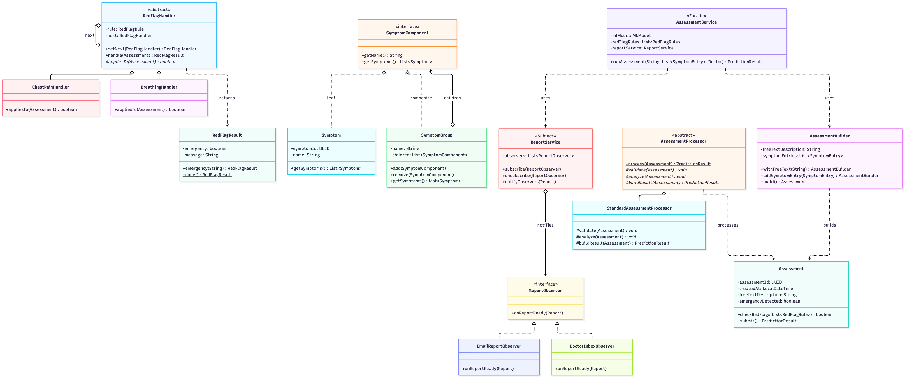
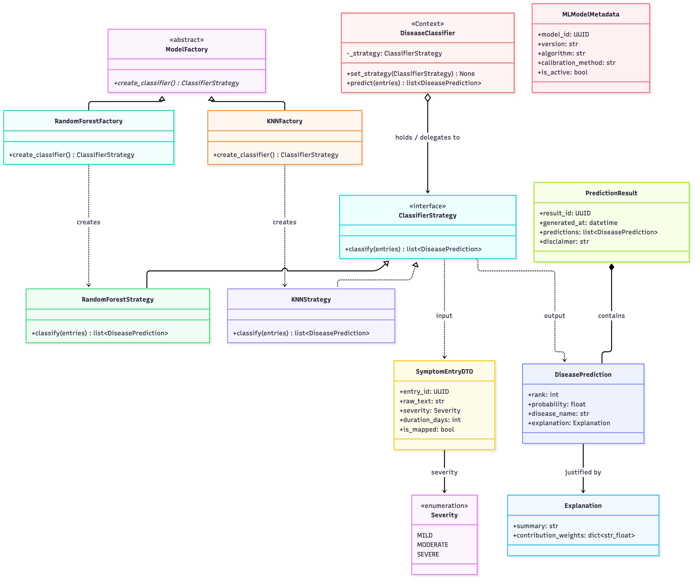

# Design Patterns — Disease Prediction Application (Lab04)

This document records the design patterns used in the project. It separates two
things the lab asks us to distinguish:

1. **Patterns provided by the frameworks we use** — patterns we did not write but
   must recognise and identify correctly (Spring, Spring Boot).
2. **Patterns we implemented ourselves** — each team member implements at least
   two, with a short justification of *why* each one fits the problem.

Repositories:
- `disease-prediction-be` — Java / Spring Boot backend
- `disease-prediction-ai` — Python prediction service

---

## 1. Design patterns provided by Spring / Spring Boot

Frameworks already contain many design patterns. We use these but did **not**
implement them; we list them here to show we can identify them correctly. They
are **not** counted as our own implementations.

| Pattern | Type | Where it appears in Spring | What it does |
| --- | --- | --- | --- |
| Dependency Injection / Inversion of Control | Creational-ish | `@Autowired`, constructor injection, `ApplicationContext` | The container creates and wires our objects instead of us using `new`. |
| Singleton | Creational | Default bean scope — each `@Service`/`@Component` is one shared instance | The container keeps a single shared instance of each bean. |
| Factory | Creational | `BeanFactory` / `ApplicationContext`, `FactoryBean` | The container acts as a factory that produces configured objects (beans). |
| Proxy | Structural | AOP, `@Transactional`, `@Async` — beans are wrapped in dynamic proxies | Adds behaviour (transactions, logging) around method calls without changing the code. |
| Template Method | Behavioral | `JdbcTemplate`, `RestTemplate`, `RedisTemplate` | A fixed algorithm skeleton where we supply only the varying step (a callback). |
| Front Controller | Behavioral | `DispatcherServlet` (Spring MVC) | A single entry point that routes all incoming HTTP requests. |
| MVC | Architectural | `@Controller` / model / view separation | Separates web request handling, data, and presentation. |
| Observer | Behavioral | `ApplicationEventPublisher` + `@EventListener` | Publishes application events to subscribed listeners. |
| Strategy | Behavioral | `HandlerMapping`, `ViewResolver` | Pluggable algorithms selected behind a common interface. |

---

## 2. Patterns we implemented ourselves

Each member implements at least two patterns. Patterns live **where they belong
in the architecture** (no artificial `patterns/` package); the pattern is a tool
that makes the design cleaner, not a label bolted on.

### Daria — Builder + Composite (Java backend)

**Builder (Creational)** — `domain/AssessmentBuilder.java`
- *What:* Assembles an `Assessment` step by step with fluent `withFreeText()` /
  `addSymptomEntry()` calls, then `build()`.
- *Why:* A patient builds an assessment incrementally (free text + several symptom
  entries) before it is finalised. A Builder avoids a large multi-argument
  constructor and makes the assembly readable and ordered.

**Composite (Structural)** — `domain/SymptomComponent.java`,
`domain/SymptomGroup.java`, `domain/Symptom.java` (leaf),
`domain/SymptomChecklist.java`
- *What:* Models the symptom checklist as a tree. `Symptom` is the leaf,
  `SymptomGroup` is the composite holding `List<SymptomComponent>`, and both share
  the `SymptomComponent` interface. `getSymptoms()` recurses the tree.
- *Why:* The checklist is naturally hierarchical — categories ("Respiratory",
  "Cardiac") contain symptoms and can nest further. Composite lets the client
  treat a single symptom and a whole group uniformly.

### Carla — Facade + Observer (Java backend)

**Facade (Structural)** — `service/AssessmentService.java`
- *What:* One coarse `runAssessment()` method hiding the assessment subsystem
  (red-flag check, prediction, report creation, notification).
- *Why:* Controllers should call one simple entry point instead of orchestrating
  several services. The Facade keeps the web layer thin and the subsystem
  encapsulated.

**Observer (Behavioral)** — `service/ReportService.java` (subject),
`service/ReportObserver.java`, `service/EmailReportObserver.java`,
`service/DoctorInboxObserver.java`
- *What:* When a report is sent/reviewed, the subject notifies registered
  observers (email, doctor inbox).
- *Why:* Realises the `Report` «trigger» `Notification` relationship from the
  class diagram. New reactions to report events can be added without changing the
  report logic.

### Alex R — Chain of Responsibility + Template Method (Java backend)

**Chain of Responsibility (Behavioral)** — `service/redflag/` (`RedFlagHandler`
- concrete handlers)
- *What:* An assessment passes along a chain of red-flag checks; the first match
  raises the emergency and stops the chain.
- *Why:* Directly models the emergency red-flag intercept (Use Case 2). Rules are
  checked in sequence and can be added/reordered without touching the others.

**Template Method (Behavioral)** — `service/AssessmentProcessor.java` +
`StandardAssessmentProcessor`
- *What:* A fixed `process()` skeleton (validate → check red flags → predict →
  finalise) with overridable steps.
- *Why:* Every assessment follows the same lifecycle, but individual steps may
  vary. Template Method enforces the invariant order while allowing step
  customisation.

### Alex P — Strategy + Factory Method (Python prediction service)

**Strategy (Behavioral)** — `prediction_service/classifier.py`
(`ClassifierStrategy`, `RandomForestStrategy`, `KNNStrategy`,
`DiseaseClassifier`)
- *What:* Interchangeable classification algorithms behind a common interface;
  `DiseaseClassifier` delegates to the selected strategy and can swap it at
  runtime.
- *Why:* The ML algorithm is not chosen yet. Strategy lets us defer and swap the
  model without changing calling code.

**Factory Method (Creational)** — `prediction_service/factory.py`
(`ModelFactory`, `RandomForestFactory`, `KNNFactory`)
- *What:* `ModelFactory.create_classifier()` returns the right strategy; concrete
  factories decide which one.
- *Why:* Callers obtain a classifier without naming the concrete class, so the
  model choice lives in one place and pairs cleanly with the Strategy pattern.

---

## 3. Class diagrams

**Backend (Java) — the six patterns:** Builder, Composite, Facade, Observer,
Chain of Responsibility, and Template Method, with the domain classes they touch.

**ML prediction service (Python) — Strategy + Factory Method:** each
`ModelFactory` subclass *creates* one `ClassifierStrategy`; `DiseaseClassifier`
(the Context) *holds* a strategy and *delegates* `predict()` to its `classify()`.

---

## 4. Summary

| Member | Pattern | Type | Repository |
| --- | --- | --- | --- |
| Daria | Builder | Creational | `disease-prediction-be` |
| Daria | Composite | Structural | `disease-prediction-be` |
| Carla | Facade | Structural | `disease-prediction-be` |
| Carla | Observer | Behavioral | `disease-prediction-be` |
| Alex R | Chain of Responsibility | Behavioral | `disease-prediction-be` |
| Alex R | Template Method | Behavioral | `disease-prediction-be` |
| Alex P | Strategy | Behavioral | `disease-prediction-ai` |
| Alex P | Factory Method | Creational | `disease-prediction-ai` |

Coverage: 2 Creational, 2 Structural, 4 Behavioral — all three GoF categories.

---

## 5. Use of Artificial Intelligence

In line with the lab's AI-use policy, this section documents how AI tools were
used for the design-patterns work.

### Tool

- **Kiro IDE** agent (server-selected model, "Auto").

### How it was used

AI was used as an interactive design partner, not as a one-shot generator. The
team drove all the decisions through discussion; the AI explored trade-offs,
produced skeleton code, and verified that it compiled. The human decisions
included:

- choosing the overall split (Java backend + Python ML service);
- deciding the backend architecture (layered: `domain` / `service` / ...);
- rejecting an artificial `patterns/` package in favour of embedding each
  pattern where it belongs in the architecture;
- assigning two patterns per team member;
- deferring the ML model choice (which the Strategy/Factory patterns absorb).

The AI then: proposed which patterns fit the domain and why, generated the
declaration-only domain model and the pattern skeletons, and compiled each repo
to confirm the code builds. Generated code was reviewed and adjusted by the team
(for example, relationship fields and a mis-typed class reference were corrected,
and a teammate's Observer PR was reviewed against the pattern's required roles).

### Representative prompts

**Prompt — which patterns fit the project:**

> "On the theme of our Disease Prediction App (requirements and class diagram in
> `docs/`), suggest design patterns that fit the domain for Lab04. Each of the 4
> team members must implement at least 2 patterns. The backend is Java/Spring
> Boot and the ML part is Python. For each pattern tell me the GoF type, which
> domain classes it touches, and *why* it fits — patterns must solve a real need,
> not be forced. Also tell me which patterns Spring already provides so we can
> identify them correctly instead of claiming them as our own."

**Prompt — embedding patterns instead of a `patterns/` folder:**

> "I don't want a `patterns/` directory — a pattern should make the design
> cleaner, not be enforced as a label. Show me where each pattern should live
> naturally in the architecture (domain vs service), and how to keep per-member
> ownership traceable for grading without that folder."
