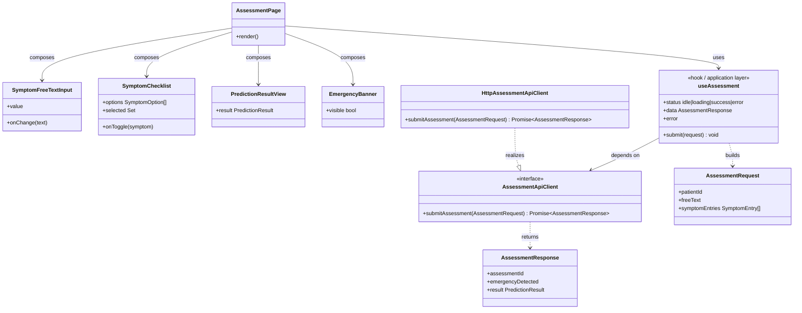
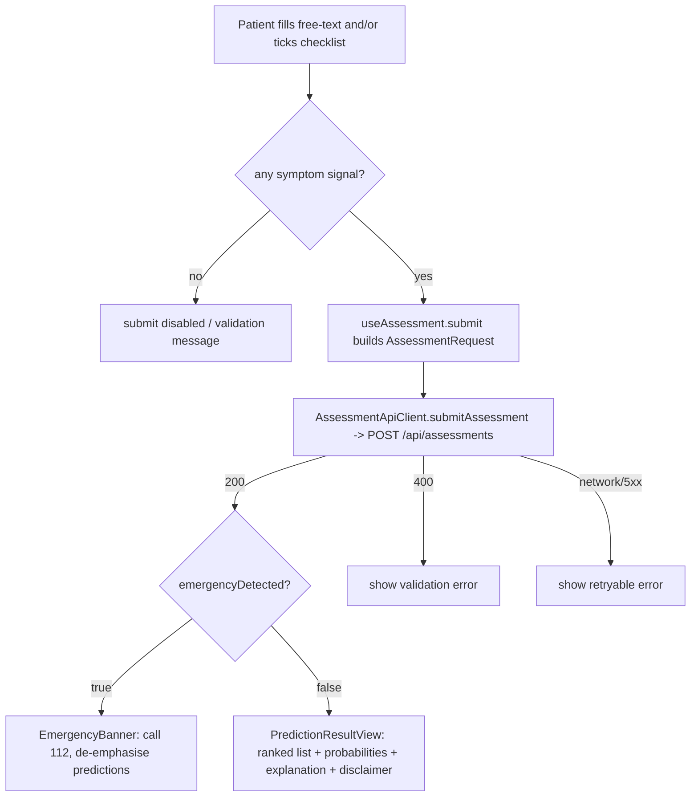
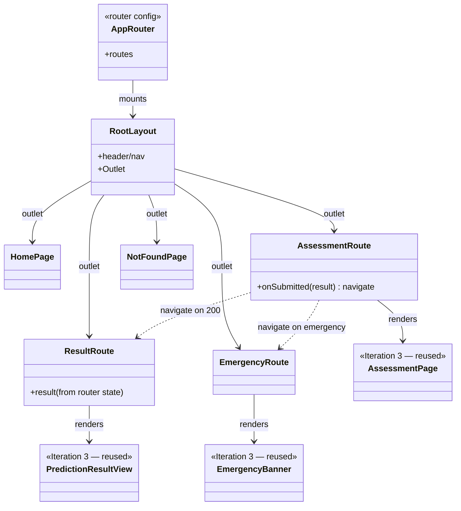
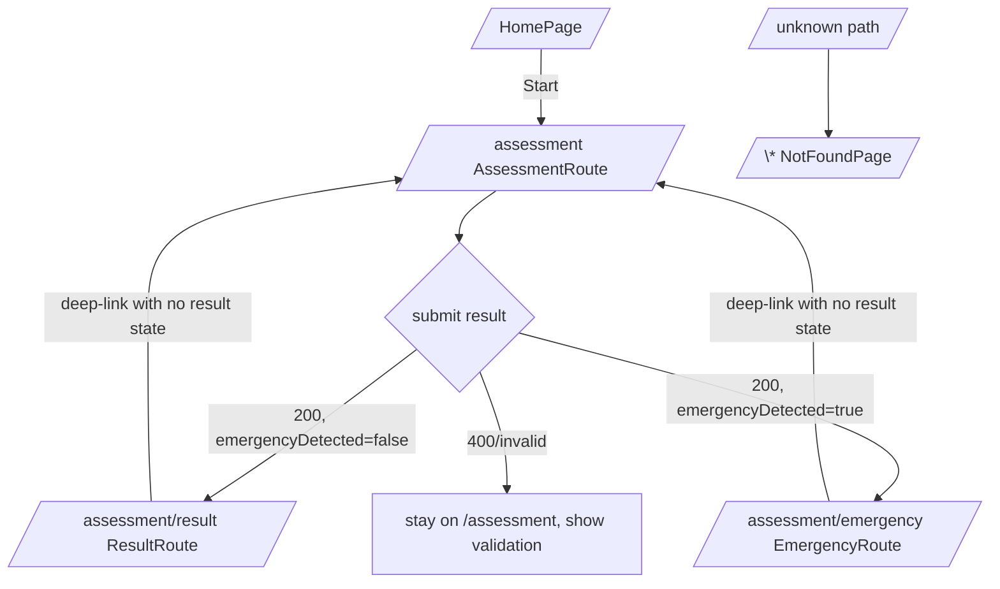

# MDD Frontend Plans — Iteration 3 & Iteration 4 (Patient Web App)

Detailed plans for the two frontend iterations of the Disease Prediction project. The iteration
summaries and the Iterations 1–2 verification record live in `MDD_ITERATIONS.md`; this file holds
the full, implementation-ready plans so the main document stays concise.

- **Part 1 — Iteration 3:** construct the Patient Web App and the symptom-prediction feature
  (single page; no routing).
- **Part 2 — Iteration 4:** add client-side routing (React Router) on top of Iteration 3.

Repository for both: `disease-prediction-fe`. Framework: React + TypeScript (matches the C4 model's
"Patient Web App (React)").

---

# Part 1 — Iteration 3: Patient Web App — Symptom Prediction Feature (Frontend construction)

This is the **plan** (not yet implemented) for Iteration 3. It constructs the **frontend for the
symptom prediction feature**: a Patient Web App scaffold plus a single assessment page that accepts
an NLP free-text symptom description **and** a structured checklist (checkbox) input, submits an
assessment, and renders the prediction result.

**Scope boundary with Iteration 4:** this iteration builds the app and the one assessment feature as
a **single page/view** — it deliberately does **not** add client-side routing or multi-page
navigation. Routing (React Router, URL-addressable views, deep-linking, guards) is **Iteration 4**
(Part 2 below). Build the Iteration 3 components so they can be mounted under a router later without
rework (no hard-coded navigation; form/result state owned by the page, not by a router).

It is written so the implementing agent has maximum context even though it will have open access to
the code. Read this part top-to-bottom before writing any code. The six MDD steps below are the
plan; Step 4 and Step 5 tell the agent exactly what to build and how to verify it.

- **Repository:** `disease-prediction-fe` (currently empty except CI + pre-commit — net-new scaffold).
- **Framework:** React (chosen for simplicity; matches the C4 model's "Patient Web App (React)").
- **Builds on:** Iteration 2's Assessment API (`disease-prediction-be`) and, through it, Iteration 1's
  parser (`disease-prediction-ai`).

## 1.0 Context the implementing agent MUST load first

### 1.0.1 The SOA picture (where this slice sits)

```
Patient → [Patient Web App — React]  ← THIS ITERATION
             │  HTTP POST /api/assessments
             ▼
          [API Backend — Java / Spring Boot]   (disease-prediction-be, Iteration 2)
             │  (delegates) POST /predict
             ▼
          [Prediction Service — Python]         (disease-prediction-ai, Iteration 1)
```

The frontend talks **only** to the Java backend's `POST /api/assessments`. It never calls the
Python service directly — that SOA hop is the backend's responsibility.

### 1.0.2 The contract the frontend is derived from (authoritative — copy exactly)

Source of truth: `disease-prediction-be/src/main/java/com/diseaseprediction/controller/` and
`.../controller/dto/`. The frontend's TypeScript types are the **mirror** of these records.

`POST /api/assessments` — **Request body**:

```jsonc
{
  "patientId": "uuid | null",        // optional for the MVP; backend tolerates absence
  "freeText": "string",              // the NLP textbox value (may be empty)
  "symptomEntries": [                // the checklist selections (may be empty)
    {
      "rawText": "cough",            // canonical/display symptom name
      "severity": "MILD | MODERATE | SEVERE",  // enum: com.diseaseprediction.domain.enums.Severity
      "durationDays": 3,             // integer (0 default in MVP)
      "isMapped": true               // true for checklist items (known symptoms)
    }
  ]
}
```

**Validation rule (must match backend `AssessmentRequest.hasAnySymptomSignal()`):** the request is
valid only if `freeText` is non-blank **OR** `symptomEntries` is non-empty. Otherwise the backend
returns **400**. The frontend must disable submit / show a message in that same empty case, so the
UI and the contract agree.

`POST /api/assessments` — **Response (200)**:

```jsonc
{
  "assessmentId": "uuid",
  "emergencyDetected": false,        // if true → show the FR-P5 emergency banner, de-emphasise predictions
  "result": {
    "resultId": "uuid",
    "generatedAt": "2026-10-31T12:00:00Z",  // ISO instant
    "disclaimer": "This is not a medical diagnosis",
    "predictions": [
      {
        "rank": 1,
        "probability": 0.82,         // 0..1 — render as a percentage
        "diseaseName": "Common Cold",
        "explanation": {
          "summary": "string",
          "contributionWeights": { "cough": 0.5 }  // symptom → weight
        }
      }
    ]
  }
}
```

**400** — empty/invalid payload. The frontend should surface a friendly validation message.

### 1.0.3 Requirements this slice satisfies

- **FR-P1** — describe symptoms via free text **or** a structured checklist (both inputs, this
  iteration).
- **FR-P2** — show the ranked likely diseases with a calibrated probability score.
- **FR-P3** — show the per-prediction explanation and disclaimer (precautions/description are
  backend-dependent; render whatever the contract provides, show disclaimer always).
- **FR-P5 / UC2** — if `emergencyDetected` is true, show a high-priority alert to contact emergency
  services (112) and halt/de-emphasise the normal prediction display.
- **UC1** — the overall patient triage flow (input → result).

### 1.0.4 CI / process constraints the scaffold MUST satisfy (from `disease-prediction-fe/.github/workflows/ci.yml`)

The CI already has disabled placeholder jobs with explicit expectations. The scaffold must make
these real and the commands runnable:

| CI job | What it expects | Implication for the scaffold |
| --- | --- | --- |
| `lint` | "configure its lint command" | ESLint configured; `npm run lint` passes. |
| `build` | "configure its build command" | `npm run build` produces a production bundle. |
| `unit-test` | "a real unit test suite" | Vitest + React Testing Library; `npm test` runs. |
| `integration-test` | "integration tests and the command to run them" | Component/integration tests (MSW-mocked API); a script to run them. |
| `sonarqube` | `-Dsonar.sources=src`, `coverage/lcov.info` | Source under `src/`; coverage emitted as `coverage/lcov.info`. |
| `owasp` | "frontend dependency manager … dependency scan" | Use **npm**; lockfile committed; `npm audit` wired as the scan. |
| `containerize` | "a root Dockerfile" | Provide a root `Dockerfile` (multi-stage: build → static serve). |

Also: **GitFlow is enforced** — PRs into `main` must come from `develop`. Do Iteration 3 work on
`feature/patient-web-app` and open PRs into `develop`. (Iteration 4 routing will use its own branch,
`feature/patient-web-app-routing`.)

### 1.0.5 Known divergence to flag (do not silently "fix")

The C4 model (`requirments.md`, section 7.2) names the backend "API Backend (Python/FastAPI)".
The **actually implemented** backend is **Java / Spring Boot** exposing `POST /api/assessments`
(verified in Iteration 2). The frontend must target the real, implemented contract above. Note this
divergence in the Step 6 refinement; do not change the backend to match the old diagram.

## 1.1 Step 1 — Requirements envisioning

- **Slice:** a patient enters symptoms (free-text NLP box + structured checklist) in the Patient Web
  App, submits, and sees the ranked predictions (or an emergency alert).
- **Anchored to:** FR-P1, FR-P2, FR-P3, FR-P5, UC1, UC2 (see 1.0.3).
- **Out of scope this iteration** (carry to later): **client-side routing / multi-page navigation
  (Iteration 4, Part 2)**, authentication/consent (FR-G1), doctor portal (FR-D1), account
  deletion (FR-G2), specialty routing UI (FR-P4). Keep the component boundaries so these drop in
  later without rework — in particular, the assessment feature renders as one page and does not
  assume a router.

## 1.2 Step 2 — Architecture / platform envisioning (SOA)

- The slice lives entirely in the **Patient Web App (React)** container. It is a pure client of the
  Java backend over HTTP/JSON; no business logic (prediction, red-flag detection) is duplicated in
  the frontend — the backend owns that.
- **Layering (mirrors the backend's controller → service → client split so the structure matches):**
  - **View layer** (components/pages) — the equivalent of the backend's `controller` layer.
  - **Application layer** (a hook / state orchestrator) — equivalent of `AssessmentApiService`.
  - **API client layer** (an interface + fetch-based implementation) — equivalent of the backend's
    `PredictionClient` port/adapter. Modelling the HTTP call behind an interface lets the UI be
    built and tested against a **mock** before/without the live backend (same tactic Iteration 2
    used with `StubPredictionClient`).
  - **Domain/types layer** — TypeScript mirrors of the backend DTOs (the shared contract model).
- **Stack (keep minimal):** React + TypeScript + **Vite** (dev/build), Vitest + React Testing
  Library (tests), **MSW** (Mock Service Worker) for API mocking in tests and local dev, ESLint +
  Prettier (lint/format), npm (dependency manager, for the OWASP job). A multi-stage `Dockerfile`
  for the `containerize` job.

## 1.3 Step 3 — Model the slice (core MDD step)

Baseline model: `disease-prediction-fe` has no application code — only CI and pre-commit config. The
C4 model declares the container "Patient Web App (React)" but nothing realises it. This iteration
introduces the component model that realises that container for the prediction feature.

### Structural model (component/class view) — render to `disease-prediction-fe/docs/diagrams/iteration3/`



### Behavioural model (submit flow)



**What changed from baseline and why:** the baseline had an empty repo and a named-but-unrealised C4
container. We add the component model (view → hook → API-client-interface → types) because the
requirement needs two input modes feeding one submit, an emergency path (FR-P5), and a result view
(FR-P2/P3). Putting the HTTP call behind `AssessmentApiClient` mirrors the backend's port/adapter
style, so the structure matches across tiers and the UI is testable with a mock client.

## 1.4 Step 4 — Model-to-code transformation (what the agent builds)

Create the scaffold under `disease-prediction-fe/`. Target directory layout (source under `src/` to
satisfy SonarQube):

```
disease-prediction-fe/
├─ Dockerfile                      # multi-stage: node build → static file server (nginx or `serve`)
├─ package.json                    # scripts: dev, build, preview, lint, test, test:integration, coverage
├─ package-lock.json               # committed (npm; required for the owasp job)
├─ index.html
├─ vite.config.ts                  # Vitest config + coverage reporter lcov → coverage/lcov.info
├─ tsconfig.json
├─ .eslintrc.cjs (or eslint.config.js)
├─ .env.example                    # VITE_API_BASE_URL=http://localhost:8080
├─ src/
│  ├─ main.tsx
│  ├─ App.tsx                       # renders <AssessmentPage/> directly — NO router this iteration
│  ├─ domain/
│  │  └─ assessment.ts             # TS mirrors of the DTOs + Severity union + type guards
│  ├─ api/
│  │  ├─ AssessmentApiClient.ts    # interface (port)
│  │  ├─ HttpAssessmentApiClient.ts# fetch impl (adapter) reading VITE_API_BASE_URL
│  │  └─ errors.ts                 # ValidationError (400) vs NetworkError distinction
│  ├─ application/
│  │  └─ useAssessment.ts          # hook: builds request, calls client, exposes status/data/error
│  ├─ components/
│  │  ├─ SymptomFreeTextInput.tsx  # the NLP textbox (FR-P1)
│  │  ├─ SymptomChecklist.tsx      # the checkbox list (FR-P1); each item → SymptomEntry(isMapped=true)
│  │  ├─ SeveritySelect.tsx        # per-checked-symptom severity (MILD/MODERATE/SEVERE)
│  │  ├─ PredictionResultView.tsx  # ranked predictions + probability% + explanation + disclaimer (FR-P2/P3)
│  │  └─ EmergencyBanner.tsx       # FR-P5 / UC2 alert → 112
│  ├─ pages/
│  │  └─ AssessmentPage.tsx        # composes the above; owns form state; calls useAssessment
│  └─ test/
│     ├─ setup.ts                  # RTL + MSW server lifecycle
│     └─ mocks/handlers.ts         # MSW handlers for POST /api/assessments (200, 400, emergency)
└─ tests/ or *.test.tsx co-located # unit + integration tests
```

**Model-element → code traceability (the agent keeps this table accurate as it builds):**

| Model element | Code element | File |
| --- | --- | --- |
| `AssessmentRequest`, `AssessmentResponse`, `PredictionResult`, `SymptomEntry`, `Severity` | TS types / unions | `src/domain/assessment.ts` |
| `AssessmentApiClient` (interface) | `interface AssessmentApiClient` | `src/api/AssessmentApiClient.ts` |
| `HttpAssessmentApiClient` (realization) | `class`/fn implementing the interface via `fetch` | `src/api/HttpAssessmentApiClient.ts` |
| `useAssessment` (application layer) | React hook | `src/application/useAssessment.ts` |
| `SymptomFreeTextInput` | component (NLP textbox) | `src/components/SymptomFreeTextInput.tsx` |
| `SymptomChecklist` (+ `SeveritySelect`) | component(s) | `src/components/SymptomChecklist.tsx` |
| `PredictionResultView` | component | `src/components/PredictionResultView.tsx` |
| `EmergencyBanner` | component | `src/components/EmergencyBanner.tsx` |
| `AssessmentPage` | page composing all of the above | `src/pages/AssessmentPage.tsx` |

**Key implementation rules for the agent:**
1. **Types mirror the backend DTOs exactly** (field names, `Severity` literals). When in doubt, read
   `disease-prediction-be/src/main/java/com/diseaseprediction/controller/dto/` — it is the source of
   truth.
2. **Checklist item → `SymptomEntry`:** `rawText` = canonical symptom, `severity` from `SeveritySelect`
   (default `MODERATE`), `durationDays` = 0 for MVP, `isMapped = true`. Free-text goes into
   `freeText` only (the backend/Python parser maps it; the frontend does not parse).
3. **Client-side validation mirrors `hasAnySymptomSignal()`** — disable submit when free-text is blank
   and no checkbox is selected; never send a known-empty request.
4. **Emergency path:** when `emergencyDetected === true`, render `EmergencyBanner` prominently and
   de-emphasise `PredictionResultView` (FR-P5 says halt standard triage output).
5. **Always render the disclaimer** from the result (FR-P3).
6. **API base URL from env** (`VITE_API_BASE_URL`), never hard-coded; default to the backend dev port.
7. **Accessibility:** label the textbox and every checkbox; the emergency banner uses `role="alert"`.
8. **No secrets, no PII in code/sample data** — use placeholder patient IDs; align with GDPR intent.
9. Keep the `AssessmentApiClient` interface clean so a future real vs. mock swap needs no view changes.

**Symptom checklist source:** seed the checklist from a small curated subset of the canonical
vocabulary (see `disease-prediction-ai/prediction_service/vocabulary.py`, `CANONICAL_SYMPTOMS`, 131
entries). For the MVP pick ~10–15 common ones (e.g. cough, high_fever, headache, fatigue, nausea,
chest_pain, breathlessness). Display names should be the human-readable form (underscores → spaces).

## 1.5 Step 5 — Validate / test (acceptance criteria for the iteration)

The agent must leave the repo green. Concretely:

- **Build:** `npm run build` succeeds (satisfies CI `build`).
- **Lint:** `npm run lint` passes (satisfies CI `lint`).
- **Unit tests (Vitest + RTL)** — at least:
  - `SymptomChecklist` toggles produce the right `SymptomEntry[]` (correct `rawText`, default
    severity, `isMapped=true`).
  - `useAssessment` builds a request that matches the contract and does **not** submit when there is
    no symptom signal (mirrors `hasAnySymptomSignal`).
  - `PredictionResultView` renders rank, probability as a %, disease name, explanation summary, and
    the disclaimer.
  - `EmergencyBanner` renders (with `role="alert"` and "112") only when `emergencyDetected` is true.
- **Integration tests (RTL + MSW)** — drive `AssessmentPage` end-to-end against a mocked
  `POST /api/assessments`:
  - valid submit (free text only) → predictions rendered.
  - valid submit (checklist only) → predictions rendered.
  - emergency response → banner shown, predictions de-emphasised.
  - 400 response → validation message shown.
  - network error → retryable error shown.
- **Coverage:** emit `coverage/lcov.info` (Vitest `--coverage`, lcov reporter) so the SonarQube job
  can read it.
- **Container:** `docker build .` succeeds with the root `Dockerfile`.
- **Manual smoke (document, don't block CI on it):** `npm run dev`, run the backend locally
  (`./mvnw spring-boot:run`), submit a real assessment, confirm the result renders. Note: the
  backend targets JDK 25; if only JDK 21 is available use `-Dmaven.compiler.release=21` as in
  Iteration 2.

State clearly in the PR which of these were actually run vs. not (e.g. if Docker or the live backend
weren't available in the agent's environment).

## 1.6 Step 6 — Review & refine the model

After implementation, fold back what was learned and record decisions, e.g.:
- Confirm the **Java/Spring vs. FastAPI** divergence (1.0.5) and update the C4 container diagram's
  technology label for "API Backend" to match reality (Java/Spring Boot), or note why not.
- Per-symptom **severity & duration** UX: did one `SeveritySelect` per checked item work, or is a
  simpler single-severity model better for the MVP? Refine `SymptomChecklist`/`SymptomEntry` usage.
- Whether a shared **OpenAPI schema** (generated from the backend) should replace the hand-written
  TS types to keep both tiers in lockstep — candidate for a future iteration.
- Error taxonomy: is distinguishing `ValidationError` (400) from `NetworkError` enough, or is a
  typed error for 5xx/timeout needed (parallels Iteration 2's open "timeout/fallback" item)?
- Carry-forward hooks for out-of-scope requirements (auth/consent FR-G1, specialty routing FR-P4).
- **Routing readiness (feeds Iteration 4):** confirm `AssessmentPage` and its child components hold
  their own state and contain no hard-coded navigation, so Iteration 4 (Part 2) can mount them
  under React Router and lift the result/emergency states to dedicated routes without rework.

## 1.7 Suggested task breakdown for the implementing agent (execution order)

1. **Scaffold:** `npm create vite@latest . -- --template react-ts`; add ESLint/Prettier, Vitest,
   RTL, MSW, coverage (lcov), scripts. Commit lockfile.
2. **Domain types:** `src/domain/assessment.ts` mirroring the backend DTOs + `Severity` union.
3. **API layer:** `AssessmentApiClient` interface + `HttpAssessmentApiClient` (fetch, env base URL,
   error mapping) + MSW handlers.
4. **Application layer:** `useAssessment` hook (build request, call client, status machine).
5. **Components:** free-text input, checklist (+ severity), result view, emergency banner.
6. **Page:** `AssessmentPage` composing everything; wire validation to `hasAnySymptomSignal` logic.
7. **Tests:** unit + integration per Step 5; produce `coverage/lcov.info`.
8. **Containerize:** root multi-stage `Dockerfile`; verify `docker build`.
9. **Wire CI:** flip the disabled jobs in `.github/workflows/ci.yml` to real commands; keep GitFlow
   (branch `feature/patient-web-app` → PR into `develop`).
10. **Diagrams + docs:** render the Step 3 diagrams to `disease-prediction-fe/docs/diagrams/iteration3/`;
    keep the traceability table accurate; write the Step 6 refinements.

## 1.8 Definition of done

- Repo builds, lints, unit + integration tests pass, coverage lcov emitted, Docker image builds.
- The prediction feature works end-to-end against a mocked backend (and, if runnable, the live one).
- CI placeholder jobs replaced with real commands; work on a feature branch targeting `develop`.
- Model-to-code traceability table accurate; Step 3 diagrams rendered; Step 6 refinements recorded.
- No hard-coded URLs/secrets; inputs are accessible; disclaimer always shown; emergency path works.

---

# Part 2 — Iteration 4: Patient Web App — Client-side Routing

This is the **plan** (not yet implemented) for Iteration 4. It adds **client-side routing** to the
Patient Web App built in Iteration 3 (Part 1), turning the single assessment page into a
navigable, URL-addressable multi-route app with **React Router**.

It is written so the implementing agent has maximum context even though it has open access to the
code. Read it top-to-bottom before writing code.

- **Repository:** `disease-prediction-fe` (already scaffolded by Iteration 3).
- **Depends on:** Iteration 3 merged to `develop` (the feature components and `AssessmentApiClient`
  must already exist). Do not start before that.
- **Branch:** `feature/patient-web-app-routing`; PR into `develop` (GitFlow — PRs into `main` come
  from `develop`).

## 2.0 Context the implementing agent MUST load first

- **Reuse, don't rewrite.** Iteration 3's components (`SymptomFreeTextInput`, `SymptomChecklist`,
  `PredictionResultView`, `EmergencyBanner`, `AssessmentPage`), the `useAssessment` hook, the
  `AssessmentApiClient`/`HttpAssessmentApiClient`, and the `domain/` types are the building blocks.
  Routing is a **new layer above** them; feature components stay presentation/logic as-is.
- **No new backend contract.** Routing is purely client-side; the API contract from Part 1
  (§1.0.2) is unchanged. No new network calls are introduced by this iteration.
- **Same CI/process constraints** as Part 1 §1.0.4 still apply (lint, build, unit-test,
  integration-test, `coverage/lcov.info`, `npm audit`, root `Dockerfile`, GitFlow). The static-serve
  `Dockerfile`/host must be configured for **SPA fallback** (serve `index.html` for unknown paths) so
  deep links to client routes work on refresh.

## 2.1 Step 1 — Requirements envisioning

- **Slice:** navigable multi-route Patient Web App — distinct URLs for the landing/home view, the
  assessment form, the result view, the emergency view, and a not-found fallback; browser
  back/forward and deep-linking work.
- **Anchored to:** UC1 (a navigable triage flow) and the structural need to host future views
  (FR-P4 specialty routing, FR-D1 doctor portal) as additional routes without reworking the
  feature. Making the result/emergency states their own routes also makes them shareable/bookmarkable.
- **Out of scope:** authentication/route guards tied to real auth (FR-G1) — model a guard seam but
  do not implement login; actual specialty-routing and doctor-portal pages (future iterations).

## 2.2 Step 2 — Architecture / platform envisioning (SOA)

- Still entirely within the **Patient Web App (React)** container. Adds a **routing/navigation
  layer**: a router configuration, a shared layout (header/nav + `<Outlet/>`), and thin route
  components that compose the Iteration 3 feature components.
- **Library:** `react-router-dom` (v6+, data/`createBrowserRouter` API preferred). No other new
  runtime deps.
- **State hand-off:** after a successful submit, navigate to the result route. Pass the result via
  router state/loader or a small shared store (e.g. context), **not** via a global singleton — keep
  it so a direct deep-link to the result route with no state redirects back to the form (documented
  behaviour, tested).

## 2.3 Step 3 — Model the slice (core MDD step)

Baseline model (post-Iteration-3): `App.tsx` renders `<AssessmentPage/>` directly; there is exactly
one view and no URL semantics. This iteration introduces a route model and the router/layout
structure that realises it.

### Route model

| Path | Route component | Composes (Iteration 3) | Purpose |
| --- | --- | --- | --- |
| `/` | `HomePage` | — (intro + CTA) | Landing / start an assessment |
| `/assessment` | `AssessmentRoute` | `AssessmentPage` (form + submit) | Enter symptoms, submit |
| `/assessment/result` | `ResultRoute` | `PredictionResultView` | Show the ranked predictions (deep-linkable) |
| `/assessment/emergency` | `EmergencyRoute` | `EmergencyBanner` | FR-P5 emergency view (112) |
| `*` | `NotFoundPage` | — | 404 fallback |

### Structural model (routing layer) — render to `disease-prediction-fe/docs/diagrams/iteration4/`



### Behavioural model (navigation flow)



**What changed from baseline and why:** the baseline rendered one page with no URL semantics. We add
a router + layout + thin route components because the app now needs addressable views, deep-linking,
and a place to hang future pages (FR-P4, FR-D1). Feature components from Iteration 3 are reused
unchanged — the router only orchestrates which one is shown and carries the result between routes.

## 2.4 Step 4 — Model-to-code transformation (what the agent builds)

Add under `disease-prediction-fe/src/` (do not modify Iteration 3 feature components except to remove
any now-redundant top-level conditional rendering from `App.tsx`):

```
src/
├─ App.tsx                         # now renders <RouterProvider router={appRouter}/>
├─ routing/
│  ├─ appRouter.tsx                # createBrowserRouter([...]) — the route model
│  ├─ RootLayout.tsx               # header/nav + <Outlet/>
│  └─ routes/
│     ├─ HomePage.tsx
│     ├─ AssessmentRoute.tsx       # wraps AssessmentPage; navigate() on success/emergency
│     ├─ ResultRoute.tsx           # reads result from router state; redirect to /assessment if absent
│     ├─ EmergencyRoute.tsx
│     └─ NotFoundPage.tsx
└─ (Iteration 3 files unchanged: components/, pages/AssessmentPage.tsx, application/, api/, domain/)
```

| Model element | Code element | File |
| --- | --- | --- |
| route model (`AppRouter`) | `createBrowserRouter([...])` | `src/routing/appRouter.tsx` |
| `RootLayout` (+ `<Outlet/>`) | layout component | `src/routing/RootLayout.tsx` |
| `HomePage` | route component | `src/routing/routes/HomePage.tsx` |
| `AssessmentRoute` | route wrapping `AssessmentPage`, `useNavigate` | `src/routing/routes/AssessmentRoute.tsx` |
| `ResultRoute` | route rendering `PredictionResultView` from router state | `src/routing/routes/ResultRoute.tsx` |
| `EmergencyRoute` | route rendering `EmergencyBanner` | `src/routing/routes/EmergencyRoute.tsx` |
| `NotFoundPage` | 404 route | `src/routing/routes/NotFoundPage.tsx` |

**Key implementation rules:**
1. Use `react-router-dom` v6+ with `createBrowserRouter` / `RouterProvider`.
2. `AssessmentRoute` drives navigation: on a 200 with `emergencyDetected=false` → `/assessment/result`;
   on emergency → `/assessment/emergency`; on 400 → stay and show the validation message.
3. Carry the `AssessmentResponse` between routes via router state (`navigate(path, { state })`) or a
   small `AssessmentContext`. **Never** store it in a module-global.
4. Guard the result/emergency routes: if entered directly with no result in state, redirect to
   `/assessment` (and test this).
5. Reuse Iteration 3 components unchanged; `App.tsx` stops doing conditional view rendering and
   defers entirely to the router.
6. SPA deep-link support: configure the dev server (`vite` historyApiFallback is default) and the
   production `Dockerfile`/static host to serve `index.html` for unknown paths.
7. Accessible nav: a `<nav>` with labelled links; focus management on route change is a plus.

## 2.5 Step 5 — Validate / test (acceptance criteria)

Leave the repo green (same gates as Part 1 §1.5), plus routing-specific tests:

- **Unit/component (Vitest + RTL, render within a `MemoryRouter`/test router):**
  - rendering `/` shows the home view with a link to `/assessment`.
  - unknown path renders `NotFoundPage`.
  - `ResultRoute` with no result state redirects to `/assessment`.
- **Integration (RTL + MSW, full router):**
  - from `/assessment`, a valid submit navigates to `/assessment/result` and renders predictions.
  - an emergency response navigates to `/assessment/emergency` and shows the 112 banner.
  - a 400 keeps the user on `/assessment` with a validation message.
  - browser back from the result returns to the form.
- **Coverage** `coverage/lcov.info` still emitted; **build**, **lint**, **`docker build`** still pass.
- **Deep-link smoke (document):** `npm run build` + serve, hard-refresh on `/assessment/result`,
  confirm SPA fallback serves the app (and the no-state guard redirects to the form).

State in the PR which checks were actually run vs. not.

## 2.6 Step 6 — Review & refine the model

- Decide the final result hand-off mechanism (router `state` vs. context vs. a loader) and record why.
- Whether `/assessment/result/:assessmentId` (a param route backed by a future
  `GET /api/assessments/{id}`) should replace state-only results — ties into Iteration 2's open
  `GET /api/assessments/{id}` item.
- Where FR-P4 (specialty routing) and FR-D1 (doctor portal) routes will slot in, and the auth/guard
  seam for FR-G1.

## 2.7 Suggested task breakdown (execution order)

1. Add `react-router-dom`; update lockfile.
2. `appRouter.tsx` + `RootLayout.tsx` (nav + `<Outlet/>`); point `App.tsx` at `RouterProvider`.
3. Route components: `HomePage`, `AssessmentRoute`, `ResultRoute`, `EmergencyRoute`, `NotFoundPage`.
4. Wire navigation + result hand-off in `AssessmentRoute`; add the no-state guards.
5. SPA fallback in the `Dockerfile`/static host.
6. Tests: unit + integration per §2.5; keep `coverage/lcov.info`.
7. Render the Step 3 diagrams to `disease-prediction-fe/docs/diagrams/iteration4/`; keep the
   traceability table accurate; write the Step 6 refinements.

## 2.8 Definition of done

- All routes reachable; back/forward and deep-linking work; unknown paths hit `NotFoundPage`.
- Result/emergency routes guard against missing state (redirect to form), covered by tests.
- Iteration 3 feature components reused unchanged; `App.tsx` defers to the router.
- Build, lint, unit + integration tests pass; `coverage/lcov.info` emitted; `docker build` succeeds
  with SPA fallback; work on `feature/patient-web-app-routing` targeting `develop`.
- Step 3 diagrams rendered; traceability table accurate; Step 6 refinements recorded.
