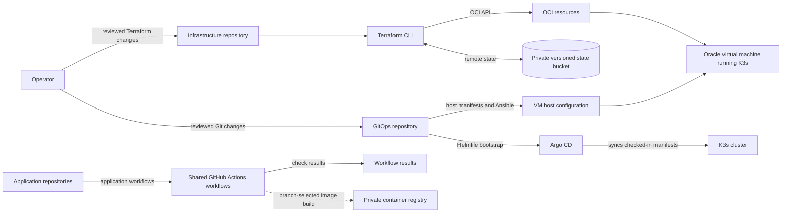
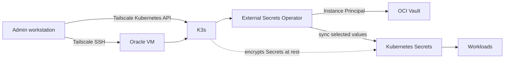
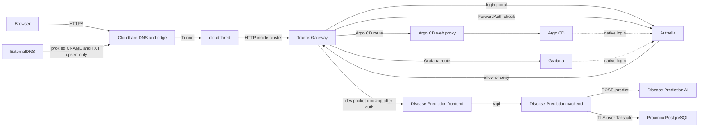

# DevOps overview

Use this page to find the repository for each task and see how infrastructure,
cluster operations, and application delivery fit together. Follow the linked
guides for setup and change procedures.

## Repositories and guides

| Repository | Owns | Start here |
| --- | --- | --- |
| `disease-prediction-infra` | Oracle Cloud Infrastructure (OCI) resources managed with Terraform. | [Terraform setup and change guide](https://github.com/Disease-Prediction-ASET26/disease-prediction-infra/blob/main/README.md) |
| `disease-prediction-gitops` | Oracle and Proxmox Kubernetes configuration, Argo CD, Helmfile, and host automation. | [Oracle bootstrap guide](https://github.com/Disease-Prediction-ASET26/disease-prediction-gitops/blob/main/docs/bootstrap.md) and [operations index](https://github.com/Disease-Prediction-ASET26/disease-prediction-gitops/blob/main/docs/operations/README.md) |
| `disease-prediction-ci` | Shared GitHub Actions workflows and their pinned tool versions. | [Shared workflow guide](https://github.com/Disease-Prediction-ASET26/disease-prediction-ci/blob/main/README.md) and [tool versions](https://github.com/Disease-Prediction-ASET26/disease-prediction-ci/blob/main/TOOL-VERSIONS.md) |
| `disease-prediction-ai` | AI service code and service setup. | [AI README](https://github.com/Disease-Prediction-ASET26/disease-prediction-ai/blob/main/README.md) and [application workflow](https://github.com/Disease-Prediction-ASET26/disease-prediction-ai/blob/main/.github/workflows/ci.yml) |
| `disease-prediction-be` | Backend service and its application programming interface (API). | [Backend README](https://github.com/Disease-Prediction-ASET26/disease-prediction-be/blob/main/README.md) and [application workflow](https://github.com/Disease-Prediction-ASET26/disease-prediction-be/blob/main/.github/workflows/ci.yml) |
| `disease-prediction-fe` | Frontend code and service setup. | [Frontend README](https://github.com/Disease-Prediction-ASET26/disease-prediction-fe/blob/main/README.md) and [application workflow](https://github.com/Disease-Prediction-ASET26/disease-prediction-fe/blob/main/.github/workflows/ci.yml) |
| `disease-prediction-docker` | Compose profiles for running the application repositories together. | [Docker and Compose guide](https://github.com/Disease-Prediction-ASET26/disease-prediction-docker/blob/main/README.md) |
| `disease-prediction-docs` | Cross-repository overviews, diagrams, and project models. | [Documentation index](../README.md) |

## Provisioning and delivery

The private, versioned Object Storage bucket for Terraform state is created
separately from the project stack. The [infrastructure guide](https://github.com/Disease-Prediction-ASET26/disease-prediction-infra/blob/main/README.md)
covers its setup and the Terraform plan and apply steps. For Oracle, K3s applies
the checked-in host manifests for the Gateway API and Traefik custom resource
definitions (CRDs). Argo CD
manages the other checked-in cluster manifests after bootstrap; see the
[Oracle bootstrap guide](https://github.com/Disease-Prediction-ASET26/disease-prediction-gitops/blob/main/docs/bootstrap.md).

Application workflows use the shared GitHub Actions workflows for checks and
image publishing. Pull requests build the image for their target branch;
`develop` builds `Dockerfile.dev` and publishes a dev image, while `main`
builds `Dockerfile.prod` and publishes a production image. After a successful
dev publish, backend and frontend CI open or update a GitOps pull request with
the immutable digest. The reviewed AI model-runtime release opens the same kind
of pull request for its image. Merge the GitOps pull request to let Argo CD
sync the Oracle dev stack. These workflows need a GitHub App limited to the
GitOps repository with Contents and Pull requests write access. Configure
`GITOPS_APP_ID` and `GITOPS_APP_PRIVATE_KEY` in the application Actions secrets.

## Administration and secrets

The OCI security list allows no inbound SSH, Kubernetes API, HTTP, or HTTPS
traffic. Use Tailscale for administration. See the GitOps [private access
runbook](https://github.com/Disease-Prediction-ASET26/disease-prediction-gitops/blob/main/docs/operations/tailscale.md).

External Secrets Operator (ESO) reads selected values from OCI Vault and
creates Kubernetes Secrets. K3s encrypts those Secrets at rest. The OCI
Instance Principal belongs to the Oracle virtual machine (VM), not to an ESO
pod, and its policy can read every secret in the Vault. A pod that can reach
the OCI metadata endpoint may be able to use that permission. Run only trusted
workloads until metadata access is restricted. See the GitOps [secrets
runbook](https://github.com/Disease-Prediction-ASET26/disease-prediction-gitops/blob/main/docs/operations/secrets.md).

## Public traffic

Name.com is the registrar; Cloudflare hosts the Domain Name System (DNS) and
the public edge. HTTPS ends at Cloudflare. The Tunnel connects outbound to
Traefik, so OCI exposes no inbound web ports. Authelia, Argo CD, and Grafana
have public hostnames. Argo CD and Grafana use native OpenID Connect (OIDC)
with Authelia. The Disease Prediction dev route is
`dev.pocket-doc.app`, protected by Authelia ForwardAuth and its two-factor
policy. Only the frontend has a public route; backend and AI remain internal.
`health.pocket-doc.app` is reserved for a future production route. ExternalDNS
creates proxied canonical name (CNAME) and TXT ownership records for approved
routes; its upsert-only policy does not delete records.

See the GitOps [Disease Prediction dev runbook](https://github.com/Disease-Prediction-ASET26/disease-prediction-gitops/blob/main/docs/operations/disease-prediction.md)
for Vault prerequisites, activation, route checks, and rollback.

For route setup, DNS changes, and authentication choices, use the GitOps
[domain and ingress runbook](https://github.com/Disease-Prediction-ASET26/disease-prediction-gitops/blob/main/docs/operations/domain-ingress.md)
and [Authelia runbook](https://github.com/Disease-Prediction-ASET26/disease-prediction-gitops/blob/main/docs/operations/authelia.md).
