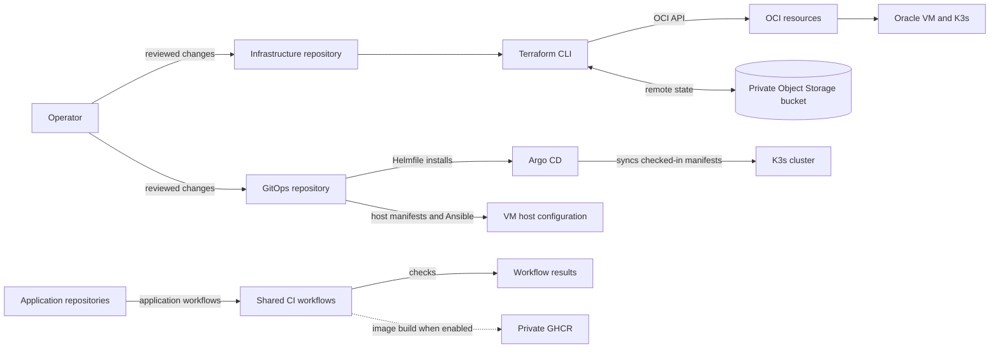
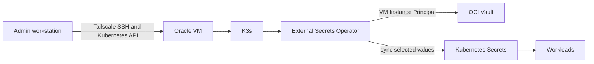
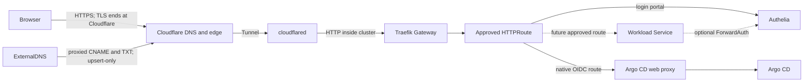

# DevOps overview

This page shows where DevOps work lives and how changes and traffic move
through the system. Use the repository guides for commands and change steps.

## Repository ownership

| Repository | Owns |
| --- | --- |
| `disease-prediction-infra` | Terraform for OCI resources, including the VM, network, boot-volume backup, Vault and HSM key, access policy, quotas, and budget. Its README is the Terraform setup and change guide. |
| `disease-prediction-gitops` | K3s configuration, Argo CD, Helmfile, platform manifests, and host automation. Its bootstrap and operations guides are the cluster runbooks. |
| `disease-prediction-ci` | Shared GitHub Actions workflows and their pinned tool versions. Each application repository keeps its own pipeline file and commands. |
| Application repositories | Application source and service-specific setup. The CI workflows use the shared workflows where needed. |
| `disease-prediction-docs` | Cross-repository overviews, diagrams, and project model artifacts. |

## Provision and deploy

The private, versioned remote state bucket is created separately from the
project Terraform stack. Argo CD reads the GitOps repository and syncs its checked-in cluster
configuration. The shared container workflow can build and publish images when
an application sets `CONTAINER_ENABLED` to `true` and provides a Dockerfile. It
does not mean an application is deployed. The GitOps repository currently has
no public product workload route.

K3s applies its host manifests for the Gateway API and Traefik CRDs. Argo CD
manages the rest of the checked-in cluster configuration. See the GitOps
[bootstrap guide](https://github.com/Disease-Prediction-ASET26/disease-prediction-gitops/blob/main/docs/bootstrap.md)
for the procedure.

## Administration and secrets

K3s encrypts Kubernetes Secrets at rest. The OCI Instance Principal is a VM-level
identity, not a pod identity. A pod that can reach the OCI metadata endpoint
may be able to use the VM's Vault permissions. Check this trust boundary before
you run an untrusted workload. See the GitOps [secrets runbook](https://github.com/Disease-Prediction-ASET26/disease-prediction-gitops/blob/main/docs/operations/secrets.md)
and [private access runbook](https://github.com/Disease-Prediction-ASET26/disease-prediction-gitops/blob/main/docs/operations/tailscale.md).

The OCI security list allows no inbound SSH, Kubernetes API, HTTP, or HTTPS
traffic. Use Tailscale for administration.

## Public traffic

The Authelia portal and Argo CD UI have public hostnames. Argo CD uses native
OIDC with Authelia. No product workload route is published. Name.com is the
registrar and delegates DNS to Cloudflare. The Cloudflare Tunnel uses outbound
connectivity, so OCI exposes no inbound application ports. See the GitOps
[domain and ingress runbook](https://github.com/Disease-Prediction-ASET26/disease-prediction-gitops/blob/main/docs/operations/domain-ingress.md)
and [Authelia runbook](https://github.com/Disease-Prediction-ASET26/disease-prediction-gitops/blob/main/docs/operations/authelia.md).

## Where to make changes

- For OCI resources and Terraform state, use the
  [infrastructure guide](https://github.com/Disease-Prediction-ASET26/disease-prediction-infra/blob/main/README.md).
- For cluster bootstrap, access, secrets, routes, and recovery, use the
  [GitOps operations index](https://github.com/Disease-Prediction-ASET26/disease-prediction-gitops/blob/main/docs/operations/README.md).
- For shared workflow behavior and tool versions, use the
  [CI guide](https://github.com/Disease-Prediction-ASET26/disease-prediction-ci/blob/main/README.md)
  and [tool versions](https://github.com/Disease-Prediction-ASET26/disease-prediction-ci/blob/main/TOOL-VERSIONS.md).
