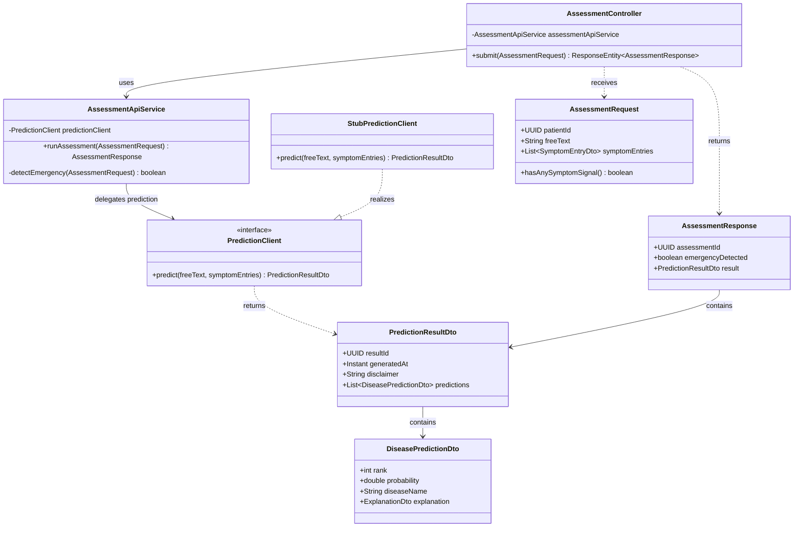
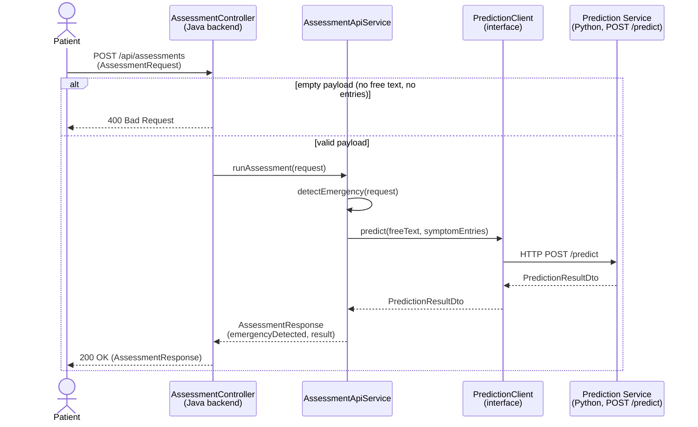
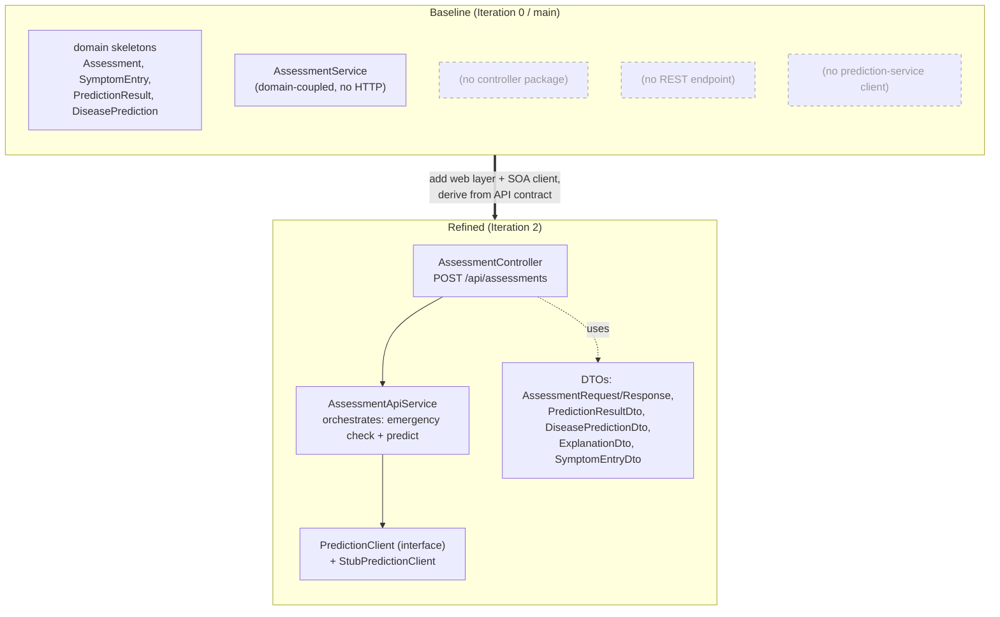

# MDD Iteration 2 — Assessment API (Java backend)

Diagrams and model-to-code traceability for Iteration 2 of the Model Driven Development
cycle (Lab05, Problem 1). The slice: a patient submits an assessment (free text + symptom
entries) through the backend and receives a prediction result. The backend orchestrates and
delegates prediction to the Python prediction service across the SOA boundary.

- **Anchored to:** UC1 (Patient Triage and Direct Specialist Routing), FR-P1 (free text /
  checklist input), FR-P2 (ranked diseases with a calibrated probability score).
- **Lives in:** `disease-prediction-be` (Java / Spring Boot) — the web layer.

> Render the `.mmd` files with the VS Code *Markdown Preview Mermaid* extension, IntelliJ's
> Mermaid plugin, or by pasting into <https://mermaid.live>. GitHub renders the fenced
> `mermaid` blocks below automatically.

---

## Step 3 — Model the slice

### API contract (platform-independent model)

`POST /api/assessments` — submit an assessment, receive a prediction result.

**Request**

```json
{
  "patientId": "11111111-1111-1111-1111-111111111111",
  "freeText": "I have a bad cough and high fever for 3 days",
  "symptomEntries": [
    { "rawText": "cough", "severity": "MODERATE", "durationDays": 3, "isMapped": true }
  ]
}
```

**Response (200)**

```json
{
  "assessmentId": "uuid",
  "emergencyDetected": false,
  "result": {
    "resultId": "uuid",
    "generatedAt": "2026-10-31T12:00:00Z",
    "disclaimer": "This is not a medical diagnosis",
    "predictions": [
      {
        "rank": 1,
        "probability": 0.82,
        "diseaseName": "Common Cold",
        "explanation": { "summary": "...", "contributionWeights": { "cough": 0.5 } }
      }
    ]
  }
}
```

**400** — payload with no symptom signal (blank free text **and** no symptom entries).

### Structural model (`assessment_api_class.mmd`)



### Behavioural model (`assessment_api_sequence.mmd`)



### Baseline vs refined (`baseline_vs_refined.mmd`)



---

## Step 4 — Model-to-code transformation

Every model element maps one-to-one to Java code under
`src/main/java/com/diseaseprediction/`.

| Model element | Code element | File |
| --- | --- | --- |
| `POST /api/assessments` + `AssessmentController` | `@RestController AssessmentController` | `controller/AssessmentController.java` |
| `AssessmentRequest` | `record AssessmentRequest` (+ `hasAnySymptomSignal()`) | `controller/dto/AssessmentRequest.java` |
| `AssessmentResponse` | `record AssessmentResponse` | `controller/dto/AssessmentResponse.java` |
| `PredictionResultDto` | `record PredictionResultDto` | `controller/dto/PredictionResultDto.java` |
| `DiseasePredictionDto` | `record DiseasePredictionDto` | `controller/dto/DiseasePredictionDto.java` |
| `ExplanationDto` | `record ExplanationDto` | `controller/dto/ExplanationDto.java` |
| `SymptomEntryDto` | `record SymptomEntryDto` | `controller/dto/SymptomEntryDto.java` |
| `AssessmentService.runAssessment()` | `@Service AssessmentApiService.runAssessment()` | `service/assessment/AssessmentApiService.java` |
| `PredictionClient` (interface) | `interface PredictionClient` | `service/prediction/PredictionClient.java` |
| `PredictionClient` realization | `@Component StubPredictionClient` | `service/prediction/StubPredictionClient.java` |

**Naming note:** the orchestrator is `AssessmentApiService` (not `AssessmentService`) because a
pre-existing, domain-coupled `AssessmentService` already lives in `service/`. Iteration 2 is
net-new web-layer code and deliberately does not rewrite the existing service.

---

## Step 5 — Validate / test

`@WebMvcTest AssessmentController` with a mocked `PredictionClient`
(`src/test/java/com/diseaseprediction/controller/AssessmentControllerTest.java`):

- `validRequestReturns200WithPrediction` — valid payload → 200 with a `PredictionResultDto` body.
- `emptyRequestReturns400` — blank free text + empty entries → 400.
- `chestPainIsFlaggedAsEmergency` — red-flag text → `emergencyDetected = true`.

Verified locally:

```
Tests run: 4, Failures: 0, Errors: 0, Skipped: 0
BUILD SUCCESS
```

(3 controller tests + the existing `contextLoads`.) Run against JDK 21 (JetBrains Runtime)
with `-Dmaven.compiler.release=21`; CI uses the project's pinned JDK 25 toolchain.

---

## Step 6 — Review & refine the model

Decisions folded back into the API contract / model:

1. **Emergency check runs before prediction** — `detectEmergency(...)` is evaluated before
   `predictionClient.predict(...)`, so an emergency is surfaced even if prediction fails.
2. **Prediction behind an interface** — `PredictionClient` + `StubPredictionClient` let the
   backend be built and tested against the contract before `POST /predict` exists. The Step 6
   follow-up is an `HttpPredictionClient` (Spring `RestClient`) calling the Python service.
3. **Validation lives in the contract** — `AssessmentRequest.hasAnySymptomSignal()` defines the
   400 condition as part of the model, not ad-hoc controller logic.
4. **Open items** — prediction-service timeout/fallback handling, and whether
   `GET /api/assessments/{id}` is needed to retrieve a stored result.
