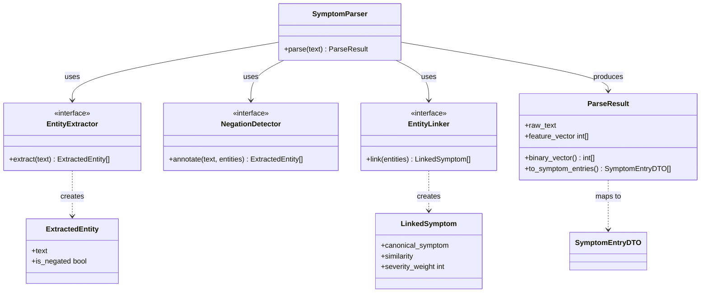
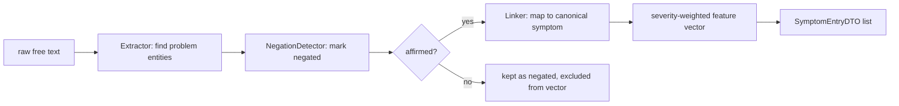
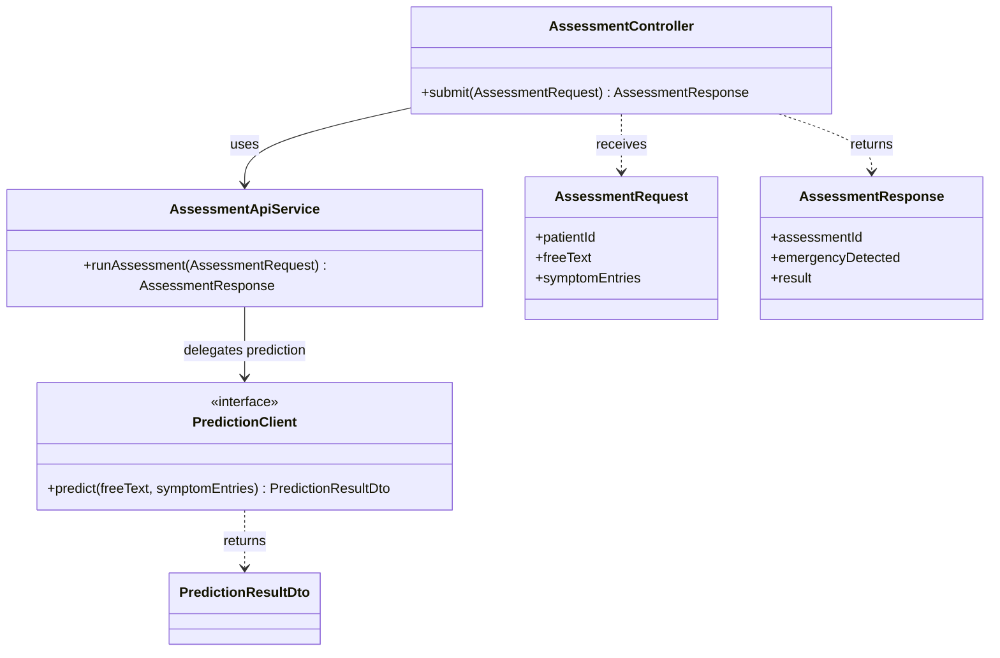

# Model Driven Development — Iterations (Lab05, Problem 1)

This document records our use of Model Driven Development (AMDD) on the Disease Prediction
project. Lab05 requires at least two MDD/TDD iterations, graded on the correct identification of
the steps and their execution. We use MDD because the project has been model-first since Lab02
(requirements → UML/C4 → design patterns → code), so our code is genuinely derived from models.

Repositories (SOA — separate services):

- `disease-prediction-be` — Java / Spring Boot backend
- `disease-prediction-ai` — Python prediction service (the ML part)

## The MDD iteration cycle (six steps)

Each iteration below executes the same six steps:

1. **Requirements envisioning** — pick the functional slice, anchor it to a real requirement
   (FR / use case).
2. **Architecture / platform envisioning** — decide where the slice lives in the SOA architecture
   (which service, which layer, how it communicates).
3. **Model the slice** — evolve the model (class and/or behavioural diagram) for just this slice;
   record what changed from the baseline model and why. This is the artifact the iteration is
   driven from.
4. **Model-to-code transformation** — derive code from the model, element by element, keeping
   traceability (model element → code element).
5. **Validate / test** — compile and run; confirm the code matches the model and behaves as
   modelled.
6. **Review & refine the model** — fold back what implementation taught us; the refined model
   becomes the input to the next iteration.

## Iteration 0 — Baseline (not counted)

Lab02–Lab04 produced the baseline model: the shared class diagram
(`docs/diagrams/class_diagram_daria.png`, `patterns_class_diagram_ai.png`), the C4 diagrams, and
the declaration-only domain + design-pattern skeletons (Strategy + Factory in the Python service).
We treat this as Iteration 0: a model-first foundation, but not framed with explicit MDD steps.
The two iterations below build on it.

## Iteration 1 — Free-Text Symptom Parsing (Python prediction service)

Turns a patient's free-text symptom description into structured, mapped symptom data (a
severity-weighted feature vector + `SymptomEntryDTO` list).

### Step 1 — Requirements envisioning

- Slice: free text → structured, mapped symptoms.
- Anchored to: FR-P1 ("describe symptoms via free text or a structured checklist") and the agreed
  behaviour "Free-text symptoms are mapped to known Symptoms; unmapped text is kept and shown to
  the doctor." (see `docs/requirments.md`).

### Step 2 — Architecture / platform envisioning (SOA)

The slice lives entirely in the Prediction Service (Python), not the Java backend, honouring the
SOA split. It is the front stage of the service's pipeline: raw text enters, a severity-weighted
feature vector and a list of `SymptomEntryDTO` leave, ready for the classifier stage (Iteration 2).
NLP libraries (transformers, spaCy/negspacy, sentence-transformers, rapidfuzz) sit behind
interfaces so they can be swapped.

### Step 3 — Model the slice (core MDD step)

Baseline model: `SymptomEntry`, `Symptom`, `Severity` existed only as passive data. There was no
model for how free text becomes a `SymptomEntry`.

Model evolution this iteration: introduce a parsing pipeline — a chain of four stages, each
modelled as a role (interface) with a concrete realization. This is a direct application of the
Strategy pattern from our design model.



Behavioural model (pipeline flow):



What changed from baseline and why: the baseline had no transformation from text → `SymptomEntry`.
We added the pipeline abstraction (Extractor → NegationDetector → Linker → vectorization) because
the requirement demands mapping free text to known symptoms while keeping unmapped / negated text.
Modelling each stage as an interface lets us swap NLP implementations without touching the pipeline.

### Step 4 — Model-to-code transformation

Each model element maps one-to-one to code on branch `feature/nlp-pipeline`:

| Model element | Code element | File |
| --- | --- | --- |
| `SymptomParser` (orchestrator) | `class SymptomParser.parse()` | `prediction_service/parser.py` |
| `EntityExtractor` (interface) | `Protocol EntityExtractor` + `ClinicalBertExtractor` | `prediction_service/parser.py` |
| `NegationDetector` (interface) | `Protocol NegationDetector` + `NegspacyNegationDetector`, `KeywordNegationDetector` | `prediction_service/parser.py` |
| `EntityLinker` (interface) | `Protocol EntityLinker` + `SemanticEntityLinker` (semantic → fuzzy fallback) | `prediction_service/parser.py` |
| `ExtractedEntity`, `LinkedSymptom`, `ParseResult` | dataclasses | `prediction_service/parser.py` |
| canonical symptom vocabulary | `CANONICAL_SYMPTOMS` + `normalise_symptom()` | `prediction_service/vocabulary.py` |
| severity weighting | `weight_for()`, `SEVERITY_WEIGHTS` | `prediction_service/severity.py` |
| output DTO + `Severity` | `ParseResult.to_symptom_entries()` → `SymptomEntryDTO` | `prediction_service/models.py` |

Every interface and dataclass in the model has a named counterpart in the code.

### Step 5 — Validate / test

The slice is validated by the parser test suite in `tests/test_parser.py`, which checks exactly
the modelled behaviour: happy-path weighted vector, negation filtered before linking, empty /
no-entity / only-negated → zero vector, severity bucketing, semantic-above-threshold vs fuzzy
fallback, and dedup keeping the best match.

Verified run (Python 3.12.10, Windows):

```
40 passed in 0.26s
```

All 40 tests pass locally — including the fuzzy-fallback linking path (`rapidfuzz`). There are no
environment failures. The same pinned stack runs in CI on Python 3.12 (see
`.github/workflows/ci.yml`, the `lint` / `build` jobs with `python-version: '3.12'`), so the local
and CI results agree. Because the heavy ML libraries are lazy-imported behind the interfaces, the
suite also runs with only pytest, numpy and the pure-Python modules present.

> Correction note: an earlier draft of this document reported "38 passed, 2 failed in 0.08s" on
> "Python 3.15, macOS", attributing the two failures to a missing `rapidfuzz` wheel on Python 3.15,
> and said CI ran on Python 3.13. That result was not reproducible: the suite is 40 tests and all
> pass on Python 3.12.10, and CI is pinned to Python 3.12. The numbers above are the verified result.

### Step 6 — Review & refine the model

Implementation surfaced three things the baseline class diagram did not capture; they are folded
back into the model (and carried into Iteration 2):

1. **Negation is a dedicated stage, not a flag on a symptom.** Affirmed and negated entities must
   be split before linking, so negated symptoms never reach the feature vector.
2. **Linking needs a two-tier strategy** — semantic match first, fuzzy match when the semantic
   model is absent or below threshold. Modelled now as two strategies behind `EntityLinker`, not a
   single `link()`.
3. **Severity is a weight (int), not only the enum.** The feature vector carries severity-weighted
   values; the `Severity` enum is derived from the weight at the end. `LinkedSymptom.severity_weight`
   is now explicit in the model.

The refined model's output (`ParseResult.feature_vector` / `to_symptom_entries()`) defines what the
prediction service consumes, which the Iteration 2 API contract (Java backend → prediction service)
is modelled against.

## Iteration 2 — Assessment API (Java backend)

Status: implemented. Builds directly on Iteration 1 across the SOA boundary: the Java backend
exposes the assessment endpoint and (per the design) delegates prediction to the Python prediction
service, which consumes the parser's output. The backend web layer was net-new this iteration.

### Step 1 — Requirements envisioning

- Slice: a patient submits an assessment (free text + symptom entries) through the backend and
  receives a prediction result.
- Anchored to: UC1 (Patient Triage and Direct Specialist Routing), FR-P1 (describe symptoms via
  free text / checklist) and FR-P2 (list of likely diseases with a calibrated probability score).
  See `docs/requirments.md`.

### Step 2 — Architecture / platform envisioning (SOA)

The slice lives in the API Backend (Java / Spring Boot) — the web layer. The backend does not
predict; it orchestrates. It is the client of the Python prediction service across the SOA boundary:

```
Patient → POST /api/assessments (Java backend) → calls → POST /predict (Python service)
       → PredictionResult → backend → Patient
```

The API contract (request/response schema) is the shared model that both sides are derived from.

### Step 3 — Model the slice (core MDD step)

Baseline model: the domain exists as declaration-only skeletons (`Assessment`, `SymptomEntry`,
`PredictionResult`, `DiseasePrediction`, `Patient`) with empty methods; there is no web layer and no
API contract modelling how an assessment is submitted or how the backend reaches the prediction
service.

Model evolution this iteration: introduce the Assessment API contract and the controller/client
structure that realises it. (Rendered diagrams: `docs/mdd/iteration2/` in this docs repo.)

API contract (the platform-independent model) — `POST /api/assessments`:

Request:

```json
{
  "patientId": "uuid",
  "freeText": "I have a bad cough and high fever for 3 days",
  "symptomEntries": [
    { "rawText": "cough", "severity": "MODERATE", "durationDays": 3, "isMapped": true }
  ]
}
```

Response (200):

```json
{
  "assessmentId": "uuid",
  "emergencyDetected": false,
  "result": {
    "resultId": "uuid",
    "generatedAt": "2026-10-31T12:00:00Z",
    "disclaimer": "This is not a medical diagnosis",
    "predictions": [
      {
        "rank": 1,
        "probability": 0.82,
        "diseaseName": "Common Cold",
        "explanation": { "summary": "...", "contributionWeights": { "cough": 0.5 } }
      }
    ]
  }
}
```

400 — invalid / empty symptom payload.

Structural model (web layer derived from the contract):



What changed from baseline and why: the baseline had domain objects but no way to invoke them over
HTTP. We add the API contract (the model of the service boundary) plus the controller → service →
client structure. Modelling `PredictionClient` as an interface keeps the SOA call behind an
abstraction, so the backend can be built and tested against the contract whether or not the live
Python endpoint exists yet.

### Step 4 — Model-to-code transformation

Each model element maps to Java code under `src/main/java/com/diseaseprediction/`:

| Model element | Code element | Location |
| --- | --- | --- |
| `POST /api/assessments` + `AssessmentController` | `@RestController AssessmentController` | `controller/` |
| `AssessmentRequest` / `AssessmentResponse` | request/response DTO records | `controller/dto/` |
| `PredictionResultDto`, `DiseasePredictionDto`, `ExplanationDto`, `SymptomEntryDto` | DTO records | `controller/dto/` |
| `AssessmentService.runAssessment()` | `@Service AssessmentApiService` | `service/assessment/` |
| `PredictionClient` (interface) | `PredictionClient` + `StubPredictionClient` | `service/prediction/` |

Naming note: the orchestrator is `AssessmentApiService` (not `AssessmentService`) because a
pre-existing domain-coupled `AssessmentService` already exists; Iteration 2 is net-new web-layer
code and deliberately does not rewrite it. DTOs are immutable records so the web slice serialises
cleanly without touching the declaration-only domain classes.

### Step 5 — Validate / test

`@WebMvcTest AssessmentController` with a mocked `PredictionClient`
(`src/test/java/com/diseaseprediction/controller/AssessmentControllerTest.java`):

- `validRequestReturns200WithPrediction` — valid payload → 200 with a `PredictionResultDto` body.
- `emptyRequestReturns400` — blank free text + empty entries → 400.
- `chestPainIsFlaggedAsEmergency` — red-flag text → `emergencyDetected = true`.

Verified run:

```
Tests run: 4, Failures: 0, Errors: 0, Skipped: 0
BUILD SUCCESS
```

(3 controller tests + the existing `contextLoads`.) Verified on JDK 21 (JetBrains Runtime) with
`-Dmaven.compiler.release=21`; the `pom.xml` pins `java.version=25` and CI uses that toolchain.

### Step 6 — Review & refine the model

- **Emergency check runs before prediction** — `AssessmentApiService.runAssessment()` evaluates the
  red-flag check before calling the prediction client, so an emergency surfaces even if prediction
  fails.
- **Prediction behind an interface** — `PredictionClient` + `StubPredictionClient`; the Step 6
  follow-up is an `HttpPredictionClient` (Spring `RestClient`) that calls the Python `POST /predict`.
- Open items for the next refinement: prediction-service timeout/fallback handling, and whether
  `GET /api/assessments/{id}` is needed to retrieve a stored result.

## Iteration 3 — Patient Web App: Symptom Prediction Feature (Frontend construction)

Status: **planned** (not yet implemented). Builds on Iteration 2 across the SOA boundary: a Patient
Web App (React) that accepts a free-text NLP symptom description **and** a structured checklist,
submits to the Java backend's `POST /api/assessments`, and renders the prediction result (or the
FR-P5 emergency alert). This iteration constructs the app scaffold and the single assessment feature
(one page); it does **not** add navigation between pages — that is Iteration 4.

- Slice anchored to FR-P1 (free text + checklist), FR-P2/FR-P3 (ranked predictions + explanation +
  disclaimer), FR-P5 / UC2 (emergency intercept), UC1 (patient triage flow).
- Lives entirely in the "Patient Web App (React)" C4 container; a pure HTTP/JSON client of the
  backend, with the view → hook → `AssessmentApiClient` (port/adapter) → types layering deliberately
  mirroring the backend's controller → service → `PredictionClient` structure.

The full six-step plan — context the implementing agent must load, the authoritative API contract,
structural/behavioural models, the model-to-code file map, CI/GitFlow constraints, and the
definition of done — is in **`MDD_ITERATIONS_FE_PLAN.md`, Part 1**.

## Iteration 4 — Patient Web App: Client-side Routing

Status: **planned** (not yet implemented, depends on Iteration 3). Adds client-side **routing** to
the Patient Web App built in Iteration 3: distinct URL-addressable views (home/landing, the
assessment page, a dedicated result view, an emergency view, and a not-found fallback) with React
Router, so the single-page feature becomes a navigable multi-route app and the result/emergency
states become shareable/bookmarkable routes.

- Anchored to UC1 (navigable triage flow) and the structural need to add FR-P4 (specialty routing)
  and later portals (FR-D1) as new routes without reworking the feature components.
- Still entirely within the "Patient Web App (React)" container; introduces a routing/navigation
  layer **above** the Iteration 3 feature components, which are reused unchanged.

The full six-step plan — route model, the router/layout structure derived from it, the
model-to-code map, and routing-specific tests (navigation, deep-linking, guards) — is in
**`MDD_ITERATIONS_FE_PLAN.md`, Part 2**.

## Coordinator & team notes

- Coordinator: `<fill in name>` — tracks who did what and negotiates per-member points (Lab05
  Problem 1 requirement).
- Iteration ownership:
  - Iteration 1 — NLP parser (Python) — `<teammate(s), feature/nlp-pipeline>`
  - Iteration 2 — Assessment API (Java backend) — `<owner>`
  - Iteration 3 — Patient Web App: prediction feature (React frontend) — `<owner>` (planned; see `MDD_ITERATIONS_FE_PLAN.md`, Part 1)
  - Iteration 4 — Patient Web App: client-side routing (React Router) — `<owner>` (planned; see `MDD_ITERATIONS_FE_PLAN.md`, Part 2)
- Repository / process (Lab05 Theme 2 — GitHub): GitFlow branching (main ← develop ← feature
  branches), CI pipeline (lint, build, secret scan, OWASP dependency scan, SonarQube gate,
  containerize), and pre-commit hooks (ruff + hygiene). Process/DevOps evidence for the GitHub
  theme — not counted as an MDD iteration (no model is transformed into the pipeline).

## Use of Artificial Intelligence

Per the Lab05 AI-use policy:

- Tool: Kiro IDE agent (server-selected model, "Auto").
- How used: AI acted as a modelling/documentation partner. The team made all decisions (MDD over
  TDD, which slices to iterate on, the SOA split). The AI read the existing code, derived the model
  fragments that the code already realises, built the model→code traceability tables, implemented
  Iteration 2's web layer from the API contract, ran both test suites to produce the Step 5
  evidence, and rendered the diagrams. Diagrams and tables were reviewed by the team.

---

# Appendix — Implementation Verification Record (Iterations 1 & 2)

This appendix verifies the iterations above against the code that is actually implemented, step by
step. For every one of the six MDD steps it records whether the step's artefact exists, whether the
implementation is the *same as* / *better than* / *weaker than* the description, and the evidence.

Verification was run on **2026-11-02** on Windows.
Repositories: `disease-prediction-ai` (Iteration 1, branch `feature/nlp-pipeline`) and
`disease-prediction-be` (Iteration 2, branch `main`).

Legend: ✅ same as described · ⬆️ better than described · ⚠️ discrepancy (corrected above).

## B.1 Summary

| Iteration | Step | Implemented? | Verdict |
| --- | --- | --- | --- |
| 1 — Free-text symptom parsing | 1 Requirements envisioning | Yes (anchored) | ✅ same |
| 1 | 2 Architecture / platform envisioning | Yes | ✅ same |
| 1 | 3 Model the slice | Yes | ✅ same |
| 1 | 4 Model-to-code transformation | Yes | ⬆️ better (every element present + extras) |
| 1 | 5 Validate / test | Yes | ⬆️ better (40 pass, 0 fail — no failures to excuse) |
| 1 | 6 Review & refine the model | Yes | ✅ same (all three refinements in code) |
| 2 — Assessment API | 1 Requirements envisioning | Yes (anchored) | ✅ same |
| 2 | 2 Architecture / platform envisioning | Yes | ✅ same |
| 2 | 3 Model the slice | Yes | ✅ same |
| 2 | 4 Model-to-code transformation | Yes | ⬆️ better (naming + records; domain untouched) |
| 2 | 5 Validate / test | Yes | ⬆️ better (adds emergency test; 4 pass) |
| 2 | 6 Review & refine the model | Yes | ✅ same (decisions encoded in code) |

Overall: **every step of both iterations is implemented.** Iteration 1 is fully realised code;
Iteration 2 — originally described as "planned / in progress" — is now implemented and green.

## B.2 Iteration 1 — Free-Text Symptom Parsing (Python)

- **Step 1 — ✅ same.** Slice anchored to FR-P1 and the free-text-mapping behaviour. Mapped symptoms
  become a weighted vector; negated / unmapped text is preserved (`ParseResult.negated`,
  `ParseResult.entities`).
- **Step 2 — ✅ same.** Lives entirely in the Python service; heavy NLP libs are **lazy-imported**
  inside each concrete class (`ClinicalBertExtractor._get_pipeline`, `NegspacyNegationDetector._get_nlp`,
  `SemanticEntityLinker._get_model` / `_fuzzy_match`), so the pure-Python pipeline runs without the
  ML stack installed.
- **Step 3 — ✅ same.** The four-stage pipeline (Extractor → NegationDetector → Linker →
  vectorization) is the structure of `prediction_service/parser.py`; each role is a `Protocol`, each
  data element a dataclass.
- **Step 4 — ⬆️ better.** Every model element maps one-to-one to code in `parser.py`
  (`SymptomParser`, the three `Protocol`s + realizations, `ExtractedEntity`/`LinkedSymptom`/`ParseResult`),
  with `CANONICAL_SYMPTOMS`+`normalise_symptom()` in `vocabulary.py`, `weight_for()`+`SEVERITY_WEIGHTS`
  in `severity.py`, and `to_symptom_entries()`→`SymptomEntryDTO` in `models.py`. Extras beyond the model:
  `binary_vector()`, `numpy_vector(dtype=...)`, `active_symptoms()`, a second `KeywordNegationDetector`,
  `@runtime_checkable` Protocols, and injectable implementations (`pipeline=`/`nlp=`/`model=`).
- **Step 5 — ⬆️ better (with the ⚠️ now fixed in the main doc).** `tests/test_parser.py` covers the
  modelled behaviour. Verified: **40 passed in 0.26s on Python 3.12.10**; the fuzzy-fallback
  (`rapidfuzz`) path runs and passes. CI is pinned to Python 3.12, so local and CI agree. (An earlier
  draft wrongly said "38 passed, 2 failed / Python 3.15" with CI on 3.13 — corrected in Iteration 1,
  Step 5 above.) `test_parser_default_vocabulary_is_canonical` asserts the vocabulary length is 131,
  matching `vocabulary.py`.
- **Step 6 — ✅ same.** All three refinements are in code: negation is a dedicated stage
  (`parse()` splits affirmed/negated before linking); two-tier linking (`_link_one()` semantic →
  `_fuzzy_match()`); severity is an int weight (`LinkedSymptom.severity_weight`, enum derived at the end).

## B.3 Iteration 2 — Assessment API (Java backend)

The pre-existing baseline was richer than "declaration-only": the backend already had an
`AssessmentService`, `AssessmentProcessor` / `StandardAssessmentProcessor` (Template Method),
red-flag handlers (Chain of Responsibility) and report observers. Iteration 2 adds the missing HTTP
boundary without rewriting that code.

- **Step 1 — ✅ same.** Slice "submit assessment → receive prediction result", anchored to UC1, FR-P1,
  FR-P2.
- **Step 2 — ✅ same.** Web layer delegates prediction across the SOA boundary via `PredictionClient`
  (port); `StubPredictionClient` is the current adapter; `HttpPredictionClient` is the Step 6 follow-up.
- **Step 3 — ✅ same.** API contract + controller → service → client structure modelled and rendered
  (`docs/mdd/iteration2/` in this docs repo: `assessment_api_class`, `assessment_api_sequence`,
  `baseline_vs_refined`, as `.mmd` + `.png`).
- **Step 4 — ⬆️ better.** Every model element maps to Java under
  `src/main/java/com/diseaseprediction/`: `@RestController AssessmentController`; request/response and
  result DTOs as **records** in `controller/dto/`; `@Service AssessmentApiService.runAssessment()`;
  `interface PredictionClient` + `@Component StubPredictionClient`. Deliberate, non-destructive
  deviations: orchestrator named `AssessmentApiService` (to coexist with the pre-existing
  `AssessmentService`); immutable records instead of the getter-less domain skeletons; validation
  modelled into `AssessmentRequest.hasAnySymptomSignal()`.
- **Step 5 — ⬆️ better.** `@WebMvcTest AssessmentControllerTest` with a mocked `PredictionClient`,
  adding a third (emergency) test beyond the planned two: `validRequestReturns200WithPrediction`,
  `emptyRequestReturns400`, `chestPainIsFlaggedAsEmergency`. Verified: **Tests run: 4, Failures: 0,
  Errors: 0 — BUILD SUCCESS** (3 controller + existing `contextLoads`). Caveat: built on JDK 21
  (JetBrains Runtime) with `-Dmaven.compiler.release=21` because no JDK 25 is installed (pom pins
  `java.version=25`; CI uses that toolchain); Spotless couldn't run offline so AOSP formatting is
  unverified — run `./mvnw spotless:apply` online before committing.
- **Step 6 — ✅ same.** Emergency check runs before prediction in `runAssessment()`; prediction is
  behind the `PredictionClient` interface; open items (timeout/fallback, `GET /api/assessments/{id}`)
  carried forward.

## B.4 Open action items

1. ✅ Done — Iteration 1 Step 5 numbers corrected to "40 passed, 0 failed" on Python 3.12.10 (CI 3.12).
2. Before committing the backend: run `./mvnw spotless:apply` (online) and, ideally, a build on the
   pinned JDK 25 to confirm the `java.version=25` toolchain.
3. Iteration 2 Step 6 follow-up: implement `HttpPredictionClient` calling the Python `POST /predict`,
   replacing `StubPredictionClient`.
