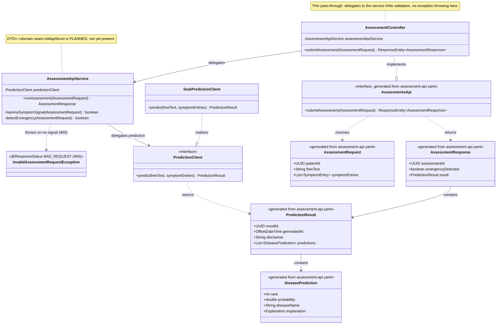
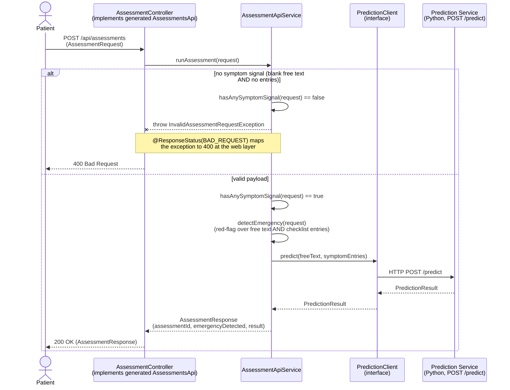
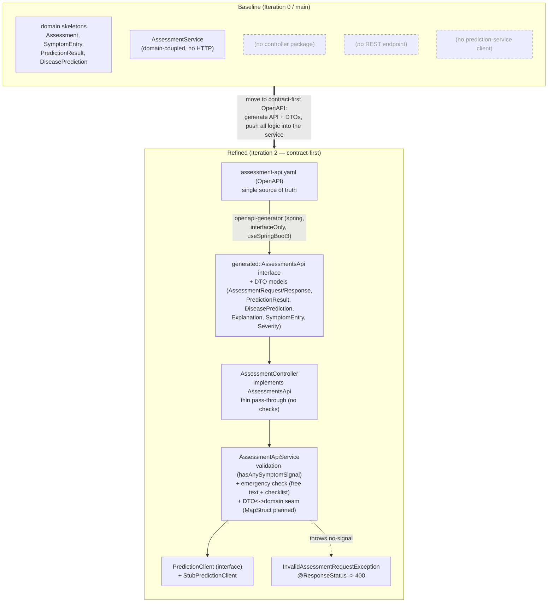

# MDD Iteration 2 — Assessment API (Java backend)

Diagrams and model-to-code traceability for Iteration 2 of the Model Driven Development
cycle (Lab05, Problem 1). The slice: a patient submits an assessment (free text + symptom
entries) through the backend and receives a prediction result. The backend orchestrates and
delegates prediction to the Python prediction service across the SOA boundary.

- **Anchored to:** UC1 (Patient Triage and Direct Specialist Routing), FR-P1 (free text /
  checklist input), FR-P2 (ranked diseases with a calibrated probability score).
- **Lives in:** `disease-prediction-be` (Java / Spring Boot) — the web layer.

> Render the `.mmd` files with the VS Code *Markdown Preview Mermaid* extension, IntelliJ's
> Mermaid plugin, or by pasting into <https://mermaid.live>. GitHub renders the fenced
> `mermaid` blocks below automatically.

---

## Step 3 — Model the slice

### API contract (platform-independent model)

`POST /api/assessments` — submit an assessment, receive a prediction result.

**Request**

```json
{
  "patientId": "11111111-1111-1111-1111-111111111111",
  "freeText": "I have a bad cough and high fever for 3 days",
  "symptomEntries": [
    { "rawText": "cough", "severity": "MODERATE", "durationDays": 3, "isMapped": true }
  ]
}
```

**Response (200)**

```json
{
  "assessmentId": "uuid",
  "emergencyDetected": false,
  "result": {
    "resultId": "uuid",
    "generatedAt": "2026-10-31T12:00:00Z",
    "disclaimer": "This is not a medical diagnosis",
    "predictions": [
      {
        "rank": 1,
        "probability": 0.82,
        "diseaseName": "Common Cold",
        "explanation": { "summary": "...", "contributionWeights": { "cough": 0.5 } }
      }
    ]
  }
}
```

**400** — payload with no symptom signal (blank free text **and** no symptom entries).
This is decided in `AssessmentApiService` (not the controller): the service throws
`InvalidAssessmentRequestException`, annotated `@ResponseStatus(HttpStatus.BAD_REQUEST)`, so the
web layer surfaces the 400 without any controller-side validation.

### Structural model (`assessment_api_class.mmd`)



### Behavioural model (`assessment_api_sequence.mmd`)



### Baseline vs refined (`baseline_vs_refined.mmd`)



---

## Step 4 — Model-to-code transformation

This slice is **contract-first**: `src/main/resources/openapi/assessment-api.yaml` is the single
source of truth. The `openapi-generator-maven-plugin` (`spring`, `interfaceOnly`, `useSpringBoot3`)
generates the Spring API interface and the request/response models at build time; the controller
implements the generated interface. The old hand-written `controller/dto/*.java` records were
**deleted**. Generated types live under `target/generated-sources` and are not committed.

| Model element | Code element | Source |
| --- | --- | --- |
| API contract (`POST /api/assessments`) | `assessment-api.yaml` (OpenAPI 3.0.3) | `src/main/resources/openapi/assessment-api.yaml` |
| `AssessmentsApi` (Spring API interface) | generated `interface AssessmentsApi` | `com.diseaseprediction.api.AssessmentsApi` *(generated)* |
| `AssessmentController` | `@RestController AssessmentController implements AssessmentsApi` (thin pass-through) | `controller/AssessmentController.java` |
| `AssessmentRequest` | generated `AssessmentRequest` DTO | `com.diseaseprediction.api.model.AssessmentRequest` *(generated)* |
| `AssessmentResponse` | generated `AssessmentResponse` DTO | `com.diseaseprediction.api.model.AssessmentResponse` *(generated)* |
| `PredictionResult` | generated `PredictionResult` DTO | `com.diseaseprediction.api.model.PredictionResult` *(generated)* |
| `DiseasePrediction` | generated `DiseasePrediction` DTO | `com.diseaseprediction.api.model.DiseasePrediction` *(generated)* |
| `Explanation` | generated `Explanation` DTO | `com.diseaseprediction.api.model.Explanation` *(generated)* |
| `SymptomEntry` | generated `SymptomEntry` DTO | `com.diseaseprediction.api.model.SymptomEntry` *(generated)* |
| `Severity` | generated `Severity` enum | `com.diseaseprediction.api.model.Severity` *(generated)* |
| `runAssessment()` + validation + emergency check | `@Service AssessmentApiService` | `service/assessment/AssessmentApiService.java` |
| no-signal → 400 | `InvalidAssessmentRequestException` (`@ResponseStatus(BAD_REQUEST)`) | `exception/InvalidAssessmentRequestException.java` |
| `PredictionClient` (interface) | `interface PredictionClient` | `service/prediction/PredictionClient.java` |
| `PredictionClient` realization | `@Component StubPredictionClient` | `service/prediction/StubPredictionClient.java` |

**Naming note:** the orchestrator is `AssessmentApiService` (not `AssessmentService`) because a
pre-existing, domain-coupled `AssessmentService` already lives in `service/`. Iteration 2 is
net-new web-layer code and deliberately does not rewrite the existing service.

**DTO↔domain seam:** the DTO↔domain boundary lives in `AssessmentApiService`. MapStruct is
**planned** but **not yet present**; today the service works directly with the generated DTOs.

---

## Step 5 — Validate / test

`@WebMvcTest AssessmentController` with a mocked `PredictionClient`
(`src/test/java/com/diseaseprediction/controller/AssessmentControllerTest.java`):

- `validRequestReturns200WithPrediction` — valid payload → 200 with a `PredictionResult` body.
- `emptyRequestReturns400` — blank free text + empty entries → 400 (via
  `InvalidAssessmentRequestException` raised in the service).
- `chestPainIsFlaggedAsEmergency` — red-flag text → `emergencyDetected = true`.

Verified locally:

```
Tests run: 7, Failures: 0, Errors: 0, Skipped: 0
BUILD SUCCESS
```

(controller tests + the existing `contextLoads`; the count grew after the red-flag check was
extended to cover checklist symptom entries.)

---

## Step 6 — Review & refine the model

Decisions folded back into the API contract / model:

1. **Contract owned by the OpenAPI spec** — `assessment-api.yaml` is the single source of truth.
   The Spring API interface (`AssessmentsApi`) and all request/response DTOs are generated from it;
   the hand-written `controller/dto/*.java` records were removed. The model and the code cannot
   drift because the DTOs are generated.
2. **Controller is a thin pass-through** — `AssessmentController implements AssessmentsApi` and its
   `submitAssessment(...)` only calls `assessmentApiService.runAssessment(...)` and returns
   `ResponseEntity.ok(...)`. No validation and no exception throwing in the controller: all logic
   lives in the service.
3. **Validation lives in the service** — the no-symptom-signal rule (`hasAnySymptomSignal(...)`) is
   evaluated inside `AssessmentApiService`, which throws `InvalidAssessmentRequestException`. That
   exception carries `@ResponseStatus(HttpStatus.BAD_REQUEST)`, so the 400 is surfaced declaratively
   at the web layer rather than by a controller check.
4. **Emergency check runs before prediction** — `detectEmergency(...)` is evaluated before
   `predictionClient.predict(...)`, so an emergency is surfaced even if prediction fails. The
   red-flag scan covers **both** the free text **and** the checklist symptom entries
   (`SymptomEntry.getRawText()`), with underscores normalised to spaces, against the red-flag
   phrases (chest pain, difficulty breathing, shortness of breath, breathlessness).
5. **Prediction behind an interface** — `PredictionClient` + `StubPredictionClient` let the
   backend be built and tested against the contract before `POST /predict` exists. The
   `StubPredictionClient` currently returns a deterministic result; the real `HttpPredictionClient`
   (calling the Python `POST /predict`) is future work.
6. **DTO↔domain seam, MapStruct planned** — the DTO↔domain boundary is kept in
   `AssessmentApiService` so MapStruct mappers can be slotted in later; MapStruct is not present yet.
7. **Open items** — prediction-service timeout/fallback handling, the real `HttpPredictionClient`,
   and whether `GET /api/assessments/{id}` is needed to retrieve a stored result.
