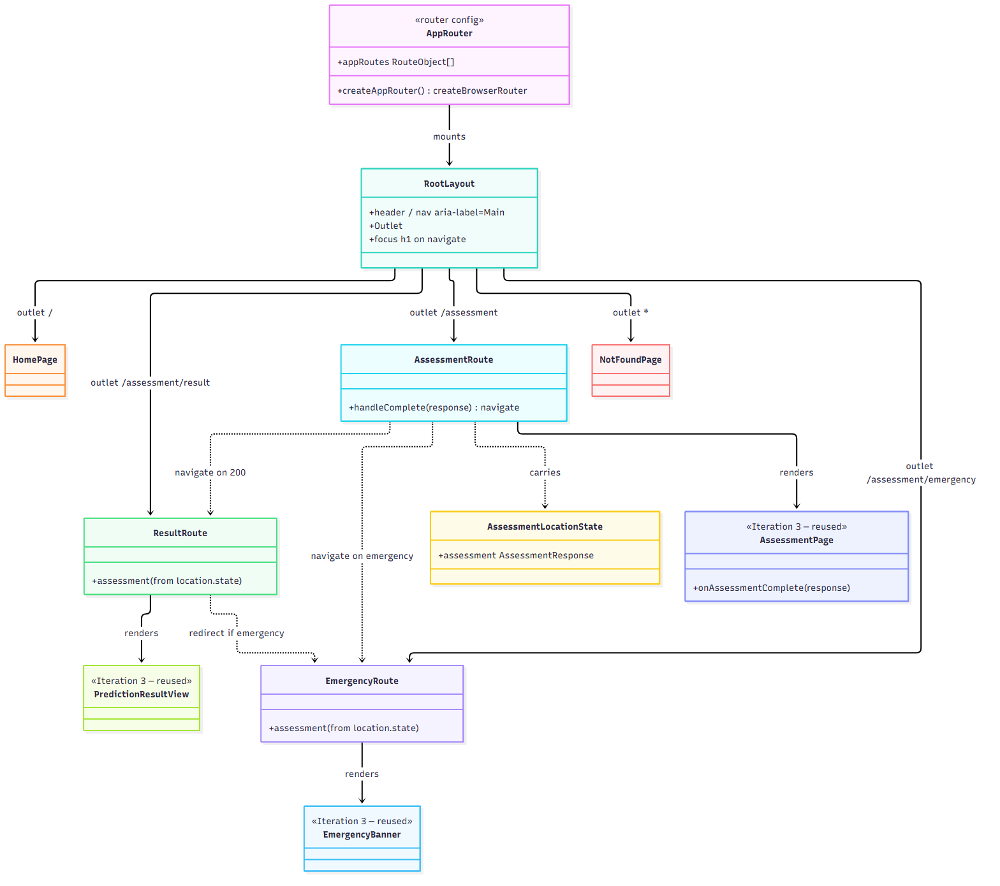
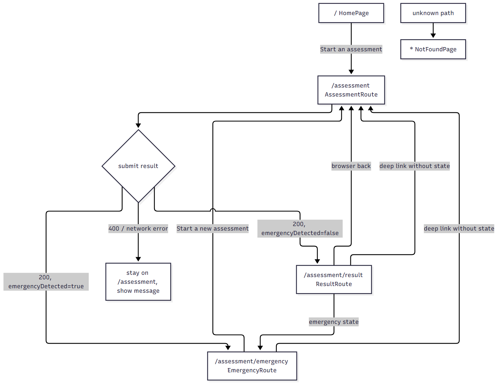
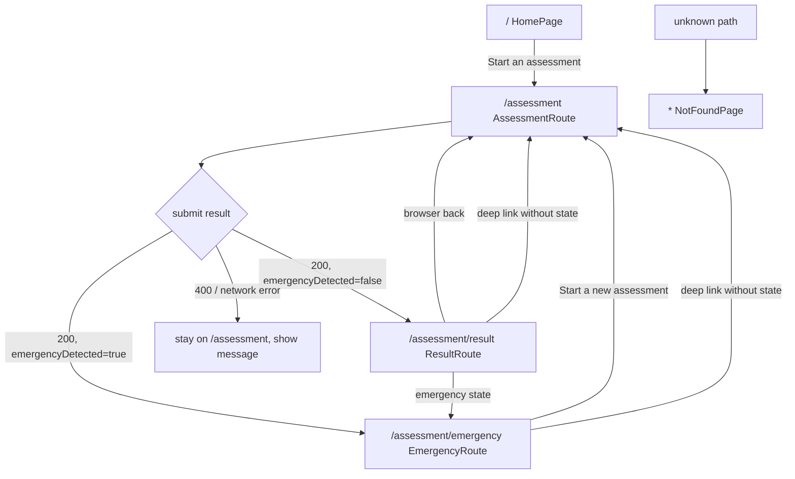
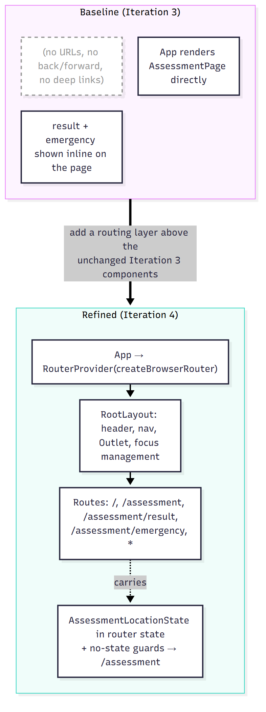

# MDD Iteration 4 — Patient Web App: Client-side Routing

Diagrams and model-to-code traceability for Iteration 4 of the Model Driven Development cycle.
The slice: turn the single-page Iteration 3 app into a navigable, URL-addressable app with
React Router — home, assessment form, result, emergency and not-found views; back/forward and
deep links work.

- **Anchored to:** UC1 (a navigable triage flow) and the structural need to host future views
  (FR-P4 specialty routing, FR-D1 doctor portal) as further routes.
- **Lives in:** `disease-prediction-fe` — still entirely inside "Patient Web App (React)". Code
  paths below are relative to that repo.
- **Contract:** unchanged. Routing is client-side only; no new network calls.
- **Library:** `react-router-dom` v7 (`createBrowserRouter` / `RouterProvider`).

> `.mmd` sources render in GitHub, IntelliJ, VS Code or <https://mermaid.live>; the `.png` files
> were rendered with `@mermaid-js/mermaid-cli`.

---

## Step 3 — Model the slice

### Route model

| Path                    | Route component   | Composes (Iteration 3)                                  | Purpose                                     |
| ----------------------- | ----------------- | ------------------------------------------------------- | ------------------------------------------- |
| `/`                     | `HomePage`        | —                                                       | Landing, emergency caveat, CTA              |
| `/assessment`           | `AssessmentRoute` | `AssessmentPage`                                        | Enter symptoms, submit                      |
| `/assessment/result`    | `ResultRoute`     | `PredictionResultView`                                  | Ranked predictions                          |
| `/assessment/emergency` | `EmergencyRoute`  | `EmergencyBanner`                                       | FR-P5 alert (112); prediction halted        |
| `*`                     | `NotFoundPage`    | —                                                       | 404 fallback                                |

### Structural model (`routing_class.mmd`)

### Behavioural model (`routing_flow.mmd`)

### Baseline vs refined (`baseline_vs_refined.mmd`)

**What changed and why:** Iteration 3 rendered one page with no URL semantics. Iteration 4 adds a
router, a shared layout and thin route components, because the app now needs addressable views,
deep-linking and somewhere to hang future pages. The Iteration 3 feature components are reused
unchanged: `AssessmentRoute` passes `onAssessmentComplete` (the seam built in Iteration 3) and
navigates; the result/emergency routes render the existing presentational components.

---

## Step 4 — Model-to-code transformation

| Model element | Code element | File |
| --- | --- | --- |
| Route model (`AppRouter`) | `appRoutes: RouteObject[]` + `createAppRouter()` (`createBrowserRouter`) | `src/routing/appRouter.tsx` |
| Paths + hand-off state | `PATHS`, `AssessmentLocationState`, `readAssessmentState()` | `src/routing/paths.ts` |
| `RootLayout` (+ `<Outlet/>`) | header, `<nav aria-label="Main">`, focus-on-navigate | `src/routing/RootLayout.tsx` |
| `HomePage` | route component | `src/routing/routes/HomePage.tsx` |
| `AssessmentRoute` | wraps `AssessmentPage`, `useNavigate` on success | `src/routing/routes/AssessmentRoute.tsx` |
| `ResultRoute` | `PredictionResultView` from `location.state`; guard → `/assessment`; emergency → `/assessment/emergency` | `src/routing/routes/ResultRoute.tsx` |
| `EmergencyRoute` | `EmergencyBanner` only; guard → `/assessment` | `src/routing/routes/EmergencyRoute.tsx` |
| `NotFoundPage` | `*` route | `src/routing/routes/NotFoundPage.tsx` |
| App root | `<RouterProvider router={appRouter}/>` | `src/App.tsx` |

Iteration 3 files under `components/`, `pages/`, `application/`, `api/` and `domain/` are not
modified. The only Iteration 3 test change: `AssessmentPage.integration.test.tsx` now renders
`<AssessmentPage/>` instead of `<App/>`, since `App` now mounts the router at `/`.

---

## Step 5 — Validate / test

| Check | Command | Result (local) |
| --- | --- | --- |
| Build | `npm run build` | ✅ |
| Lint + format | `npm run lint`, `npm run format:check` | ✅ |
| Unit tests | `npm test` | ✅ 8 files, 72 tests |
| Integration tests | `npm run test:integration` | ✅ 2 files, 15 tests |
| Coverage | `npm run coverage` → `coverage/lcov.info` | ✅ |
| Dependency scan | `npm audit --audit-level=high` | ✅ (only the 13 moderate dev-only findings from Iteration 3) |

Routing tests (`src/routing/routes.test.tsx`, memory router over the real `appRoutes`): `/`
shows home with a link to `/assessment`; labelled nav on every route; unknown paths →
`NotFoundPage`; `/assessment/result` and `/assessment/emergency` without (or with malformed)
state redirect to `/assessment`; both render correctly with state; the emergency view has no
predictions or link to them; an emergency assessment on `/assessment/result` redirects to the
emergency view.

Navigation integration tests (`src/routing/navigation.integration.test.tsx`, full router + MSW):
home CTA → form; valid submit → `/assessment/result` with predictions; focus moves to the new
`h1`; emergency → `/assessment/emergency` with the 112 banner and no predictions; 400
stays on `/assessment`; browser back from the result returns to the form (and forward returns);
nav "New assessment" from the result shows an empty form.

Manual smoke (run, Vite dev server + live `disease-prediction-be`): direct load of
`/assessment/result` redirected to `/assessment`; free-text submit navigated to
`/assessment/result` with the heading focused; `history.back()` returned to the form;
"I have chest pain" navigated to `/assessment/emergency` with the 112 banner.

---

## Step 6 — Review & refine the model

1. **Hand-off mechanism: router `state`.** The `AssessmentResponse` travels in
   `navigate(path, { state })`. Chosen over a context/store because it needs no provider, is
   scoped to the history entry (so back/forward restore the right result), and makes "no state"
   detectable for the guards. Consequence worth knowing: `history.state` survives a hard refresh,
   so refreshing `/assessment/result` keeps the result; only a *fresh* deep link / bookmark (no
   state) redirects to the form. The state is validated with `isAssessmentResponse` before use.
2. **Param route later.** `/assessment/result/:assessmentId`, backed by a future
   `GET /api/assessments/{id}` (Iteration 2's open item), would make results shareable across
   devices and allow a route `loader`. Until that endpoint exists, a param route would only add a
   dead link, so it is deferred.
3. **Where future routes slot in.** FR-P4 (specialty routing) → e.g.
   `/assessment/result/specialists` as a child of the result view; FR-D1 (doctor portal) → a
   separate `/doctor/*` subtree with its own layout. FR-G1 auth guard → a pathless layout route
   (`element: <RequireAuth><Outlet/></RequireAuth>`) wrapping protected children; the
   `AssessmentApiContext` seam from Iteration 3 is where an authenticated client is injected.
4. **Form state on back.** Going back from the result remounts `AssessmentPage`, so the form is
   empty. Acceptable for the MVP (and arguably right for privacy); preserving it would mean lifting
   form state into router state or a context — candidate refinement if users ask for it.
5. **Emergency halts prediction.** Per the UC1 sequence diagram ("prediction … halted (FR-P5)") and
   activity A11–A13, the emergency route shows only the 112 alert. There is no link to the
   predictions, and `ResultRoute` redirects an emergency assessment back to the emergency view, so
   back/forward or a crafted history entry cannot surface them either.
6. **Hosting needs an SPA fallback.** Client-side routes are not files on disk, so whatever serves
   the production build must return `index.html` for unknown paths (while real missing assets
   still 404); otherwise a refresh or deep link on `/assessment/result` 404s. The Vite dev server
   already does this. Container/hosting config is left to the DevOps track.
