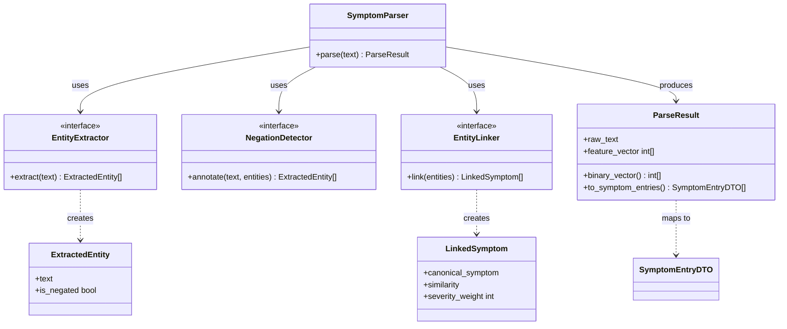
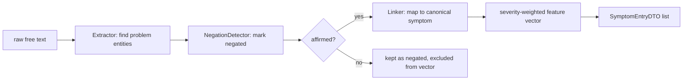
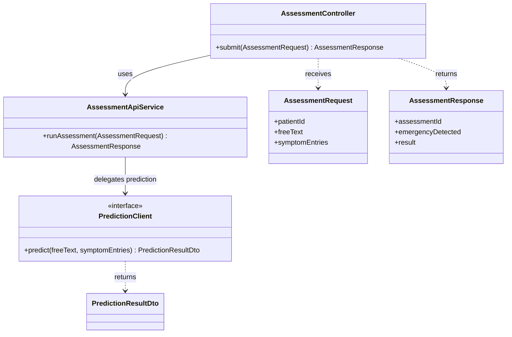
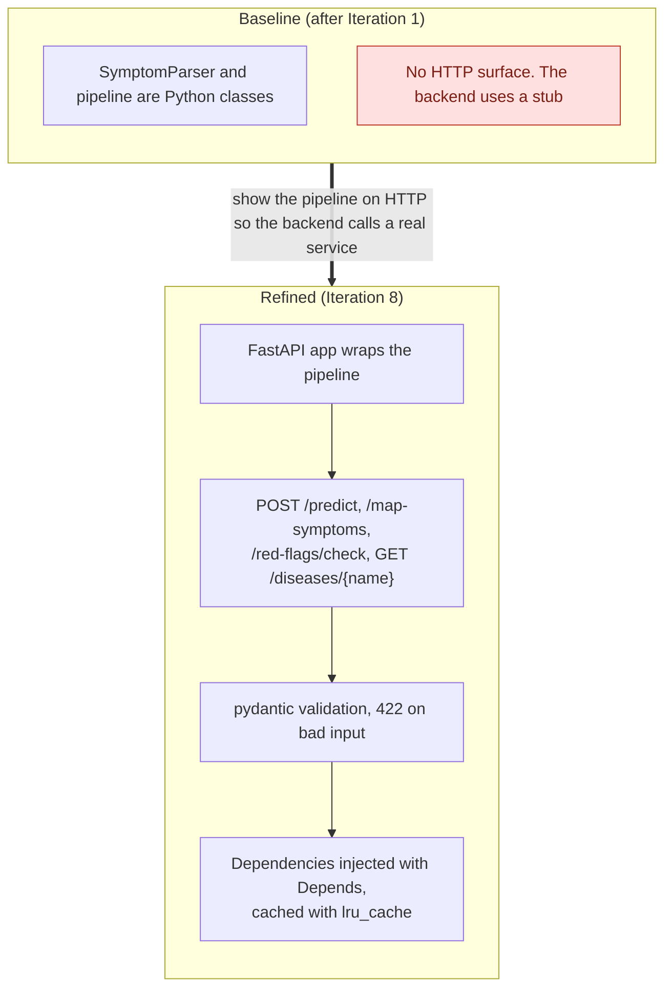
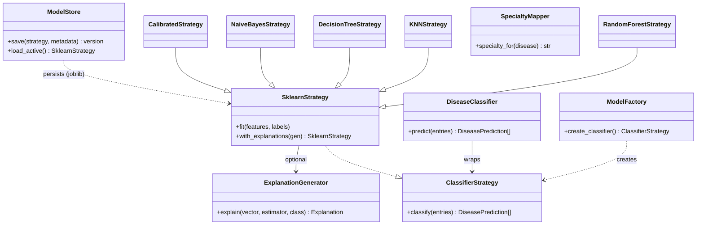
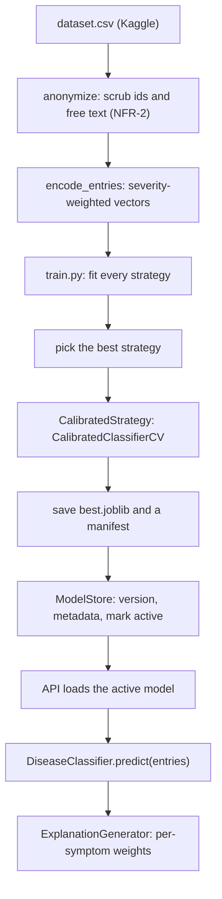
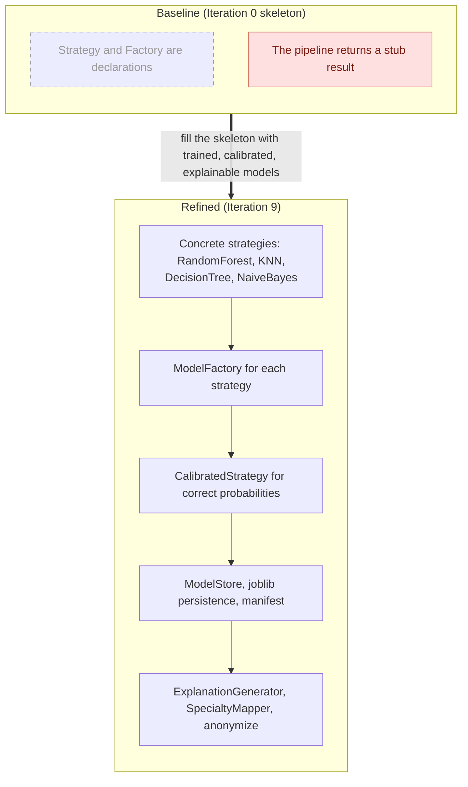
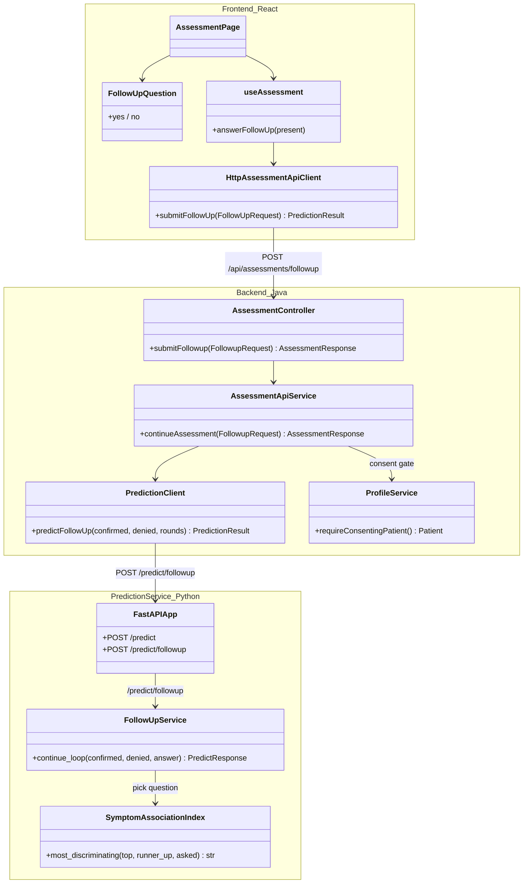
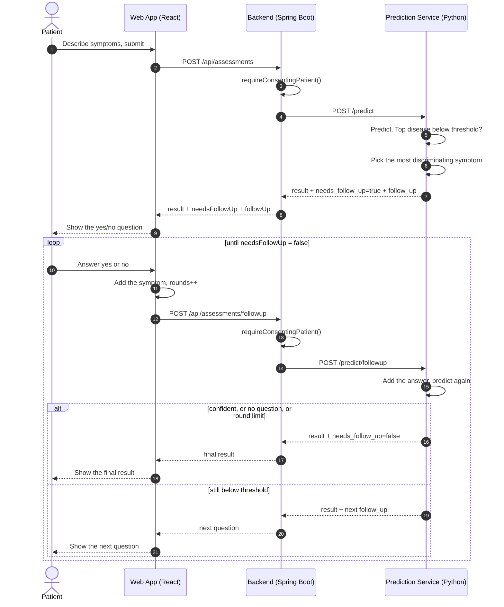
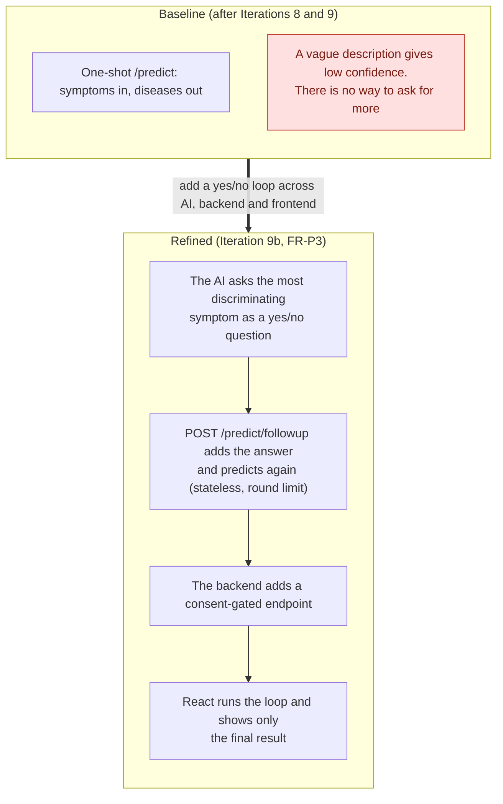

# Model Driven Development — Iterations (Lab05, Problem 1)

This document records our use of Model Driven Development (AMDD) on the Disease Prediction
project. Lab05 requires at least two MDD/TDD iterations, graded on the correct identification of
the steps and their execution. We use MDD because the project has been model-first since Lab02
(requirements → UML/C4 → design patterns → code), so our code is genuinely derived from models.

Repositories (SOA — separate services):

- `disease-prediction-be` — Java / Spring Boot backend
- `disease-prediction-ai` — Python prediction service (the ML part)

## The MDD iteration cycle (six steps)

Each iteration below executes the same six steps:

1. **Requirements envisioning** — pick the functional slice, anchor it to a real requirement
   (FR / use case).
2. **Architecture / platform envisioning** — decide where the slice lives in the SOA architecture
   (which service, which layer, how it communicates).
3. **Model the slice** — evolve the model (class and/or behavioural diagram) for just this slice;
   record what changed from the baseline model and why. This is the artifact the iteration is
   driven from.
4. **Model-to-code transformation** — derive code from the model, element by element, keeping
   traceability (model element → code element).
5. **Validate / test** — compile and run; confirm the code matches the model and behaves as
   modelled.
6. **Review & refine the model** — fold back what implementation taught us; the refined model
   becomes the input to the next iteration.

## Iteration 0 — Baseline (not counted)

Lab02–Lab04 produced the baseline model: the shared class diagram
([class diagram](../design/diagrams/uml/class_diagram_daria.png), [AI pattern diagram](../design/diagrams/patterns/patterns_class_diagram_ai.png)), the C4 diagrams, and
the declaration-only domain + design-pattern skeletons (Strategy + Factory in the Python service).
We treat this as Iteration 0: a model-first foundation, but not framed with explicit MDD steps.
The two iterations below build on it.

## Iteration 1 — Free-Text Symptom Parsing (Python prediction service)

Turns a patient's free-text symptom description into structured, mapped symptom data (a
severity-weighted feature vector + `SymptomEntryDTO` list).

### Step 1 — Requirements envisioning

- Slice: free text → structured, mapped symptoms.
- Anchored to: FR-P1 ("describe symptoms via free text or a structured checklist") and the agreed
  behaviour "Free-text symptoms are mapped to known Symptoms; unmapped text is kept and shown to
  the doctor." (see `../requirments.md`).

### Step 2 — Architecture / platform envisioning (SOA)

The slice lives entirely in the Prediction Service (Python), not the Java backend, honouring the
SOA split. It is the front stage of the service's pipeline: raw text enters, a severity-weighted
feature vector and a list of `SymptomEntryDTO` leave, ready for the classifier stage (Iteration 2).
NLP libraries (transformers, spaCy/negspacy, sentence-transformers, rapidfuzz) sit behind
interfaces so they can be swapped.

### Step 3 — Model the slice (core MDD step)

Baseline model: `SymptomEntry`, `Symptom`, `Severity` existed only as passive data. There was no
model for how free text becomes a `SymptomEntry`.

Model evolution this iteration: introduce a parsing pipeline — a chain of four stages, each
modelled as a role (interface) with a concrete realization. This is a direct application of the
Strategy pattern from our design model.



Behavioural model (pipeline flow):



What changed from baseline and why: the baseline had no transformation from text → `SymptomEntry`.
We added the pipeline abstraction (Extractor → NegationDetector → Linker → vectorization) because
the requirement demands mapping free text to known symptoms while keeping unmapped / negated text.
Modelling each stage as an interface lets us swap NLP implementations without touching the pipeline.

### Step 4 — Model-to-code transformation

Each model element maps one-to-one to code on branch `feature/nlp-pipeline`:

| Model element | Code element | File |
| --- | --- | --- |
| `SymptomParser` (orchestrator) | `class SymptomParser.parse()` | `prediction_service/parser.py` |
| `EntityExtractor` (interface) | `Protocol EntityExtractor` + `ClinicalBertExtractor` | `prediction_service/parser.py` |
| `NegationDetector` (interface) | `Protocol NegationDetector` + `NegspacyNegationDetector`, `KeywordNegationDetector` | `prediction_service/parser.py` |
| `EntityLinker` (interface) | `Protocol EntityLinker` + `SemanticEntityLinker` (semantic → fuzzy fallback) | `prediction_service/parser.py` |
| `ExtractedEntity`, `LinkedSymptom`, `ParseResult` | dataclasses | `prediction_service/parser.py` |
| canonical symptom vocabulary | `CANONICAL_SYMPTOMS` + `normalise_symptom()` | `prediction_service/vocabulary.py` |
| severity weighting | `weight_for()`, `SEVERITY_WEIGHTS` | `prediction_service/severity.py` |
| output DTO + `Severity` | `ParseResult.to_symptom_entries()` → `SymptomEntryDTO` | `prediction_service/models.py` |

Every interface and dataclass in the model has a named counterpart in the code.

### Step 5 — Validate / test

The slice is validated by the parser test suite in `tests/test_parser.py`, which checks exactly
the modelled behaviour: happy-path weighted vector, negation filtered before linking, empty /
no-entity / only-negated → zero vector, severity bucketing, semantic-above-threshold vs fuzzy
fallback, and dedup keeping the best match.

Verified run (Python 3.12.10, Windows):

```
40 passed in 0.26s
```

All 40 tests pass locally — including the fuzzy-fallback linking path (`rapidfuzz`). There are no
environment failures. The same pinned stack runs in CI on Python 3.12 (see
`.github/workflows/ci.yml`, the `lint` / `build` jobs with `python-version: '3.12'`), so the local
and CI results agree. Because the heavy ML libraries are lazy-imported behind the interfaces, the
suite also runs with only pytest, numpy and the pure-Python modules present.

> Correction note: an earlier draft of this document reported "38 passed, 2 failed in 0.08s" on
> "Python 3.15, macOS", attributing the two failures to a missing `rapidfuzz` wheel on Python 3.15,
> and said CI ran on Python 3.13. That result was not reproducible: the suite is 40 tests and all
> pass on Python 3.12.10, and CI is pinned to Python 3.12. The numbers above are the verified result.

### Step 6 — Review & refine the model

Implementation surfaced three things the baseline class diagram did not capture; they are folded
back into the model (and carried into Iteration 2):

1. **Negation is a dedicated stage, not a flag on a symptom.** Affirmed and negated entities must
   be split before linking, so negated symptoms never reach the feature vector.
2. **Linking needs a two-tier strategy** — semantic match first, fuzzy match when the semantic
   model is absent or below threshold. Modelled now as two strategies behind `EntityLinker`, not a
   single `link()`.
3. **Severity is a weight (int), not only the enum.** The feature vector carries severity-weighted
   values; the `Severity` enum is derived from the weight at the end. `LinkedSymptom.severity_weight`
   is now explicit in the model.

The refined model's output (`ParseResult.feature_vector` / `to_symptom_entries()`) defines what the
prediction service consumes, which the Iteration 2 API contract (Java backend → prediction service)
is modelled against.

## Iteration 2 — Assessment API (Java backend)

Status: implemented. Builds directly on Iteration 1 across the SOA boundary: the Java backend
exposes the assessment endpoint and (per the design) delegates prediction to the Python prediction
service, which consumes the parser's output. The backend web layer was net-new this iteration.

### Step 1 — Requirements envisioning

- Slice: a patient submits an assessment (free text + symptom entries) through the backend and
  receives a prediction result.
- Anchored to: UC1 (Patient Triage and Direct Specialist Routing), FR-P1 (describe symptoms via
  free text / checklist) and FR-P2 (list of likely diseases with a calibrated probability score).
  See `../requirments.md`.

### Step 2 — Architecture / platform envisioning (SOA)

The slice lives in the API Backend (Java / Spring Boot) — the web layer. The backend does not
predict; it orchestrates. It is the client of the Python prediction service across the SOA boundary:

```
Patient → POST /api/assessments (Java backend) → calls → POST /predict (Python service)
       → PredictionResult → backend → Patient
```

The API contract (request/response schema) is the shared model that both sides are derived from.

### Step 3 — Model the slice (core MDD step)

Baseline model: the domain exists as declaration-only skeletons (`Assessment`, `SymptomEntry`,
`PredictionResult`, `DiseasePrediction`, `Patient`) with empty methods; there is no web layer and no
API contract modelling how an assessment is submitted or how the backend reaches the prediction
service.

Model evolution this iteration: introduce the Assessment API contract and the controller/client
structure that realises it. (Rendered diagrams: `mdd/iteration2/` in this repository.)

API contract (the platform-independent model) — `POST /api/assessments`:

Request:

```json
{
  "patientId": "uuid",
  "freeText": "I have a bad cough and high fever for 3 days",
  "symptomEntries": [
    { "rawText": "cough", "severity": "MODERATE", "durationDays": 3, "isMapped": true }
  ]
}
```

Response (200):

```json
{
  "assessmentId": "uuid",
  "emergencyDetected": false,
  "result": {
    "resultId": "uuid",
    "generatedAt": "2026-10-31T12:00:00Z",
    "disclaimer": "This is not a medical diagnosis",
    "predictions": [
      {
        "rank": 1,
        "probability": 0.82,
        "diseaseName": "Common Cold",
        "explanation": { "summary": "...", "contributionWeights": { "cough": 0.5 } }
      }
    ]
  }
}
```

400 — invalid / empty symptom payload.

Structural model (web layer derived from the contract):



What changed from baseline and why: the baseline had domain objects but no way to invoke them over
HTTP. We add the API contract (the model of the service boundary) plus the controller → service →
client structure. Modelling `PredictionClient` as an interface keeps the SOA call behind an
abstraction, so the backend can be built and tested against the contract whether or not the live
Python endpoint exists yet.

### Step 4 — Model-to-code transformation

Each model element maps to Java code under `src/main/java/com/diseaseprediction/`:

| Model element | Code element | Location |
| --- | --- | --- |
| `POST /api/assessments` + `AssessmentController` | `@RestController AssessmentController` | `controller/` |
| `AssessmentRequest` / `AssessmentResponse` | request/response DTO records | `controller/dto/` |
| `PredictionResultDto`, `DiseasePredictionDto`, `ExplanationDto`, `SymptomEntryDto` | DTO records | `controller/dto/` |
| `AssessmentService.runAssessment()` | `@Service AssessmentApiService` | `service/assessment/` |
| `PredictionClient` (interface) | `PredictionClient` + `StubPredictionClient` | `service/prediction/` |

Naming note: the orchestrator is `AssessmentApiService` (not `AssessmentService`) because a
pre-existing domain-coupled `AssessmentService` already exists; Iteration 2 is net-new web-layer
code and deliberately does not rewrite it. DTOs are immutable records so the web slice serialises
cleanly without touching the declaration-only domain classes.

### Step 5 — Validate / test

`@WebMvcTest AssessmentController` with a mocked `PredictionClient`
(`src/test/java/com/diseaseprediction/controller/AssessmentControllerTest.java`):

- `validRequestReturns200WithPrediction` — valid payload → 200 with a `PredictionResultDto` body.
- `emptyRequestReturns400` — blank free text + empty entries → 400.
- `chestPainIsFlaggedAsEmergency` — red-flag text → `emergencyDetected = true`.

Verified run:

```
Tests run: 4, Failures: 0, Errors: 0, Skipped: 0
BUILD SUCCESS
```

(3 controller tests + the existing `contextLoads`.) Verified on JDK 21 (JetBrains Runtime) with
`-Dmaven.compiler.release=21`; the `pom.xml` pins `java.version=25` and CI uses that toolchain.

### Step 6 — Review & refine the model

- **Emergency check runs before prediction** — `AssessmentApiService.runAssessment()` evaluates the
  red-flag check before calling the prediction client, so an emergency surfaces even if prediction
  fails.
- **Prediction behind an interface** — `PredictionClient` + `StubPredictionClient`; the Step 6
  follow-up is an `HttpPredictionClient` (Spring `RestClient`) that calls the Python `POST /predict`.
- Open items for the next refinement: prediction-service timeout/fallback handling, and whether
  `GET /api/assessments/{id}` is needed to retrieve a stored result.

## Iteration 3 — Patient Web App: Symptom Prediction Feature (Frontend construction)

Status: **planned** (not yet implemented). Builds on Iteration 2 across the SOA boundary: a Patient
Web App (React) that accepts a free-text NLP symptom description **and** a structured checklist,
submits to the Java backend's `POST /api/assessments`, and renders the prediction result (or the
FR-P5 emergency alert). This iteration constructs the app scaffold and the single assessment feature
(one page); it does **not** add navigation between pages — that is Iteration 4.

- Slice anchored to FR-P1 (free text + checklist), FR-P2/FR-P3 (ranked predictions + explanation +
  disclaimer), FR-P5 / UC2 (emergency intercept), UC1 (patient triage flow).
- Lives entirely in the "Patient Web App (React)" C4 container; a pure HTTP/JSON client of the
  backend, with the view → hook → `AssessmentApiClient` (port/adapter) → types layering deliberately
  mirroring the backend's controller → service → `PredictionClient` structure.

The full six-step plan — context the implementing agent must load, the authoritative API contract,
structural/behavioural models, the model-to-code file map, CI/GitFlow constraints, and the
definition of done — is in **`MDD_ITERATIONS_FE_PLAN.md`, Part 1**.

## Iteration 4 — Patient Web App: Client-side Routing

Status: **planned** (not yet implemented, depends on Iteration 3). Adds client-side **routing** to
the Patient Web App built in Iteration 3: distinct URL-addressable views (home/landing, the
assessment page, a dedicated result view, an emergency view, and a not-found fallback) with React
Router, so the single-page feature becomes a navigable multi-route app and the result/emergency
states become shareable/bookmarkable routes.

- Anchored to UC1 (navigable triage flow) and the structural need to add FR-P4 (specialty routing)
  and later portals (FR-D1) as new routes without reworking the feature components.
- Still entirely within the "Patient Web App (React)" container; introduces a routing/navigation
  layer **above** the Iteration 3 feature components, which are reused unchanged.

The full six-step plan — route model, the router/layout structure derived from it, the
model-to-code map, and routing-specific tests (navigation, deep-linking, guards) — is in
**`MDD_ITERATIONS_FE_PLAN.md`, Part 2**.

## Iteration 5 — User and Consent Persistence (Java backend)

Status: **implemented** (branch `feat/user-persistence`, PR into `develop`; 21 tests pass). First
step of the "secured before stored" plan: users and consent are persisted before any health data,
so that assessments (Iteration 7) land in a schema that already has identity, consent, cascade
deletion and encrypted personal data.

### Step 1 — Requirements envisioning

- Slice: persist patients, doctors, administrators and the patient's consent history.
- Anchored to: NFR-1 (GDPR Article 9, health data is a special category), FR-G1 (grant and revoke
  consent), FR-G2 / UC3 (delete the account and all data), UC1 step 1 (consent before symptom
  input).

### Step 2 — Architecture / platform envisioning

- **Where:** the API Backend (Java / Spring Boot), new persistence layer. The Python prediction
  service is not involved.
- **Platform:** PostgreSQL 18, run locally with Docker Compose (`compose.yaml`, port 5433);
  Spring Data JPA; Flyway for versioned migrations.
- **Schema ownership:** Flyway migrations are the source of truth for the schema. Hibernate runs
  with `ddl-auto=validate`, so it checks the entities against the tables but never changes them.
  Letting Hibernate generate the schema was rejected because it is not versioned or reviewable.
- **Relational, not MongoDB:** an assessment would fit a document store, but the wider domain is
  relational (users, doctors, reports, consent), and the GDPR requirements need foreign keys with
  cascade deletes and auditable history. MongoDB also has no Flyway equivalent of the same maturity.
- **Identity:** login and passwords are delegated to Keycloak in Iteration 6. This iteration only
  adds the `identity_id` column that links a user row to the Keycloak account.
- **Domain classes are the JPA entities:** a separate persistence model with mappers (hexagonal
  style) was considered and rejected, because it doubles the classes for little benefit at this
  size and weakens the one-to-one model-to-code traceability.
- **Encryption:** personal data (`full_name`, `date_of_birth`) is encrypted by the application
  with AES-256-GCM (field-level encryption). Disk-level encryption at rest and TLS to the database
  need a deployed database, so they belong to the deployment work with the GitOps and infra
  owners.

The model (ER, class and baseline-vs-refined diagrams), the reasons for each change, the
model-to-code mapping, the test results and the review (Steps 3–6) are in
**`iteration5/README.md`**.

## Iteration 6 — Identity and Login with Hanko (Java backend + React)

Status: **designed** (implementation on one branch per repository). Second step of the "secured
before stored" plan: every API request carries a Hanko session token, the backend verifies it
and maps it to the Iteration 5 user, and a first-login onboarding step creates the patient
profile and records consent.

### Step 1 — Requirements envisioning

- Slice: register, log in, log out, first-login onboarding, consent grant and revoke, server-side
  protection of the assessment API. Every `/api/**` endpoint requires login.
- Anchored to: NFR-1 (GDPR Article 9), FR-G1 (consent), UC1 step 1 (consent before symptom
  input), the domain rule "users must log in".

### Step 2 — Architecture / platform envisioning

- **Identity provider:** Hanko v3.1.0, already deployed by DevOps on K3s (dev and production
  instances), replaces the Keycloak plan from Iteration 5 and the roadmap. `identity_id` holds the
  Hanko user id (the token's `sub`); the schema does not change.
- **Session transport:** `Authorization: Bearer <Hanko session JWT>`. No refresh tokens; the
  session lifespan goes from 15 minutes to 1 hour.
- **Backend:** Spring Security OAuth2 resource server (RS256, JWKS, issuer, audience) plus a
  cached `POST /sessions/validate` check for logout and revocation, failing closed.
- **Roles:** stay in the app database (the Iteration 5 discriminator). New users are patients.
- **Frontend:** Hanko Elements (`<hanko-auth>`), an auth context, route guards and an onboarding
  page.
- **Local development:** Hanko, its database and a mail catcher in the backend's Docker Compose.

The model (sequence, class and baseline-vs-refined diagrams), the API contract changes, the
model-to-code plan, the test plan, and the design of the AOP component (Part B, Personal Data
Access Guard) are in **`iteration6/README.md`**.

> The three iterations below are written in ASD Simplified Technical English (STE): short
> sentences, active voice, present tense, and one instruction in each sentence. Iteration 7
> (Health-data persistence, Java backend) stays a planned roadmap item. It is not yet done.
> Iteration 9b comes after Iteration 9 so that it does not use the Iteration 7 number.

## Iteration 8 — Prediction Service: Web Layer (Python)

Status: **done**. This iteration puts an HTTP layer in front of the Iteration 1 pipeline. The
Java backend can then call a real service. Before this iteration, the backend used a stub.

### Step 1 — Requirements envisioning

- Slice: show the pipeline on HTTP. The service predicts diseases. It maps free text to symptoms.
  It checks red flags. It gives disease information.
- Anchored to FR-P1 and FR-P2 (predict diseases from symptoms) and the SOA rule. The backend must
  not run ML code. The backend calls the Python service.

### Step 2 — Architecture / platform envisioning (SOA)

- The web layer stays in the Prediction Service (Python). It does not go into the backend.
- Use FastAPI. FastAPI gives input validation, dependency injection and an OpenAPI contract.
- Inject the pipeline, the red-flag engine, the knowledge base and the specialty mapper with
  `Depends`. Cache each one with `lru_cache`. The model loads one time for each process.

### Endpoints

| Operation | Function | Success | Error |
| --- | --- | --- | --- |
| `POST /predict` | Free text to ranked diseases, with descriptions, precautions, red flags and specialty | `200` | `422` if the text is empty |
| `POST /map-symptoms` | Free text to structured symptom entries | `200` | `422` |
| `POST /red-flags/check` | Active symptoms to red-flag rules and urgency | `200` | `422` |
| `GET /diseases/{name}` | Description and precautions for one disease | `200` | `404` if the disease is unknown |
| `GET /health`, `GET /ready` | Liveness and readiness for the container probes | `200` / `503` | — |

### Step 3 — Model the slice

**Structural model**

```mermaid
classDiagram
    class FastAPIApp {
        +POST /predict
        +POST /predict/followup
        +POST /map-symptoms
        +POST /red-flags/check
        +GET /diseases/{name}
        +GET /health
        +GET /ready
    }
    class PredictRequest {
        +str text
    }
    class PredictResponse {
        +PredictionItem[] predictions
        +RedFlag[] redFlags
        +Urgency urgency
        +bool needs_follow_up
        +FollowUp follow_up
    }
    class PredictionPipeline {
        +predict(text) PredictionResult
        +classifier
    }
    class RedFlagEngine {
        +evaluate(active) RedFlag[]
    }
    class DiseaseKnowledgeBase {
        +describe(disease)
        +precautions(disease)
    }
    class SpecialtyMapper {
        +specialty_for(disease)
    }

    FastAPIApp --> PredictRequest : validates
    FastAPIApp --> PredictResponse : returns
    FastAPIApp --> PredictionPipeline : get_pipeline (Depends)
    FastAPIApp --> RedFlagEngine : get_red_flag_engine (Depends)
    FastAPIApp --> DiseaseKnowledgeBase : get_knowledge (Depends)
    FastAPIApp --> SpecialtyMapper : get_specialty_mapper (Depends)
```

**Baseline vs refined**



The baseline from Iteration 1 was a pipeline of Python classes. It had no network surface. The
backend could use only a stub. Iteration 8 adds a FastAPI app. The app wraps the pipeline and does
not change it. The app adds validation and container probes.

### Step 4 — Model-to-code transformation

| Model element | Code element | File |
| --- | --- | --- |
| FastAPI app and routes | `app`, `predict`, `map_symptoms`, `red_flags_check`, `disease_info`, `health`, `ready` | `prediction_service/api.py` |
| Request and response models | `PredictRequest`, `PredictResponse`, `MapSymptomsResponse`, `RedFlagCheckResponse`, `DiseaseInfoResponse` | `prediction_service/api.py` |
| Pipeline dependency | `get_pipeline()`, env `DISEASE_MODEL_PATH` | `prediction_service/api.py`, `pipeline.py` |
| Red-flag engine | `RedFlagEngine`, `RedFlagRule`, `Urgency` | `prediction_service/red_flags.py` |
| Disease knowledge | `DiseaseKnowledgeBase` | `prediction_service/knowledge.py` |
| Specialty mapping (FR-P4) | `SpecialtyMapper` | `prediction_service/specialty.py` |

### Step 5 — Validate / test

The test suite passes. It has 166 tests on Python 3.12.10. The API tests (`test_api.py`) have 23
tests. The red-flag tests (`test_red_flags.py`) have 7 tests. The knowledge tests
(`test_knowledge.py`) have 6 tests. The API tests call each endpoint with the FastAPI `TestClient`.

### Step 6 — Review & refine the model

1. The dependencies are cached, not global. `lru_cache` loads the model one time for each process.
   `Depends` keeps the endpoints easy to test.
2. There are two probes. `/health` is liveness. `/ready` reports if the model is loaded.
3. The red-flag check is deterministic. It runs next to the prediction. It is not a diagnosis.
4. The follow-up endpoint is added later (Iteration 9b). It reuses this app. For this reason,
   `PredictResponse` already carries `needs_follow_up` and `follow_up`.

## Iteration 9 — ML Pipeline: Trained Classifier (Python)

Status: **done**. This iteration fills the Iteration 0 Strategy and Factory skeleton. It adds
trained, calibrated classifier models. The `/predict` endpoint now gives real ranked diseases.
Before this iteration, the pipeline gave a stub result.

### Step 1 — Requirements envisioning

- Slice: train classifiers on the Kaggle dataset. Calibrate the best model. Save it. Serve ranked
  diseases with explanations and a specialty.
- Anchored to FR-P2 (ranked probabilities), FR-P4 (specialty routing) and NFR-2 (anonymise the
  training data).

### Step 2 — Architecture / platform envisioning (SOA)

- All of this stays in the Prediction Service (Python).
- Keep the Iteration 0 patterns. Strategy holds the interchangeable classifier algorithms.
  Factory builds each strategy.
- Train the models offline in `train.py`. The API loads a saved model at request time. The heavy
  training does not run in the request path.

### Classifier strategies

| Strategy | Estimator |
| --- | --- |
| `RandomForestStrategy` | random forest |
| `KNNStrategy` | k-nearest neighbours |
| `DecisionTreeStrategy` | decision tree |
| `NaiveBayesStrategy` | naive Bayes |
| `CalibratedStrategy` | wraps the best strategy in `CalibratedClassifierCV` |

### Step 3 — Model the slice

**Structural model**



**Training flow**



**Baseline vs refined**



Iteration 0 left Strategy and Factory as declarations with a stub. Iteration 9 makes them real. It
adds concrete strategies, a factory for each strategy, a calibration wrapper, a model registry with
provenance, explanations, and the FR-P4 specialty mapper. It anonymises the training data first.

### Step 4 — Model-to-code transformation

| Model element | Code element | File |
| --- | --- | --- |
| Strategy interface and base | `ClassifierStrategy`, `SklearnStrategy` | `prediction_service/classifier.py` |
| Concrete strategies | `RandomForestStrategy`, `KNNStrategy`, `DecisionTreeStrategy`, `NaiveBayesStrategy` | `prediction_service/classifier.py` |
| Calibration | `CalibratedStrategy` (`CalibratedClassifierCV`) | `prediction_service/classifier.py` |
| Factory | `ModelFactory` and the four concrete factories | `prediction_service/factory.py` |
| Classifier wrapper | `DiseaseClassifier` | `prediction_service/classifier.py` |
| Feature encoding | `encode_entries` | `prediction_service/features.py` |
| Explanations | `ExplanationGenerator`, `Explanation` | `prediction_service/explanation.py` |
| Specialty mapping (FR-P4) | `SpecialtyMapper` | `prediction_service/specialty.py` |
| Model registry and persistence | `ModelStore`, `save_strategy`, `load_strategy` | `prediction_service/persistence.py` |
| Provenance manifest | `write_model_manifest`, `verify_model_artifact` | `prediction_service/artifact.py` |
| Training script | `train.py` | `prediction_service/train.py` |
| Anonymisation (NFR-2) | `anonymize_entries`, `scrub_text`, `pseudonymize_id` | `prediction_service/anonymize.py` |

### Step 5 — Validate / test

The test suite passes. It has 166 tests. The classifier tests have 20 tests. The calibration tests
have 8 tests. The explanation tests have 8 tests. The specialty tests have 6 tests. The persistence
tests have 11 tests. The training tests have 6 tests. The anonymise tests have 12 tests.

### Step 6 — Review & refine the model

1. Calibration is a strategy, not a special case. `CalibratedStrategy` subclasses `SklearnStrategy`.
   The API loads it and calls it like any other strategy.
2. The project uses `joblib`, not `pickle`. scikit-learn models hold large NumPy arrays. `joblib`
   saves them well. The loader still reads the old `.pkl` files.
3. The manifest travels with the model. It records the artifact hash, the data hash, the strategy,
   the scores and the runtime.
4. The explanation code unwraps the calibration wrapper. It then reads the feature importances or
   the coefficients. Only the active symptoms can contribute.
5. The project anonymises the data before training (NFR-2). It hashes the `entry_id`. It scrubs the
   free text.

## Iteration 9b — Adaptive Follow-up Questions (AI + backend + React, FR-P3)

Status: **done**. This iteration adds a follow-up loop across the three services. When a
prediction is not confident, the service asks the patient one yes/no question. The service adds
the answer and predicts again. This iteration comes after Iteration 9. It does not use the
Iteration 7 number.

### Step 1 — Requirements envisioning

- Slice: for a prediction that is not confident, ask one yes/no question. The question is about the
  symptom that best separates the top disease from the next disease. Add the answer. Predict again.
  Stop when the prediction is confident.
- Anchored to FR-P3 (follow-up questions to refine a prediction).
- Out of scope: free-text answers. The service accepts only yes or no. The server keeps no session
  state. The client carries the symptom sets between turns.

### Step 2 — Architecture / platform envisioning (SOA)

The feature uses all three services. Each service keeps its role:

- **AI (Python):** selects the question. Decides when to stop. It keeps no state. The caller sends
  the confirmed and denied symptoms for each turn.
- **Backend (Java):** adds one endpoint with the consent check. It relays the loop to the AI
  service. It adds no ML logic.
- **Frontend (React):** runs the loop in the UI. It collects the symptom sets across the turns. It
  gives only the final confident result to the page.

### How the loop works

1. A normal prediction runs (`POST /predict`).
2. The top disease is below the confidence threshold (default 0.80). The AI selects the symptom
   that is frequent in the top disease and rare in the next disease. It returns this symptom as a
   yes/no question.
3. The patient answers. The service adds the symptom to the confirmed set or the denied set.
4. `POST /predict/followup` adds the answer and predicts again. It reuses the trained model. It
   does not run the NLP stage again.
5. The loop stops for one of three reasons: the confidence reaches the threshold; no useful
   question remains; the loop reaches the round limit. The round limit makes sure that the loop
   always stops.

**Structural model**



**Sequence**



**Baseline vs refined**



### Step 4 — Model-to-code transformation (by repository)

**AI (`disease-prediction-ai`, branch `feat/adaptive-followup-questions`)**

- `associations.py` — `SymptomAssociationIndex` learns the symptom frequency for each disease. It
  selects the most discriminating symptom that the patient has not answered.
- `followup.py` — `FollowUpService` runs the loop. It uses the confidence threshold and the round
  limit.
- `api.py` — `/predict` returns `needs_follow_up` and `follow_up`. The new `POST /predict/followup`
  continues the loop from the carried symptoms and the latest answer.
- `pipeline.py` — exposes the trained classifier so the loop re-ranks without the NLP stage.
- Configuration: `DISEASE_FOLLOWUP_THRESHOLD`, `DISEASE_FOLLOWUP_MAX_ROUNDS`, `DISEASE_DATASET_PATH`.

**Backend (`disease-prediction-be`, branch `feat/adaptive-followup`)**

- `assessment-api.yaml` — adds `POST /api/assessments/followup`. Adds the `FollowupRequest`,
  `FollowupAnswer` and `FollowUp` schemas. Adds `activeSymptoms`, `needsFollowUp` and `followUp`
  to `PredictionResult`.
- `PredictionClient` / `HttpPredictionClient` — add `predictFollowUp(...)`. It posts to the AI
  `/predict/followup`.
- `AssessmentApiService.continueAssessment(...)` — puts the yes/no answer into the confirmed set or
  the denied set. It calls `requireConsentingPatient()` first, like `runAssessment`.
- `AssessmentController.submitFollowup(...)` — a thin delegate.

**Frontend (`disease-prediction-fe`, branch `feat/adaptive-followup`)**

- `domain/assessment.ts` — adds the `FollowUp`, `FollowUpAnswer` and `FollowUpRequest` types. Adds
  `activeSymptoms`, `needsFollowUp` and `followUp` to `PredictionResult`. These fields are optional.
- `HttpAssessmentApiClient` — adds `submitFollowUp(...)`. It posts to `/api/assessments/followup`.
- `useAssessment.answerFollowUp(present)` — collects the confirmed and denied symptoms and the
  round count across the turns.
- `FollowUpQuestion` and `AssessmentPage` — show the yes/no question and run the loop in the page.
  The page gives only the final confident result to the host.
- Same branch: the symptom checklist now covers the full canonical vocabulary (131 symptoms) in
  clinical groups. It replaces the earlier subset.

### Step 5 — Validate / test

| Service | Scope | Result |
| --- | --- | --- |
| AI (Python 3.12.10) | association index (6), follow-up loop (9), endpoints in `test_api.py` (23) | full suite 166 tests pass |
| Backend (JDK 25) | the client maps the new fields and posts to `/predict/followup`; the service merges answers and counts rounds; the controller returns 200 / 400 | full suite 16 tests pass |
| Frontend | client method and error mapping, hook loop, `FollowUpQuestion` component, one integration test | 157 tests pass (113 unit + 44 integration) |

The AI tests confirm that the loop stops: the confidence rises past the threshold; the service does
not ask a denied symptom again; the round limit stops the loop.

### Step 6 — Review & refine the model

1. The loop keeps no state on the server. The client carries the confirmed symptoms, the denied
   symptoms and the round count. Both services stay stateless. Both services scale horizontally.
2. The service selects a discriminating question, not only a frequent symptom. Each answer gives
   more information. The loop needs fewer questions.
3. The loop always stops. There are three reasons: the confidence reaches the threshold; no useful
   question remains; the loop reaches the round limit.
4. The service checks consent for each turn. `continueAssessment` calls `requireConsentingPatient()`,
   like `runAssessment`. A follow-up answer cannot pass the Iteration 6 consent check.
5. The UI shows only the final result. `AssessmentPage` runs the loop in the page. It does not show
   the intermediate results.
6. The same branch fixes an authentication race. A protected call could run before the Hanko token
   was ready. This caused a wrong 401. The fetch now waits for the token.

## Coordinator & team notes

- Coordinator: `<fill in name>` — tracks who did what and negotiates per-member points (Lab05
  Problem 1 requirement).
- Iteration ownership:
  - Iteration 1 — NLP parser (Python) — `<teammate(s), feature/nlp-pipeline>`
  - Iteration 2 — Assessment API (Java backend) — `<owner>`
  - Iteration 3 — Patient Web App: prediction feature (React frontend) — `<owner>` (planned; see `MDD_ITERATIONS_FE_PLAN.md`, Part 1)
  - Iteration 4 — Patient Web App: client-side routing (React Router) — `<owner>` (planned; see `MDD_ITERATIONS_FE_PLAN.md`, Part 2)
  - Iteration 5 — User and consent persistence (Java backend) — `<owner>` (implemented; see `iteration5/README.md`)
  - Iteration 6 — Identity and login with Hanko (Java backend + React) — `<owner>` (designed; see `iteration6/README.md`)
  - AOP component — Personal Data Access Guard (Java backend) — Daria (designed; see `iteration6/README.md`, Part B)
- Repository / process (Lab05 Theme 2 — GitHub): GitFlow branching (main ← develop ← feature
  branches), CI pipeline (lint, build, secret scan, OWASP dependency scan, SonarQube gate,
  containerize), and pre-commit hooks (ruff + hygiene). Process/DevOps evidence for the GitHub
  theme — not counted as an MDD iteration (no model is transformed into the pipeline).

## Use of Artificial Intelligence

Per the Lab05 AI-use policy:

- Tool: Kiro IDE agent (server-selected model, "Auto").
- How used: AI acted as a modelling/documentation partner. The team made all decisions (MDD over
  TDD, which slices to iterate on, the SOA split). The AI read the existing code, derived the model
  fragments that the code already realises, built the model→code traceability tables, implemented
  Iteration 2's web layer from the API contract, ran both test suites to produce the Step 5
  evidence, and rendered the diagrams. Diagrams and tables were reviewed by the team.

---

# Appendix — Implementation Verification Record (Iterations 1 & 2)

This appendix verifies the iterations above against the code that is actually implemented, step by
step. For every one of the six MDD steps it records whether the step's artefact exists, whether the
implementation is the *same as* / *better than* / *weaker than* the description, and the evidence.

Verification was run on **2026-11-02** on Windows.
Repositories: `disease-prediction-ai` (Iteration 1, branch `feature/nlp-pipeline`) and
`disease-prediction-be` (Iteration 2, branch `main`).

Legend: ✅ same as described · ⬆️ better than described · ⚠️ discrepancy (corrected above).

## B.1 Summary

| Iteration | Step | Implemented? | Verdict |
| --- | --- | --- | --- |
| 1 — Free-text symptom parsing | 1 Requirements envisioning | Yes (anchored) | ✅ same |
| 1 | 2 Architecture / platform envisioning | Yes | ✅ same |
| 1 | 3 Model the slice | Yes | ✅ same |
| 1 | 4 Model-to-code transformation | Yes | ⬆️ better (every element present + extras) |
| 1 | 5 Validate / test | Yes | ⬆️ better (40 pass, 0 fail — no failures to excuse) |
| 1 | 6 Review & refine the model | Yes | ✅ same (all three refinements in code) |
| 2 — Assessment API | 1 Requirements envisioning | Yes (anchored) | ✅ same |
| 2 | 2 Architecture / platform envisioning | Yes | ✅ same |
| 2 | 3 Model the slice | Yes | ✅ same |
| 2 | 4 Model-to-code transformation | Yes | ⬆️ better (naming + records; domain untouched) |
| 2 | 5 Validate / test | Yes | ⬆️ better (adds emergency test; 4 pass) |
| 2 | 6 Review & refine the model | Yes | ✅ same (decisions encoded in code) |

Overall: **every step of both iterations is implemented.** Iteration 1 is fully realised code;
Iteration 2 — originally described as "planned / in progress" — is now implemented and green.

## B.2 Iteration 1 — Free-Text Symptom Parsing (Python)

- **Step 1 — ✅ same.** Slice anchored to FR-P1 and the free-text-mapping behaviour. Mapped symptoms
  become a weighted vector; negated / unmapped text is preserved (`ParseResult.negated`,
  `ParseResult.entities`).
- **Step 2 — ✅ same.** Lives entirely in the Python service; heavy NLP libs are **lazy-imported**
  inside each concrete class (`ClinicalBertExtractor._get_pipeline`, `NegspacyNegationDetector._get_nlp`,
  `SemanticEntityLinker._get_model` / `_fuzzy_match`), so the pure-Python pipeline runs without the
  ML stack installed.
- **Step 3 — ✅ same.** The four-stage pipeline (Extractor → NegationDetector → Linker →
  vectorization) is the structure of `prediction_service/parser.py`; each role is a `Protocol`, each
  data element a dataclass.
- **Step 4 — ⬆️ better.** Every model element maps one-to-one to code in `parser.py`
  (`SymptomParser`, the three `Protocol`s + realizations, `ExtractedEntity`/`LinkedSymptom`/`ParseResult`),
  with `CANONICAL_SYMPTOMS`+`normalise_symptom()` in `vocabulary.py`, `weight_for()`+`SEVERITY_WEIGHTS`
  in `severity.py`, and `to_symptom_entries()`→`SymptomEntryDTO` in `models.py`. Extras beyond the model:
  `binary_vector()`, `numpy_vector(dtype=...)`, `active_symptoms()`, a second `KeywordNegationDetector`,
  `@runtime_checkable` Protocols, and injectable implementations (`pipeline=`/`nlp=`/`model=`).
- **Step 5 — ⬆️ better (with the ⚠️ now fixed in the main doc).** `tests/test_parser.py` covers the
  modelled behaviour. Verified: **40 passed in 0.26s on Python 3.12.10**; the fuzzy-fallback
  (`rapidfuzz`) path runs and passes. CI is pinned to Python 3.12, so local and CI agree. (An earlier
  draft wrongly said "38 passed, 2 failed / Python 3.15" with CI on 3.13 — corrected in Iteration 1,
  Step 5 above.) `test_parser_default_vocabulary_is_canonical` asserts the vocabulary length is 131,
  matching `vocabulary.py`.
- **Step 6 — ✅ same.** All three refinements are in code: negation is a dedicated stage
  (`parse()` splits affirmed/negated before linking); two-tier linking (`_link_one()` semantic →
  `_fuzzy_match()`); severity is an int weight (`LinkedSymptom.severity_weight`, enum derived at the end).

## B.3 Iteration 2 — Assessment API (Java backend)

The pre-existing baseline was richer than "declaration-only": the backend already had an
`AssessmentService`, `AssessmentProcessor` / `StandardAssessmentProcessor` (Template Method),
red-flag handlers (Chain of Responsibility) and report observers. Iteration 2 adds the missing HTTP
boundary without rewriting that code.

- **Step 1 — ✅ same.** Slice "submit assessment → receive prediction result", anchored to UC1, FR-P1,
  FR-P2.
- **Step 2 — ✅ same.** Web layer delegates prediction across the SOA boundary via `PredictionClient`
  (port); `StubPredictionClient` is the current adapter; `HttpPredictionClient` is the Step 6 follow-up.
- **Step 3 — ✅ same.** API contract + controller → service → client structure modelled and rendered
  (`mdd/iteration2/` in this repository: `assessment_api_class`, `assessment_api_sequence`,
  `baseline_vs_refined`, with Mermaid embedded in the iteration README and editable `.mmd` sources).
- **Step 4 — ⬆️ better.** Every model element maps to Java under
  `src/main/java/com/diseaseprediction/`: `@RestController AssessmentController`; request/response and
  result DTOs as **records** in `controller/dto/`; `@Service AssessmentApiService.runAssessment()`;
  `interface PredictionClient` + `@Component StubPredictionClient`. Deliberate, non-destructive
  deviations: orchestrator named `AssessmentApiService` (to coexist with the pre-existing
  `AssessmentService`); immutable records instead of the getter-less domain skeletons; validation
  modelled into `AssessmentRequest.hasAnySymptomSignal()`.
- **Step 5 — ⬆️ better.** `@WebMvcTest AssessmentControllerTest` with a mocked `PredictionClient`,
  adding a third (emergency) test beyond the planned two: `validRequestReturns200WithPrediction`,
  `emptyRequestReturns400`, `chestPainIsFlaggedAsEmergency`. Verified: **Tests run: 4, Failures: 0,
  Errors: 0 — BUILD SUCCESS** (3 controller + existing `contextLoads`). Caveat: built on JDK 21
  (JetBrains Runtime) with `-Dmaven.compiler.release=21` because no JDK 25 is installed (pom pins
  `java.version=25`; CI uses that toolchain); Spotless couldn't run offline so AOSP formatting is
  unverified — run `./mvnw spotless:apply` online before committing.
- **Step 6 — ✅ same.** Emergency check runs before prediction in `runAssessment()`; prediction is
  behind the `PredictionClient` interface; open items (timeout/fallback, `GET /api/assessments/{id}`)
  carried forward.

## B.4 Open action items

1. ✅ Done — Iteration 1 Step 5 numbers corrected to "40 passed, 0 failed" on Python 3.12.10 (CI 3.12).
2. Before committing the backend: run `./mvnw spotless:apply` (online) and, ideally, a build on the
   pinned JDK 25 to confirm the `java.version=25` toolchain.
3. Iteration 2 Step 6 follow-up: implement `HttpPredictionClient` calling the Python `POST /predict`,
   replacing `StubPredictionClient`.
