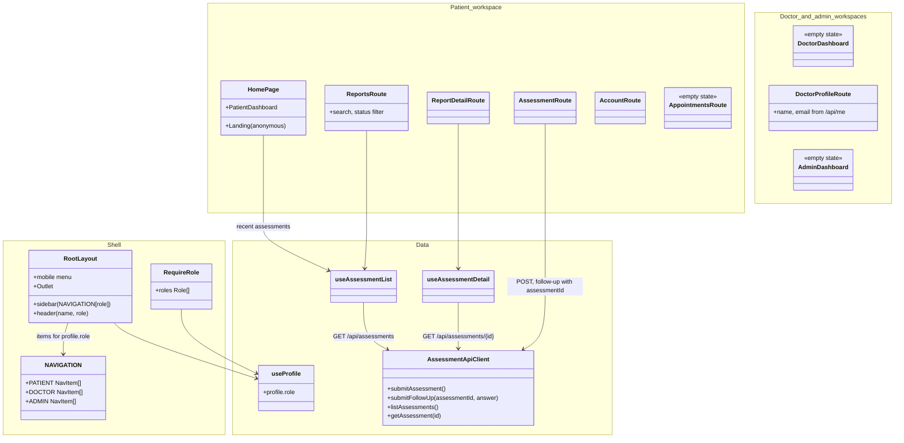
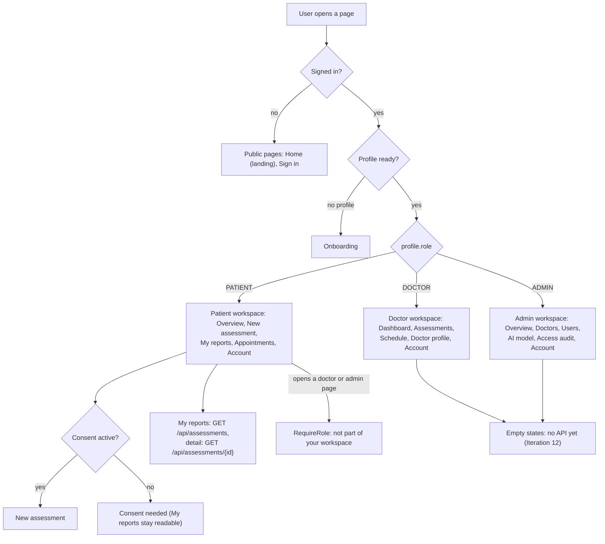
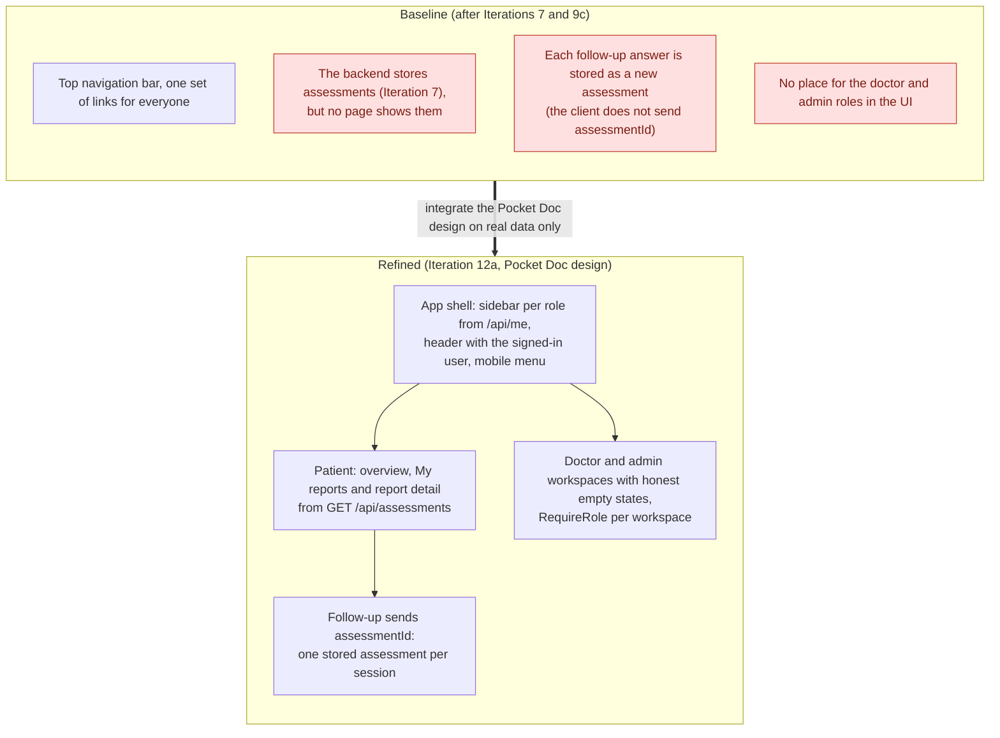

# MDD Iteration 12a — Pocket Doc App Shell and Role Workspaces (React)

Design and model-to-code record for Iteration 12a of the Model Driven Development cycle (Lab05,
Problem 1). The slice: integrate the **Pocket Doc** design (a Figma Make prototype) into the
patient web app. The app gets a shell with a sidebar for each role (patient, doctor,
administrator). The patient gets an overview and a **My reports** history built on the stored
assessments from Iteration 7. The doctor and administrator workspaces get their place in the app,
with honest empty states, because their APIs do not exist yet.

- **Anchored to:** UC1 (patient triage, the patient's own results), FR-G1 (consent), NFR-1 (only
  the owner reads health data), FR-D1 and the roadmap's Iteration 12 (doctor and admin apps —
  this is its first part, hence "12a").
- **Lives in:** `disease-prediction-fe` only. It uses the backend contract of Iteration 7 as it is.
- **Code:** branch `feat/pocket-doc-app-shell`, PR into `develop`.
- **Status:** done. Steps 5 and 6 are filled in after implementation.
- **Out of scope:** the doctor inbox, report sending, appointments and the admin console (no API
  yet); the role switcher of the prototype (a user cannot choose their role).

> Render the `.mmd` files with the VS Code *Markdown Preview Mermaid* extension, IntelliJ's
> Mermaid plugin, or by pasting into <https://mermaid.live>. GitHub renders the fenced `mermaid`
> blocks below automatically.

---

## Step 1 — Requirements envisioning

- Use the Pocket Doc design for the whole app: a sidebar, a header with the signed-in user, page
  headers, cards, badges and a mobile menu.
- The sidebar shows the workspace of the user's role. The role comes from `GET /api/me`. The
  prototype lets the viewer switch roles; the app does not, because the backend decides the role.
- The patient sees an overview (start an assessment, latest assessment, consent status, recent
  assessments), the assessment form, **My reports** (the list of stored assessments) and a report
  detail page, plus the account page.
- Pages without an API (appointments, the doctor inbox, schedule, the admin console) show an
  empty state that says the feature is not available yet. **No sample data** from the prototype
  is shown, so nothing on screen can be mistaken for a real patient, doctor or report.
- My reports stays readable after consent is withdrawn (GDPR right of access, as in Iteration 7).

## Step 2 — Architecture / platform envisioning

The slice lives in the React frontend. It changes no service contract:

| Need | Backend support (develop) | Frontend result |
| --- | --- | --- |
| Role of the user | `GET /api/me` → `role` | Sidebar per role, `RequireRole` per workspace |
| Assessment history | `GET /api/assessments` (Iteration 7) | Overview and My reports |
| One assessment | `GET /api/assessments/{id}` (Iteration 7) | Report detail page |
| Follow-up on a stored assessment | `POST /api/assessments/followup` with `assessmentId` | The loop updates one stored assessment |
| Appointments, doctor inbox, admin console | none | Empty states |

While building My reports, the integration found a gap: the frontend sent follow-up answers
without `assessmentId`. The backend then took its stateless path and stored **a new assessment for
every answer**. The history would show one row per question. The fix is in this iteration: the
client sends the `assessmentId` from the first response with every answer.

## Step 3 — Model the slice

### Structural model (`app_shell_class.mmd`)

### Workspace routing (`workspace_routing.mmd`)

### Baseline vs refined (`baseline_vs_refined.mmd`)

## Step 4 — Model-to-code transformation

All paths are in `disease-prediction-fe`.

- **Shell:** `routing/RootLayout.tsx` (sidebar, header, mobile menu, sign-out),
  `routing/navigation.ts` (`NAVIGATION` per role, public items, role labels).
- **Guards and routes:** `routing/guards/RequireRole.tsx` (one workspace per role);
  `routing/appRouter.tsx` adds `/reports`, `/reports/:assessmentId`, `/appointments`,
  `/doctor/*` and `/admin/*`; `routing/paths.ts` adds the paths and `reportPath(id)`.
- **Data:** `domain/history.ts` (`AssessmentSummary`, `AssessmentDetail`, `ReportStatus` and
  guards that mirror the OpenAPI schemas); `AssessmentApiClient` gets `listAssessments()` and
  `getAssessment(id)`; `HttpAssessmentApiClient` implements them (404 →
  `AssessmentNotFoundError`); `application/useStoredAssessments.ts` loads them for the pages.
- **Patient pages:** `HomePage` (public landing, or the dashboard of the role);
  `ReportsRoute` (search and report-status filter); `ReportDetailRoute` (symptoms shared,
  urgency banner, result, report status); `components/ReportRows.tsx`.
- **Doctor and admin pages:** `routing/routes/workspaces.tsx` — dashboards and pages with empty
  states; the doctor profile shows the real name and email from `/api/me`.
- **Restyled, same behaviour:** the assessment form, follow-up question, result, urgency banners,
  account (settings sections), login, onboarding. Sign-out moved to the sidebar.
- **Follow-up fix:** `useAssessment.answerFollowUp` sends `assessmentId`; `FollowUpRequest` has the
  optional field.
- **Styles:** `styles.css` follows the prototype but keeps the app's colour tokens, so dark mode
  still works. No text is smaller than 12px (the prototype used 8–10px).

## Step 5 — Validate / test

| Check | Result |
| --- | --- |
| Type check, ESLint, Prettier, production build | pass |
| Unit tests | 140 pass (17 new: client list/detail and error mapping, history guards and labels) |
| Integration tests (real routes, providers, HTTP client, MSW backend) | 61 pass (15 new) |

The new integration suite checks: the patient, doctor, administrator and public navigation; the
mobile menu; My reports (list, open a report, status filter, search, empty state, retry after an
error, unknown id, readable without consent); the empty states of appointments, the doctor and the
admin pages; and that `RequireRole` keeps each workspace to its role. The follow-up tests now
check that `assessmentId` is sent.

The public landing page was checked in a browser, in light and dark mode and at phone width. The
signed-in pages need a running Hanko and backend; they are covered by the integration tests only.

## Step 6 — Review & refine the model

1. **Design without fake data.** The prototype is full of sample patients, doctors and reports.
   Only screens with a real API show data. The others keep their place in the navigation and say
   what is missing, so the app never shows a record that does not exist.
2. **The role is not a UI choice.** The prototype's "Viewing as" switch is a design-review tool.
   In the app the sidebar follows `profile.role`, and `RequireRole` blocks the other workspaces.
   The backend still checks the role on every request.
3. **Integration found a real defect.** Without `assessmentId`, each follow-up answer became a new
   stored assessment. Building the history page made this visible; the fix makes the frontend use
   the stateful contract of Iteration 7.
4. **Accessibility kept.** Navigation is a labelled list of links, the current page has
   `aria-current`, icons are hidden from screen readers, the emergency banner is still an alert,
   and the focus still moves to the page heading after navigation.
5. **Next step (Iteration 12):** the doctor inbox needs a report-sending API and a doctor-side
   read endpoint; the admin console needs doctor invitations and user management. The empty
   states mark where they go.

## Roadmap check (update)

Changes since the check in Iteration 9c:

| Roadmap iteration | Status |
| --- | --- |
| 7 — Health-data persistence (Java BE) | Done (`iteration7/`); now shown in the UI (My reports) |
| 12 — Doctor and admin apps (React) | Started: shell, workspaces and empty states (this iteration); the doctor inbox and admin console need their APIs |
| 10, 11, 13 | Unchanged |
