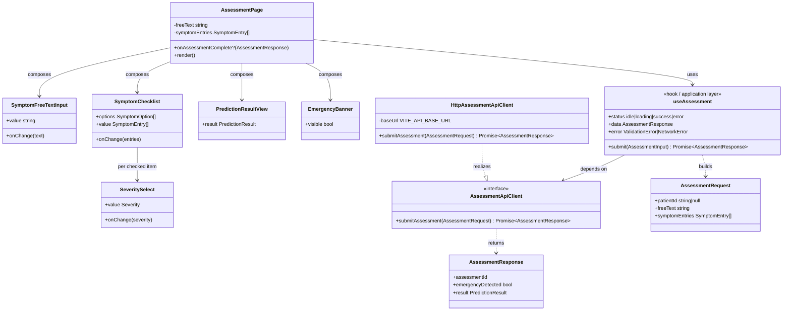
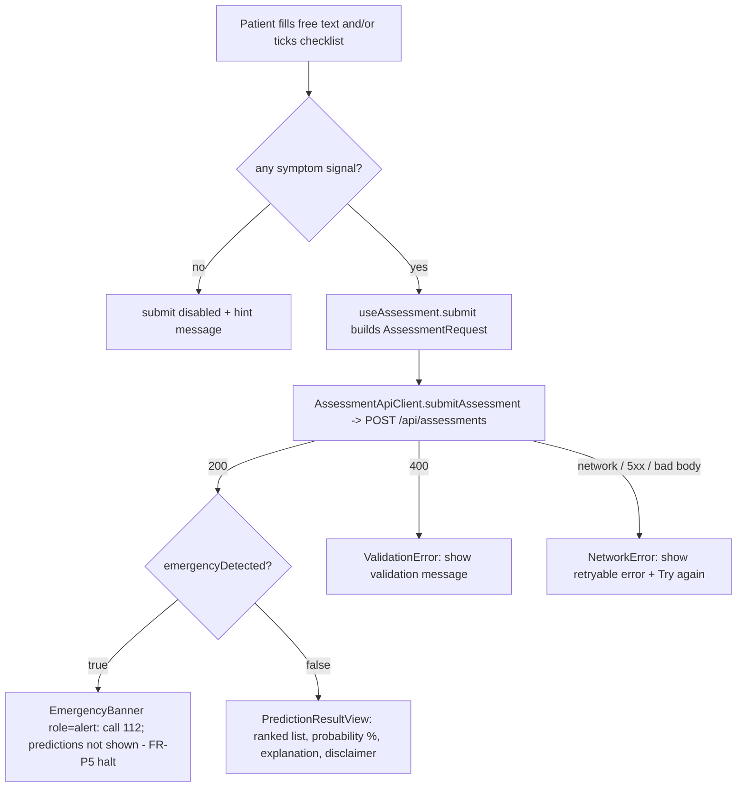

# MDD Iteration 3 — Patient Web App: Symptom Prediction Feature

Diagrams and model-to-code traceability for Iteration 3 of the Model Driven Development cycle.
The slice: a patient describes symptoms (free text **and/or** a structured checklist) in the
Patient Web App, submits, and sees the ranked predictions — or an emergency alert.

- **Anchored to:** FR-P1 (free text / checklist), FR-P2 (ranked diseases with probability),
  FR-P3 (explanation + disclaimer), FR-P5 / UC2 (emergency alert → 112), UC1 (triage flow).
- **Lives in:** `disease-prediction-fe` — the C4 container "Patient Web App (React)". Code
  paths below are relative to that repo.
- **Talks to:** only `POST /api/assessments` on the Java backend (`disease-prediction-be`,
  Iteration 2). It never calls the Python prediction service directly.
- **Scope:** a single page, no client-side routing (routing is Iteration 4).

> The diagrams are embedded below and rendered by GitHub. The `.mmd` files keep their editable
> source.

---

## Step 3 — Model the slice

### Contract the frontend is derived from

Source of truth: `disease-prediction-be/src/main/java/com/diseaseprediction/controller/dto/`.
`src/domain/assessment.ts` mirrors these records field-for-field:

| Backend record / enum | TypeScript mirror |
| --- | --- |
| `AssessmentRequest(UUID patientId, String freeText, List<SymptomEntryDto> symptomEntries)` | `interface AssessmentRequest` |
| `SymptomEntryDto(String rawText, Severity severity, int durationDays, boolean isMapped)` | `interface SymptomEntry` |
| `Severity { MILD, MODERATE, SEVERE }` | `type Severity = 'MILD' \| 'MODERATE' \| 'SEVERE'` |
| `AssessmentResponse(UUID assessmentId, boolean emergencyDetected, PredictionResultDto result)` | `interface AssessmentResponse` |
| `PredictionResultDto(UUID resultId, Instant generatedAt, String disclaimer, List<…> predictions)` | `interface PredictionResult` |
| `DiseasePredictionDto(int rank, double probability, String diseaseName, ExplanationDto explanation)` | `interface DiseasePrediction` |
| `ExplanationDto(String summary, Map<String, Double> contributionWeights)` | `interface Explanation` |
| `AssessmentRequest.hasAnySymptomSignal()` | `hasAnySymptomSignal()` |

### Structural model (`assessment_feature_class.mmd`)

### Behavioural model (`assessment_feature_flow.mmd`)

### Baseline vs refined (`baseline_vs_refined.mmd`)

**What changed and why:** the baseline repo held only CI and pre-commit config; the C4
container "Patient Web App (React)" was named but unrealised. Iteration 3 adds the component
model (view → hook → API-client port → types) because the requirement needs two input modes
feeding one submit, an emergency path (FR-P5), and a result view (FR-P2/P3). Putting the HTTP
call behind `AssessmentApiClient` mirrors the backend's `PredictionClient` port/adapter, so the
structure matches across tiers and the UI is testable without the live backend.

---

## Step 4 — Model-to-code transformation

| Model element | Code element | File |
| --- | --- | --- |
| `AssessmentRequest`, `AssessmentResponse`, `PredictionResult`, `SymptomEntry`, `Severity` | TS interfaces / union + `hasAnySymptomSignal`, `isAssessmentResponse` guards | `src/domain/assessment.ts` |
| Checklist vocabulary (`SymptomOption`) | curated 15-item subset of `CANONICAL_SYMPTOMS`, `toSymptomEntry` | `src/domain/symptoms.ts` |
| `AssessmentApiClient` (interface) | `interface AssessmentApiClient` | `src/api/AssessmentApiClient.ts` |
| `HttpAssessmentApiClient` (realisation) | `class HttpAssessmentApiClient` over `fetch`, base URL from `VITE_API_BASE_URL` | `src/api/HttpAssessmentApiClient.ts` |
| Error taxonomy | `ValidationError` (400), `NetworkError` (network / non-2xx / bad body) | `src/api/errors.ts` |
| Client injection seam | `AssessmentApiContext` (defaults to the HTTP adapter) | `src/api/AssessmentApiContext.ts` |
| `useAssessment` (application layer) | React hook + `buildAssessmentRequest` | `src/application/useAssessment.ts` |
| `SymptomFreeTextInput` | component (labelled textarea) | `src/components/SymptomFreeTextInput.tsx` |
| `SymptomChecklist` | component (labelled checkboxes → `SymptomEntry[]`) | `src/components/SymptomChecklist.tsx` |
| `SeveritySelect` | component (per checked symptom, default `MODERATE`) | `src/components/SeveritySelect.tsx` |
| `PredictionResultView` | component (rank, %, explanation, contributing symptoms, disclaimer) | `src/components/PredictionResultView.tsx` |
| `EmergencyBanner` | component (`role="alert"`, `tel:112`) | `src/components/EmergencyBanner.tsx` |
| `AssessmentPage` | page composing all of the above, owns form state | `src/pages/AssessmentPage.tsx` |
| App root | renders `<AssessmentPage/>` directly (no router) | `src/App.tsx` |

Implementation rules applied:

1. Checked item → `{ rawText: <canonical id>, severity: <select, default MODERATE>, durationDays: 0, isMapped: true }`.
   Free text goes into `freeText` only (trimmed); the frontend does not parse it.
2. Submit is disabled while `hasAnySymptomSignal` is false, so a known-empty request is never sent.
3. `emergencyDetected === true` → `EmergencyBanner` above the form and no predictions at all
   (FR-P5 / UC1 seq. "prediction … halted"; activity A11–A13 ends the flow at the alert).
4. The disclaimer is always rendered (falls back to "This is not a medical diagnosis." if empty).
5. No hard-coded backend URL: `VITE_API_BASE_URL`, empty = same-origin `/api` (see Step 6, item 1).
6. Placeholder IDs only in fixtures; `patientId` is sent as `null` (no auth yet).

---

## Step 5 — Validate / test

| Check | Command | Result (local, Node 20.11 / npm 10.9) |
| --- | --- | --- |
| Build | `npm run build` | ✅ |
| Lint + format | `npm run lint`, `npm run format:check` | ✅ 0 warnings |
| Unit tests | `npm test` (Vitest project `unit`) | ✅ 6 files, 51 tests |
| Integration tests | `npm run test:integration` (RTL + MSW, project `integration`) | ✅ 1 file, 8 tests |
| Coverage | `npm run coverage` → `coverage/lcov.info` | ✅ 100 % lines, 96 % branches |
| Dependency scan | `npm audit --audit-level=high` | ✅ (13 moderate, dev-only: `minimatch` via ESLint 9) |

Unit tests: `SymptomChecklist` toggles → correct `SymptomEntry[]`; `useAssessment` builds the
contract payload and never calls the client without a symptom signal; `PredictionResultView`
renders rank, %, name, explanation and disclaimer; `EmergencyBanner` renders (`role="alert"`,
112) only when visible; `HttpAssessmentApiClient` error mapping; domain guards.

Integration tests (`src/pages/AssessmentPage.integration.test.tsx`, MSW-mocked
`POST /api/assessments`): free-text-only submit, checklist-only submit (asserts the exact wire
payload), emergency response, 400, network error (+ retry), 5xx, and the
`onAssessmentComplete` hand-off used by Iteration 4.

Manual smoke against the live backend (run): `disease-prediction-be` on `main` started with
`./mvnw spring-boot:run` (port overridden because 8080 was taken locally) and `npm run dev`
with `VITE_API_PROXY_TARGET` pointing at it. Free text + checklist submit → 200 through the Vite
proxy, ranked prediction and disclaimer rendered (the backend still returns its
`StubPredictionClient` result). Free text "I have chest pain" → 112 banner shown.

---

## Step 6 — Review & refine the model

1. **Backend has no CORS → same-origin by default.** `disease-prediction-be` exposes no CORS
   configuration, so a browser on `:5173` cannot call `:8080` directly. `VITE_API_BASE_URL`
   therefore defaults to empty (same-origin `/api/...`): the Vite dev server proxies `/api` to
   `VITE_API_PROXY_TARGET` (default `http://localhost:8080`), and in production a reverse proxy
   (or a backend CORS config) is expected. Carry-forward: add a `CorsConfigurationSource` to the
   backend, or front both containers with one ingress.
2. **Java/Spring vs FastAPI divergence confirmed.** The C4 container model in
   `../../requirments.md` §7.2 labels the API Backend "Python/FastAPI"; the implemented backend is
   **Java / Spring Boot**. The frontend targets the implemented contract. The C4 label should be
   updated to "Java / Spring Boot" in `disease-prediction-docs` (not changed here).
3. **Per-symptom severity works for the MVP.** One `SeveritySelect` per *checked* item keeps the
   form short (selects only appear on demand). `durationDays` stays `0`; collecting duration is a
   candidate refinement once the classifier uses it.
4. **Shared OpenAPI schema.** The TS types are hand-mirrored and guarded by `isAssessmentResponse`.
   Generating them from a backend OpenAPI document (springdoc) would keep the tiers in lockstep —
   candidate for a future iteration.
5. **Error taxonomy.** `ValidationError` vs `NetworkError` (with optional `status`) is enough for
   the UI today. A distinct timeout type would pair with the backend's open
   "prediction-service timeout/fallback" item from Iteration 2.
6. **Backend red-flag check ignores the checklist.** Found during the live smoke:
   `AssessmentApiService.detectEmergency` only scans `freeText`, so ticking "Chest pain" in the
   checklist does **not** set `emergencyDetected`. The frontend deliberately does not duplicate
   red-flag logic (the backend owns it); carry-forward for the backend: also evaluate mapped
   `symptomEntries` (e.g. `chest_pain`, `breathlessness`) in the red-flag chain.
7. **Out-of-scope hooks.** `patientId` is `null` until auth/consent (FR-G1) exists; the
   `AssessmentApiContext` seam is where an authenticated client would be injected. Specialty
   routing (FR-P4) would extend `PredictionResultView`.
8. **Routing readiness (feeds Iteration 4).** `AssessmentPage` owns its own form state, contains
   no navigation, and exposes `onAssessmentComplete(response)` so a router can take over result
   display without changing the page; `PredictionResultView` and `EmergencyBanner` are pure
   props-in components that a result/emergency route can render directly.
