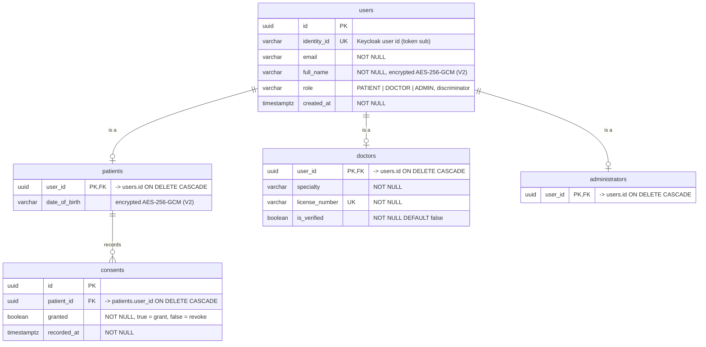
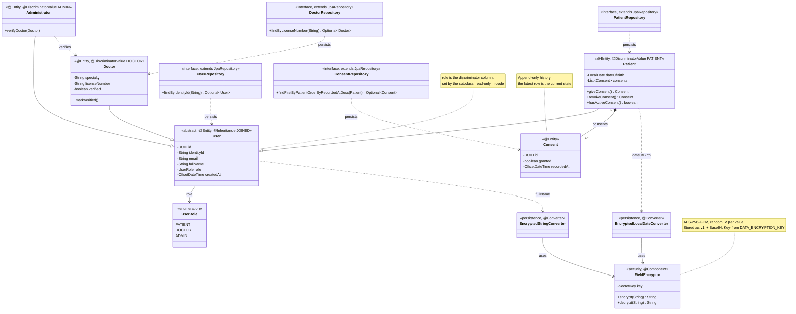
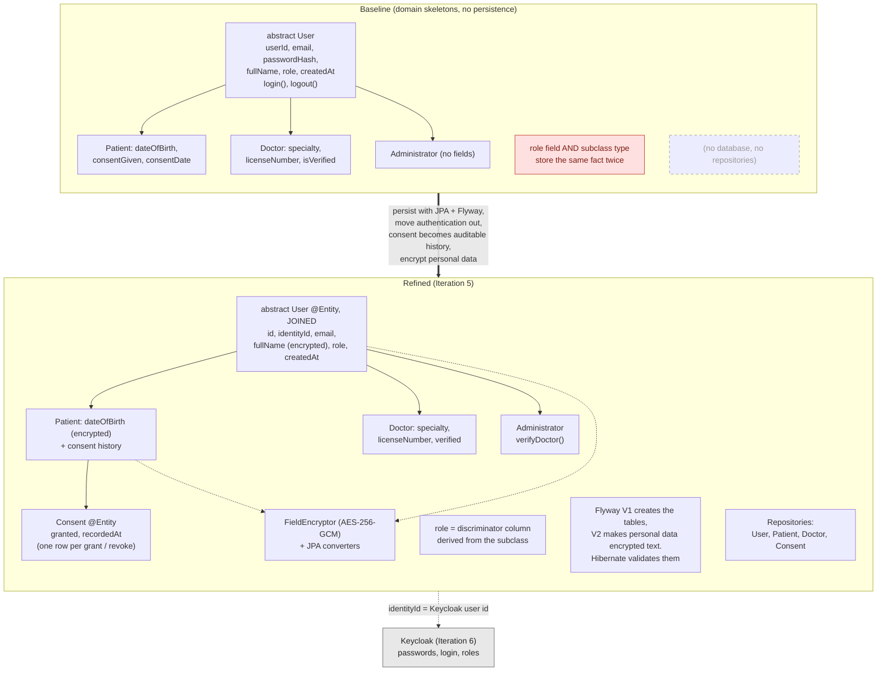

# MDD Iteration 5 — User and Consent Persistence (Java backend)

Diagrams and model-to-code traceability for Iteration 5 of the Model Driven Development cycle
(Lab05, Problem 1). The slice: store users (patients, doctors, administrators) and patient consent
in PostgreSQL, before any health data is stored, with personal data encrypted. The schema is
created and versioned by Flyway, and the JPA entities are derived from the model below.

- **Anchored to:** NFR-1 (GDPR Article 9, health data), FR-G1 (grant and revoke consent),
  FR-G2 / UC3 (delete account and data), UC1 step 1 (consent before symptom input).
- **Lives in:** `disease-prediction-be` (Java / Spring Boot), persistence layer.
- **Code:** branch `feat/user-persistence`, PR into `develop`.
- **Status:** implemented and tested. The iteration milestone ("User + consent data model
  merged") is reached when the PR is merged.

> Render the `.mmd` files with the VS Code *Markdown Preview Mermaid* extension, IntelliJ's
> Mermaid plugin, or by pasting into <https://mermaid.live>. GitHub renders the fenced
> `mermaid` blocks below automatically.

---

## Step 3 — Model the slice

### Data model (`user_consent_er.mmd`)

The tables created by Flyway: migration `V1` creates them, `V2` turns the personal-data columns
into encrypted text. Hibernate runs with `ddl-auto=validate`, so it checks the entities against
these tables and never creates or changes them itself.



### Structural model (`user_persistence_class.mmd`)



### Baseline vs refined (`baseline_vs_refined.mmd`)



### What changed from the baseline and why

1. **Inheritance is mapped with JOINED (table per subclass).** `users` holds the fields every user
   has; `patients`, `doctors` and `administrators` hold only their own fields and share the id of
   their `users` row. Compared with one single table, each type table can enforce its own rules
   (a doctor must have a unique license number) and a patient's personal data stays in its own
   table. Table per concrete class was rejected: without a shared `users` table the database
   cannot keep emails unique, and login would have to search several tables.
2. **`role` becomes the discriminator column.** The baseline stored the user type twice, in the
   `role` field and in the subclass, so the two could disagree. Now the subclass sets the role and
   the code can only read it.
3. **Authentication moves out of the domain.** `passwordHash`, `login()` and `logout()` are
   removed. Passwords, login and registration are handled by Keycloak in Iteration 6. The new
   `identityId` column holds the Keycloak user id (the `sub` claim of the login token). The neutral
   name keeps the column correct if the identity provider ever changes.
4. **Consent becomes history instead of a flag.** `consentGiven` and `consentDate` only kept the
   latest state. FR-G1 requires granting and revoking, and consent must be auditable, so each grant
   or revoke is a new `consents` row. The current state is the latest row.
5. **Deletion cascades.** Every child table references its parent with `ON DELETE CASCADE`, so
   deleting a `users` row removes the profile and all consent rows. This is the database part of
   FR-G2 / UC3; deleting the Keycloak account is added in Iteration 6.
6. **Personal data is encrypted by the application.** `full_name` and `date_of_birth` are
   encrypted with AES-256-GCM before they reach the database, so database access or a leaked
   backup does not expose them. Email stays in plain text because notifications need it and
   Keycloak holds it anyway. The key never reaches the database.
7. **Data minimization.** Keycloak stores only what is needed to log in. Date of birth, doctor
   specialty, license number and consent stay in this database, where migrations, cascades and
   exports cover them.

---

## Step 4 — Model-to-code transformation

Code lives under `src/main/java/com/diseaseprediction/` and `src/main/resources/`.

| Model element | Code element | Location |
| --- | --- | --- |
| ER model: 5 tables, FKs, cascades, unique keys, role check | Flyway `V1__create_users_and_consents.sql` | `resources/db/migration/` |
| Encrypted personal-data columns | Flyway `V2__encrypt_personal_data_columns.sql` (columns become text; refuses to run if users already exist) | `resources/db/migration/` |
| `User` (abstract, JOINED, role discriminator) | `@Entity @Table("users") @Inheritance(JOINED) @DiscriminatorColumn(name = "role")`; `role` field mapped read-only | `domain/User.java` |
| `Patient`, `Doctor`, `Administrator` | `@Entity` subclasses with `@PrimaryKeyJoinColumn(name = "user_id")` and `@DiscriminatorValue` | `domain/` |
| `Consent` (append-only history) | `@Entity` with `@ManyToOne(LAZY)` to `Patient`; all columns `updatable = false`; created only through `Patient.giveConsent()` / `revokeConsent()` | `domain/Consent.java` |
| `Patient` 1 → 0..* `Consent` | `@OneToMany(mappedBy = "patient", cascade = {PERSIST, MERGE}) @OrderBy("recordedAt ASC")` | `domain/Patient.java` |
| `Administrator.verifyDoctor()` | calls the package-private `Doctor.markVerified()`, so only domain code can verify a doctor | `domain/Administrator.java`, `domain/Doctor.java` |
| Repositories | Spring Data `JpaRepository` interfaces with the derived queries from the model | `repository/` |
| `FieldEncryptor` | AES-256-GCM component; key from `app.encryption.key` | `security/FieldEncryptor.java` |
| Encrypted attributes | `EncryptedStringConverter`, `EncryptedLocalDateConverter`, applied with `@Convert` on `User.fullName` and `Patient.dateOfBirth` | `persistence/` |
| Platform | PostgreSQL 18 in Docker Compose (`127.0.0.1:5433`); PostgreSQL driver, Spring Data JPA, Flyway | `compose.yaml`, `pom.xml` |
| Configuration | datasource and `DATA_ENCRYPTION_KEY` read from the gitignored `.env`; `ddl-auto=validate` | `application.properties`, `.env.example` |

**Design decision: the domain classes are the JPA entities.** A separate persistence model
(`PatientEntity` plus mappers, as in hexagonal architecture) was considered and rejected: it would
double the classes and mappers for every stored concept, model the JOINED inheritance twice, and
weaken the one-to-one model-to-code traceability this MDD process relies on. The domain holds no
other infrastructure: repositories stay in `repository/`, the encryption logic in `security/`.

---

## Step 5 — Validate / test

All tests run against a real PostgreSQL 18 started by Testcontainers, so Flyway runs the real
migrations and Hibernate's `validate` check must pass before any test runs.

`repository/UserPersistenceTest` (`@DataJpaTest`):

- `patientIsStoredInUsersAndPatientsWithRolePatient`: one `users` row with role `PATIENT`, one
  `patients` row, no `doctors` row.
- `doctorAndAdministratorGetTheirOwnTypeTables`: each type is written to its own table.
- `findByIdentityIdReturnsTheConcreteTypeWithItsRole`: lookup by Keycloak id returns a `Patient`.
- `duplicateIdentityIdIsRejected`, `duplicateLicenseNumberIsRejected`: unique keys hold.
- `grantThenRevokeKeepsBothRowsAndCurrentConsentIsRevoked`: two history rows; the current
  consent is "revoked".
- `deletingTheUserRowCascadesToProfileAndConsents`: a plain SQL `DELETE FROM users` removes the
  profile and the consents, so the cascade is enforced by the database, not by JPA.
- `personalDataIsEncryptedInTheDatabaseAndReadableThroughTheEntity`: the raw columns hold
  `v1:...` ciphertext without the name or birth year; reading through the entity returns the
  original values.

`security/FieldEncryptorTest` (unit): round trip; the same value encrypts differently each time;
`null` stays `null`; tampered values and values encrypted with another key are rejected; a
missing, non-Base64 or 16-byte key stops startup.

Verified locally on JDK 25 (the project's Java version) with Docker:

```
Tests run: 21, Failures: 0, Errors: 0, Skipped: 0
BUILD SUCCESS
```

(8 persistence + 6 encryptor + 6 existing controller tests + the application context test.)

Also verified against the local Docker database: `./mvnw spring-boot:run` applied `V1` and `V2`,
Hibernate's validation passed and the application started; without `DATA_ENCRYPTION_KEY` it
refuses to start and names the missing setting.

JaCoCo coverage after this iteration: 44.6 % of instructions overall; `persistence` 100 %,
`security` 90 %, `Patient` 90 %, `User` 79 %. The remaining gaps are older classes outside this
slice.

---

## Step 6 — Review & refine the model

What implementation taught us, folded back into the model above:

1. **Consent history needs a strict order.** Two consents recorded in the same microsecond would
   make "the latest row" ambiguous. Each new `Consent` gets a time strictly after the previous
   one (PostgreSQL stores microseconds, so times are truncated to microseconds first).
2. **The consent collection needs the MERGE cascade.** The first test run failed with a null
   `patient_id` in `consents` when an already-saved patient recorded a consent. Cascading MERGE
   as well as PERSIST fixed it; existing consent rows still cannot change, because every
   `Consent` column is `updatable = false`.
3. **Doctor verification became real behaviour.** `Administrator.verifyDoctor()` was an empty
   skeleton; it now sets the doctor's `verified` flag through a package-private method, so code
   outside the domain cannot mark a doctor as verified.
4. **Encryption was added as a second migration, not by editing the first.** `V1` had already
   been applied to the local database, and Flyway rejects a changed migration (checksum
   mismatch). `V2` evolves the schema instead, and stops if users already exist, because
   plaintext cannot be encrypted in SQL without the key.
5. **Encryption at rest and TLS moved to the deployment work.** Disk-level encryption and TLS to
   PostgreSQL need a deployed database, so they are configured by infrastructure (OCI Vault key,
   GitOps) rather than in this iteration. The backend is ready for it: the connection URL and
   credentials can be replaced through environment variables (`SPRING_DATASOURCE_URL`) without
   code changes. Field-level encryption (point 6 of Step 3) is the part that belongs to the
   application, and it is done here.
6. **Credentials and keys come from the environment.** The datasource and the encryption key are
   read from the gitignored `.env` (the same file Docker Compose uses). Tests use Testcontainers
   and an all-zero key that exists only in `src/test/resources/config/`.
7. **Tooling fixed on the way.** google-java-format was raised to 1.36.1 so Spotless runs on
   JDK 25, and JaCoCo now reports coverage on every test run.

**Open items for the next iterations:**

- No endpoint creates or reads users yet: first-login profile creation and the consent API come
  with Keycloak in Iteration 6.
- Encrypted columns cannot be searched or sorted in SQL. If searching by name is ever needed, it
  requires an extra searchable hash ("blind index").
- The `v1:` prefix prepares key rotation, but rotation itself is not implemented.
- CI runs only the application context test; the full suite and the coverage report run locally.
