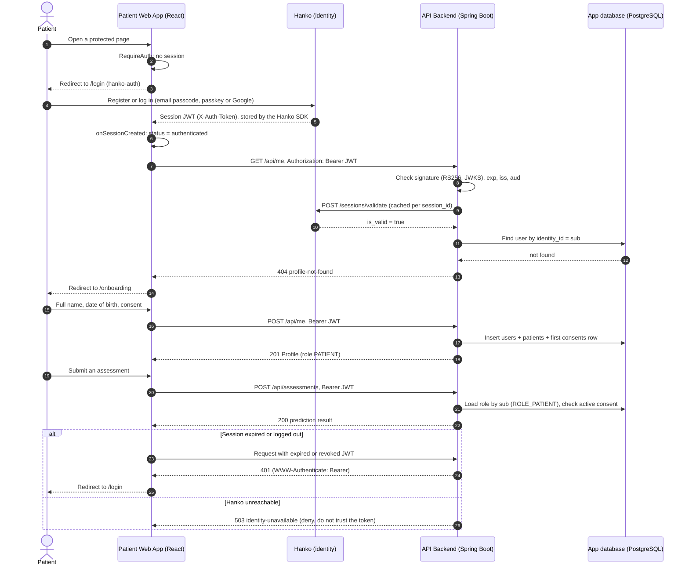
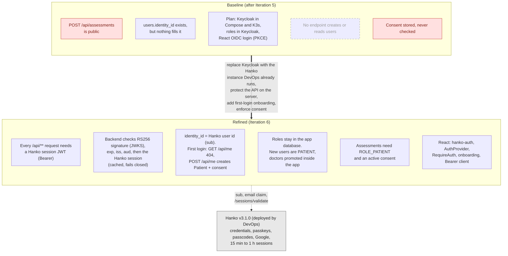
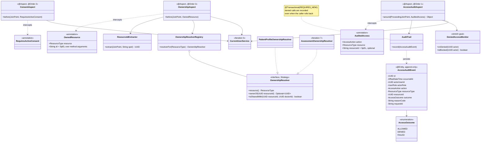

# MDD Iteration 6 — Identity and Login with Hanko (Java backend + React)

Design and model-to-code plan for Iteration 6 of the Model Driven Development cycle (Lab05,
Problem 1). The slice: patients register and log in through Hanko, every API request carries a
Hanko session token, the backend verifies it and maps it to the user stored in Iteration 5, and a
first-login onboarding step creates the patient profile and records consent.

- **Anchored to:** NFR-1 (GDPR Article 9: only the owner may reach health data), FR-G1 (grant and
  revoke consent), UC1 step 1 (consent before symptom input), domain rule "users must log in"
  (requirements, class diagram assumptions).
- **Lives in:** `disease-prediction-be` (security layer, profile API), `disease-prediction-fe`
  (login, onboarding, route guards), `disease-prediction-gitops` (Hanko settings).
- **Code:** one branch per repository, each with a PR (see Step 4).
- **Status:** designed. Steps 5 and 6 are filled in after implementation.
- **Part B (separate deliverable):** the AOP component, "Personal Data Access Guard", builds on
  this iteration. Its design is at the end of this page.

> Render the `.mmd` files with the VS Code *Markdown Preview Mermaid* extension, IntelliJ's
> Mermaid plugin, or by pasting into <https://mermaid.live>. GitHub renders the fenced
> `mermaid` blocks below automatically.

---

## Step 1 — Requirements envisioning

- Slice: register, log in, log out, first-login onboarding (profile + consent), consent grant and
  revoke, and server-side protection of the existing assessment API.
- Every `/api/**` endpoint requires login. There is no anonymous assessment.
- A new account is always a `PATIENT`. Doctors and administrators are never self-assigned.
- A patient without an active consent cannot submit an assessment (UC1 step 1).

Out of scope: account deletion (FR-G2, Iteration 7), doctor promotion and verification screens
(Iteration 12, Admin Console), the AOP component (Part B).

## Step 2 — Architecture / platform envisioning

### Hanko replaces Keycloak

Iteration 5 and the roadmap planned Keycloak. DevOps has since deployed Hanko v3.1.0 on the
Oracle K3s cluster, with separate dev and production instances, Google login, email passcodes,
passkeys, backups and NetworkPolicies (`disease-prediction-gitops/docs/operations/hanko.md`). We
use that instance instead of running Keycloak. The data model does not change: `identity_id` was
named neutrally in Iteration 5 for this reason.

| Roadmap item (Keycloak plan) | Iteration 6 with Hanko |
| --- | --- |
| Keycloak in Compose (realm, roles, default PATIENT, email verify) | Hanko in Compose for local work; default role and email verification handled as below |
| Spring OAuth2 Resource Server + role guards | Same, against Hanko's JWKS |
| Profile on first login (`GET /api/me`) | Same |
| Consent grant/revoke API (FR-G1) | Same |
| Doctor invitation via Keycloak Admin API | Moved to Iteration 12: done in the app, not in Hanko |
| React OIDC login (PKCE) + onboarding | Hanko Elements (`<hanko-auth>`) + onboarding. Hanko is not an OIDC provider |
| Keycloak on K3s via GitOps | Already done by DevOps for Hanko |

### Who stores what

| | Hanko database (`hanko_dev` / `hanko_prod`) | App database (Iteration 5 tables) |
| --- | --- | --- |
| Stores | Hanko user id, email addresses, passkeys, passcodes, Google link, sessions | role, full name (encrypted), date of birth (encrypted), consent history, doctor data |
| Owner | Hanko. The app never connects to it | The backend |
| Answers | Who is this person and did they prove it? | What is this person in the app and what may they do? |

The only link is the token's `sub` claim (the Hanko user id), stored in `users.identity_id`.

### Decisions

1. **Bearer token in the `Authorization` header.** Hanko's own cookie is host-only on the identity
   domain, so the browser never sends it to `/api/`. Hanko is configured with
   `enable_auth_token_header: true`, and the Hanko SDK keeps the returned token for the app. The
   app sends `Authorization: Bearer <token>`. No cookies reach the API, so CSRF protection is not
   needed and the API stays stateless. Tokens never go into URLs or logs.
2. **No refresh tokens; a longer session.** Hanko does not issue refresh tokens: the session JWT is
   the whole session. `session.lifespan` goes from 15 minutes to 1 hour (GitOps). When it expires,
   Hanko Elements fires a session-expired event and the app returns to `/login`.
3. **Two checks per request, failing closed.**
   - Offline: Spring Security's resource server checks the RS256 signature against Hanko's JWKS
     (Hanko signs with RS256, other algorithms are rejected), `exp`, `iss` and `aud`. Hanko has no
     OpenID discovery, so the JWKS URL is configured explicitly.
   - Online: a filter calls Hanko's `POST /sessions/validate` so logout and revocation take effect
     before the token expires. The answer is cached per `session_id` claim for 60 seconds (never
     past `exp`), so a logout reaches the API within a minute. If Hanko cannot be reached the
     request is denied with 503, never allowed.
4. **Roles stay in the app database.** Hanko v3.1.0 has organization roles, but they are managed
   only through its admin API (port 8001), which GitOps deliberately does not expose, and they are
   not in the JWT. Promoting a doctor needs app data anyway (specialty, license number,
   verification). The role is the Iteration 5 discriminator column; the backend turns it into a
   `ROLE_PATIENT` / `ROLE_DOCTOR` / `ROLE_ADMIN` authority on each request.
5. **Email comes from the token.** Hanko adds an `email` claim (`address`, `is_verified`) to the
   JWT by default. Onboarding copies it into `users.email` and requires `is_verified = true`; the
   browser never sends the email. The copy is refreshed when the token carries a different
   verified address.
6. **Registration is a Hanko setting.** `account.allow_signup` is `false` on both instances. The
   GitOps PR for this iteration enables it on dev only. Production stays closed until the checks
   in `hanko.md` ("Before enabling registration") pass.

### Environments

| Setting | Local (Compose) | Dev (K3s) | Production (K3s) |
| --- | --- | --- | --- |
| App origin | `http://localhost:5173` | `https://dev.pocket-doc.app` | `https://health.pocket-doc.app` |
| `VITE_HANKO_API_URL` (frontend build) | `http://localhost:8100` | `https://identity-dev.pocket-doc.app` | `https://identity.pocket-doc.app` |
| `HANKO_ISSUER` | `http://localhost:8100` | `https://identity-dev.pocket-doc.app` | `https://identity.pocket-doc.app` |
| `HANKO_JWKS_URI` | `http://localhost:8100/.well-known/jwks.json` | `http://hanko-dev.auth-system.svc.cluster.local:8000/.well-known/jwks.json` | `http://hanko-prod.auth-system.svc.cluster.local:8000/.well-known/jwks.json` |
| `HANKO_API_URL` (session check) | `http://localhost:8100` | `http://hanko-dev.auth-system.svc.cluster.local:8000` | `http://hanko-prod.auth-system.svc.cluster.local:8000` |
| `HANKO_AUDIENCE` | `pocket-doc-local` | `pocket-doc-dev` | `pocket-doc-prod` |

In the cluster the backend reaches Hanko over the in-cluster Service, which the Hanko
NetworkPolicy already allows for the matching backend. The issuer stays the public URL because it
must equal the token's `iss` claim. The local Hanko listens on host port 8100 because the
prediction service already uses 8000.

### Local development

Two ways to run the whole flow on a laptop:

1. **Local Hanko (default).** `compose.yaml` in the backend gains Hanko v3.1.0, its own
   PostgreSQL, and Mailpit, which catches the passcode emails (web UI on `localhost:8025`).
   Signup is on, passkeys work on `localhost`, users can be wiped with `docker compose down -v`,
   and the session lifespan can be shortened to test expiry. Google is not configured locally.
2. **Dev Hanko.** Point `VITE_HANKO_API_URL` and the backend `HANKO_*` variables at the dev
   column above. `http://localhost:5173` is an allowed origin there. Passkeys do not work (the
   relying party is `dev.pocket-doc.app`), and Google errors redirect to the dev site, not to
   localhost. Needs signup enabled on dev.

---

## Step 3 — Model the slice

### Login and first-login flow (`login_sequence.mmd`)

### Structural model (`identity_class.mmd`)

```mermaid
classDiagram
    namespace Backend {
        class SecurityConfig {
            <<@Configuration>>
            +securityFilterChain(HttpSecurity) SecurityFilterChain
        }
        class HankoProperties {
            <<@ConfigurationProperties app.auth.hanko>>
            -URI apiUrl
            -Duration sessionCheckTtl
        }
        class HankoSessionClient {
            <<interface>>
            +validate(String sessionToken) SessionStatus
        }
        class HttpHankoSessionClient {
            <<RestClient>>
        }
        class HankoSessionCheckFilter {
            <<OncePerRequestFilter>>
            -Cache sessionIdToStatus
        }
        class RoleAuthoritiesConverter {
            <<Converter Jwt to Authentication>>
            +convert(Jwt) AbstractAuthenticationToken
        }
        class AuthenticatedIdentity {
            <<record>>
            +String subject
            +String sessionId
            +String email
            +boolean emailVerified
        }
        class CurrentUserService {
            +identity() AuthenticatedIdentity
            +currentUser() Optional~User~
            +requirePatient() Patient
        }
        class ProfileController {
            <<implements generated ProfileApi>>
            +getProfile() Profile
            +createProfile(CreateProfileRequest) Profile
            +recordConsent(ConsentRequest) Profile
        }
        class ProfileService {
            +getProfile(AuthenticatedIdentity) Profile
            +createPatient(AuthenticatedIdentity, CreateProfileRequest) Profile
            +recordConsent(Patient, boolean) Profile
            +requireActiveConsent(Patient)
        }
        class UserRepository {
            <<Iteration 5>>
            +findByIdentityId(String) Optional~User~
        }
    }
    namespace Frontend {
        class AuthProvider {
            <<React context>>
            +status loading | anonymous | authenticated
            +getToken() string
            +logout()
        }
        class ProfileProvider {
            <<React context>>
            +status loading | needs-onboarding | ready
            +profile Profile
        }
        class RequireAuth {
            <<route guard>>
        }
        class RequireProfile {
            <<route guard>>
        }
        class LoginRoute {
            <<hanko-auth>>
        }
        class OnboardingRoute
        class AccountRoute {
            <<hanko-profile, consent, logout>>
        }
        class AuthorizedFetch {
            +fetch(path, init) Response
        }
        class HttpProfileApiClient
        class HttpAssessmentApiClient {
            <<Iteration 3>>
        }
    }

    SecurityConfig --> RoleAuthoritiesConverter : jwtAuthenticationConverter
    SecurityConfig --> HankoSessionCheckFilter : after bearer filter
    HankoSessionCheckFilter --> HankoSessionClient
    HttpHankoSessionClient ..|> HankoSessionClient
    HttpHankoSessionClient --> HankoProperties
    RoleAuthoritiesConverter --> UserRepository : role by sub
    CurrentUserService --> UserRepository
    CurrentUserService ..> AuthenticatedIdentity : creates from Jwt
    ProfileController --> ProfileService
    ProfileController --> CurrentUserService
    ProfileService --> UserRepository

    RequireAuth --> AuthProvider
    RequireProfile --> ProfileProvider
    ProfileProvider --> HttpProfileApiClient
    HttpProfileApiClient --> AuthorizedFetch
    HttpAssessmentApiClient --> AuthorizedFetch
    AuthorizedFetch --> AuthProvider : Bearer token, 401 means logout
```

### Baseline vs refined (`baseline_vs_refined.mmd`)

### API contract changes

Added to `src/main/resources/openapi/` (contract-first, like Iteration 2). All operations declare
the `bearerAuth` security scheme (`type: http`, `scheme: bearer`, `bearerFormat: JWT`) and a `401`
response. Errors use `application/problem+json` (RFC 9457) with a stable `type`.

| Operation | Who | Success | Errors |
| --- | --- | --- | --- |
| `GET /api/me` | any logged-in user | `200 Profile` | `404 profile-not-found` (first login) |
| `POST /api/me` | logged-in user without a profile | `201 Profile`, creates `Patient` + first consent | `400` validation, `400 consent-required` (consent must be `true`), `400 email-not-verified`, `409 profile-exists` |
| `POST /api/me/consents` | `PATIENT` | `201 Profile`, appends a grant or revoke row | `403` not a patient |
| `POST /api/assessments` (existing) | `PATIENT` with active consent | unchanged | `403 profile-required`, `403 consent-required` |

`Profile`: `id`, `email`, `fullName`, `role`, `dateOfBirth` (patients only, optional),
`consentGranted`. `CreateProfileRequest`: `fullName` (1–255 characters), `dateOfBirth` (optional,
in the past), `consentGranted` (must be `true`). `ConsentRequest`: `granted`.

### Request authorization rules

| Request | Rule |
| --- | --- |
| No or invalid token, wrong `iss`/`aud`, expired, not RS256 | `401`, `WWW-Authenticate: Bearer` |
| Hanko says the session is invalid (logout, revoked) | `401` |
| Hanko unreachable | `503 identity-unavailable` |
| `GET /api/me`, `POST /api/me` | authenticated |
| `POST /api/me/consents`, `POST /api/assessments` | `ROLE_PATIENT` |
| Any other `/api/**` | authenticated (later endpoints add their own role rules) |

The Kubernetes probes use TCP checks, so no public health endpoint is needed.

### What changed from the baseline and why

1. **The API is protected on the server.** Until now `POST /api/assessments` was public. Route
   guards in React only improve the user experience; the backend rejects every request without a
   valid token.
2. **Keycloak is replaced by the Hanko instance DevOps already runs.** Running a second identity
   provider would duplicate the work and the attack surface. Hanko is not an OIDC provider, so the
   React side uses Hanko Elements instead of an OIDC library.
3. **Revocation is checked online but cached.** Offline JWT validation alone would accept a
   logged-out token for up to an hour. Calling Hanko on every request would make Hanko a
   bottleneck. A 60-second cache per session is the compromise.
4. **Roles do not move to Hanko.** See Step 2, decision 4.
5. **Onboarding is a separate step after login.** Hanko collects only what it needs to log in.
   Personal and medical data (name, date of birth, consent) stay in the app database, where the
   Iteration 5 encryption, cascades and consent history cover them (data minimization, NFR-1).
6. **Consent is enforced, not only stored.** Iteration 5 stored consent history; now an assessment
   without an active consent is refused. In this iteration the check is a direct call to
   `ProfileService.requireConsentingPatient`; Part B replaces it with the `@RequiresActiveConsent`
   annotation.

---

## Step 4 — Model-to-code transformation (planned)

### Backend (`disease-prediction-be`, branch `feat/hanko-authentication`)

| Model element | Code element | Location |
| --- | --- | --- |
| Offline JWT check | `spring-boot-starter-oauth2-resource-server`; `spring.security.oauth2.resourceserver.jwt.issuer-uri`, `jwk-set-uri`, `audiences`, `jws-algorithms=RS256` from `HANKO_*` | `pom.xml`, `application.properties` |
| `SecurityConfig` | stateless `SecurityFilterChain`, CSRF off, rules from the table above, problem+json 401/403 | `security/SecurityConfig.java` |
| `HankoProperties` | `@ConfigurationProperties("app.auth.hanko")`: `apiUrl`, `sessionCheckTtl` | `security/hanko/` |
| `HankoSessionClient`, `HttpHankoSessionClient` | `RestClient` call to `POST /sessions/validate` with `{"session_token": ...}` | `security/hanko/` |
| `HankoSessionCheckFilter` | runs after `BearerTokenAuthenticationFilter`; Caffeine cache keyed by `session_id`; 401 or 503 | `security/hanko/` |
| `RoleAuthoritiesConverter` | loads the user by `sub`, adds `ROLE_<role>`. Created by `SecurityConfig`, not a bean: Spring MVC would register any `Converter` bean as a web type converter | `security/` |
| `AuthenticatedIdentity`, `CurrentUserService` | built from the `Jwt` principal | `security/` |
| Profile API | OpenAPI `profile-api.yaml` → generated `ProfileApi` + DTOs; `ProfileController`, `ProfileService` | `resources/openapi/`, `controller/`, `service/profile/` |
| Consent on assessments | `AssessmentApiService.runAssessment` calls `ProfileService.requireConsentingPatient()` first (the backend rule: controllers only delegate) | `service/assessment/` |
| Local Hanko | `compose.yaml`: `hanko-db`, `hanko-migrate`, `hanko` (`127.0.0.1:8100`), `mailpit`; `local/hanko/config.yaml` | repository root |
| Stale comments | "Keycloak" → "Hanko" in the Java comments (`User.java` and others). `V1__create_users_and_consents.sql` is not edited: any change alters its Flyway checksum and breaks databases where it already ran | `domain/` |

### Frontend (`disease-prediction-fe`, branch `feat/hanko-login`)

| Model element | Code element | Location |
| --- | --- | --- |
| Hanko client | `@teamhanko/hanko-elements` 3.1.0 (matches the server), `register(VITE_HANKO_API_URL)` | `src/auth/hanko.ts` |
| `AuthProvider` | context over Hanko session events (`onSessionCreated`, `onSessionExpired`, `onUserLoggedOut`) | `src/auth/` |
| `AuthorizedFetch` | adds `Authorization: Bearer`, maps `401` to logout and redirect to `/login` | `src/api/` |
| `HttpProfileApiClient`, `ProfileProvider` | `GET/POST /api/me`, `POST /api/me/consents` | `src/api/`, `src/application/` |
| `RequireAuth`, `RequireProfile` | route guards around all existing routes | `src/routing/` |
| `LoginRoute`, `OnboardingRoute`, `AccountRoute` | `/login` (`<hanko-auth>`), `/onboarding`, `/account` (`<hanko-profile>`, consent, logout) | `src/routing/routes/` |
| Build setting | `VITE_HANKO_API_URL` in `vite-env.d.ts`, `.env.example`, `Dockerfile.prod` build argument and CI for dev and production | repository root |

### GitOps (`disease-prediction-gitops`, branch `feat/hanko-dev-signup`)

| Change | File |
| --- | --- |
| `account.allow_signup: true`, `session.lifespan: 1h` (dev only) | `clusters/oracle/auth/hanko/development.yaml` |
| Later, with the backend release: `HANKO_*` variables for the dev backend | `clusters/oracle/disease-prediction/` |

---

## Step 5 — Validate / test (planned)

Backend (JUnit, MockMvc, Testcontainers):

- Tokens signed with a test RSA key and served from a test JWKS: valid token accepted; missing
  token, expired token, wrong issuer, wrong audience, other signing key, `HS256` and `none`
  rejected with 401.
- Session check: valid session passes; invalid session 401; Hanko down 503; a second request in
  the cache window does not call Hanko; a token is never written to the logs.
- Profile: `GET /api/me` 404 before onboarding; `POST /api/me` creates `users`, `patients` and one
  `consents` row with the email from the token; second `POST` 409; `consentGranted: false` 400;
  unverified email 400; one user cannot read another user's profile.
- Assessments: no profile 403; revoked consent 403; patient with consent 200; doctor 403.

Frontend (Vitest, Testing Library, MSW): guards redirect to `/login` and `/onboarding`; the API
client sends the header; a 401 logs out; onboarding submits and lands on the assessment page.

End to end, locally with Compose: register with a passcode from Mailpit, onboard, run an
assessment, revoke consent and see the assessment refused, log out and see the old token refused
within a minute, wait for expiry with a short local lifespan.

## Step 6 — Review & refine the model

Findings from the backend (PR `feat/hanko-authentication`) and frontend (PR `feat/hanko-login`).

1. **The consent check moved from the controller to the service.** The backend convention keeps
   controllers as pure delegates, so `AssessmentApiService` calls
   `ProfileService.requireConsentingPatient()` before any validation or prediction.
2. **The role converter is not a Spring bean.** Spring MVC registers every `Converter` bean as a
   web type converter, which broke the controller slice tests. `SecurityConfig` creates it.
3. **Hanko asks for a password at registration.** Hanko v3.1.0 enables passwords by default
   (`password.enabled: true`), and neither the local nor the dev configuration turns them off.
   Registration is therefore: email, passcode, password, optional MFA. The local configuration
   mirrors dev. Whether to keep passwords (or rely on passcodes, passkeys and Google only) is a
   decision for the team and DevOps.
4. **Verified against the real Hanko.** A local registration produced a token with exactly the
   modelled claims (`sub`, `session_id`, `email.address`, `email.is_verified`, `aud`, RS256, 1 hour
   lifetime). After a Hanko logout, the API refused the token once the 60-second cache window had
   passed.
5. **Sign-out must leave the protected page first.** Ending the session while still on a
   protected route let its guard redirect to `/login` before the app could go home. The app now
   navigates to the home page, then ends the session.
6. **The Hanko URL is set in the Dockerfiles.** The shared container workflow passes no build
   arguments, so `VITE_HANKO_API_URL` defaults to the dev Hanko in `Dockerfile.dev` and to the
   production Hanko in `Dockerfile.prod`. Hanko Elements load on demand in their own chunk.
7. **Verified in a real browser.** Playwright (Chromium) against the local Hanko, the real backend
   and the Vite dev server: register (passcode from Mailpit, password), onboarding (save disabled
   without consent), assessment, withdraw and give consent, reload, sign out, sign in again with
   the password. Every API call carried the Bearer token.

---

## Part B — AOP component: Personal Data Access Guard

Lab requirement: "Implement a component for security or for analysis of SQL statements or for
caching or for debugging or for wacky using AOP." This component is the security option. It is a
separate deliverable that starts once Iteration 6 login works.

### Purpose

Spring Security (Iteration 6) answers "is this a logged-in patient?". It does not answer "is this
the patient's own record?", "has this patient consented?", or "who accessed which personal data
and was it allowed?". These checks cut across every controller and service that touches personal
or health data, which is why they fit aspect-oriented programming: business methods declare the
rule with an annotation, and aspects enforce and record it.

### Structural model (`access_guard_class.mmd`)

### Behaviour

1. **`@AuditedAccess` (outermost aspect).** Wraps the call. Records `ALLOWED` when it returns,
   `DENIED` when an `AccessDeniedException` passes through it (including denials from the inner
   aspects), `FAILED` for other exceptions, then rethrows. The event holds the actor's app user id
   and role, the action, resource type and id, the outcome, a reason code and the request id. It
   never holds tokens, names, dates of birth or symptoms.
2. **`@RequiresActiveConsent`.** Loads the current patient and denies the call without an active
   consent. Replaces the direct check from Iteration 6.
3. **`@OwnedResource(resource = ASSESSMENT, id = "#assessmentId")`.** Evaluates the SpEL
   expression against the method arguments to get the resource id, asks the
   `OwnershipResolver` for that resource type who owns it, and allows only the owner (or, for
   resources shared with a doctor, that doctor). Unknown ids are denied the same way as foreign
   ids, so the response does not reveal whether a record exists.
4. **`AuditTrail`** writes in a new transaction (`REQUIRES_NEW`), so a denied call is recorded even
   when the surrounding transaction rolls back.
5. **Append-only audit table.** Flyway `V3` creates `access_audit_events` and a trigger that
   rejects `UPDATE` and `DELETE`, so the application cannot rewrite its own audit history.
6. **`DeniedAccessMonitor` (stretch goal).** Counts denials per actor in a sliding window; above
   a threshold it logs a security warning and blocks that actor for a few minutes.

Aspect order is fixed with `@Order`: audit (1) → consent (2) → ownership (3) → method.

### Where it is used

| Method | Annotations | When |
| --- | --- | --- |
| `ProfileController.getProfile` | `@AuditedAccess(READ, PATIENT_PROFILE)` | after Iteration 6 |
| `ProfileController.recordConsent` | `@AuditedAccess(UPDATE, CONSENT)` | after Iteration 6 |
| `AssessmentController.submitAssessment` | `@AuditedAccess(CREATE, ASSESSMENT)`, `@RequiresActiveConsent` | after Iteration 6 |
| `GET /api/assessments/{id}` | `@AuditedAccess(READ, ASSESSMENT)`, `@OwnedResource(ASSESSMENT, "#id")` | Iteration 7 |

### Tests

Unit tests per aspect with Spring AOP proxies over test beans: order of the aspects, SpEL
extraction, owner allowed, foreign and unknown ids denied the same way, denial recorded after a
rollback, no personal data in events. Integration tests with Testcontainers: the trigger rejects
`UPDATE` and `DELETE`; end-to-end denials through MockMvc produce audit rows.

### Open points

- **Audit rows and account deletion (FR-G2).** Keeping audit rows after an account is deleted is
  useful for security but conflicts with erasure. Options: keep them with the user id only
  (pseudonymous, no foreign key) for a fixed retention period, or delete them with the account.
  To decide before Iteration 7.
- **Who can read the audit trail.** An admin endpoint, or database access only.
