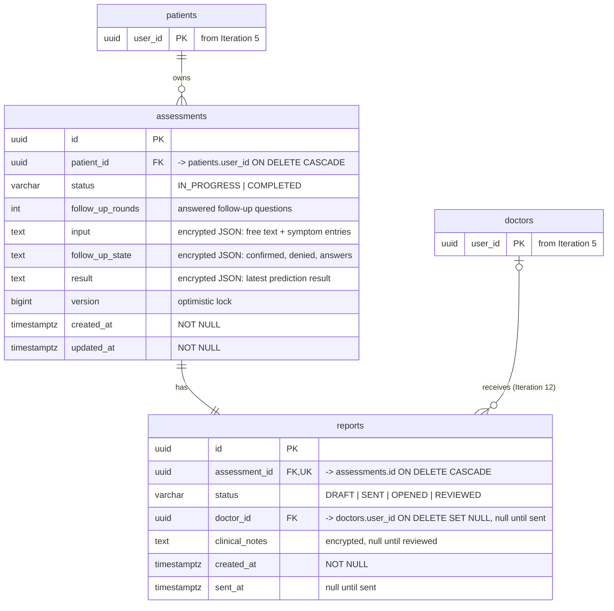
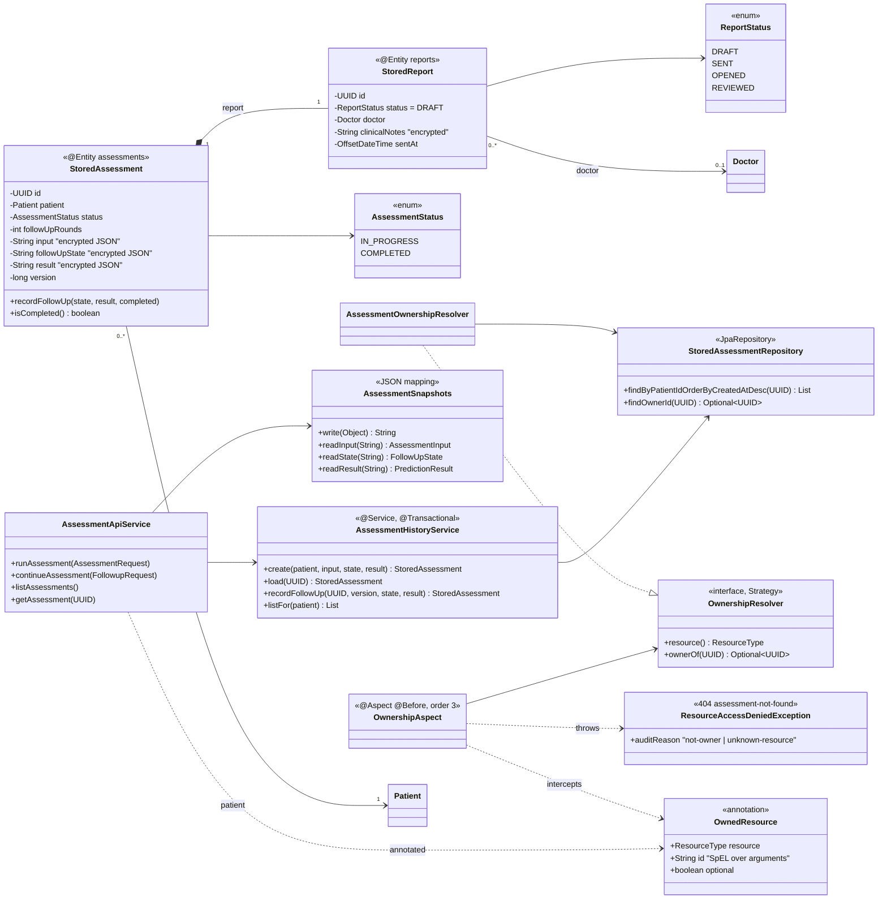
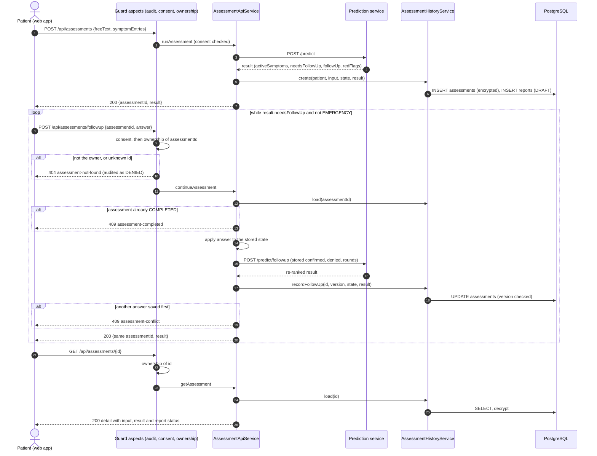
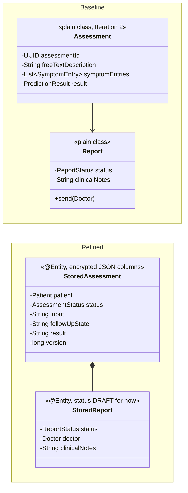

# MDD Iteration 7 — Health-Data Persistence (Java backend)

Design and model-to-code plan for Iteration 7 of the Model Driven Development cycle. The slice:
store every assessment a patient runs, with its symptoms, its follow-up answers and its latest
prediction result, plus a report that will later go to a doctor. The patient can list and open
their own assessments. Health data is encrypted, and only the owner can read it.

- **Anchored to:** NFR-1 (GDPR Article 9: only the owner may reach health data), UC1 steps 2–5
  (symptoms, prediction, report for a specialist), FR-P3 (follow-up questions), FR-D1 (the report
  a doctor will review), Part B of Iteration 6 (the ownership aspect).
- **Lives in:** `disease-prediction-be` (persistence, assessment API, access guard). The frontend
  follows in a separate step.
- **Code:** branch `feat/iteration7-health-data-persistence`, PR into `develop`.
- **Status:** designed and implemented. See Step 5.

> Render the `.mmd` files with the VS Code *Markdown Preview Mermaid* extension, IntelliJ's
> Mermaid plugin, or by pasting into <https://mermaid.live>. GitHub renders the fenced
> `mermaid` blocks below automatically.

---

## Step 1 — Requirements envisioning

- A submitted assessment is stored with the patient as its owner: free text, symptom entries and
  the prediction result, including red flags and urgency. Emergencies are stored too.
- The follow-up loop updates the **same** assessment. The server keeps the confirmed and denied
  symptoms and the number of rounds; the client only sends the `assessmentId` and the answer.
- The patient can list their assessments (newest first) and open one.
- Each assessment has a report with a status (`DRAFT`, `SENT`, `OPENED`, `REVIEWED`). The status
  stays `DRAFT` in this iteration: sending a report needs the doctor portal (Iteration 12).
- Only the owner reads an assessment. An unknown id and another patient's id get the same
  answer, so the response does not reveal whether the record exists.
- Reading your own assessments needs a verified email but **not** an active consent: withdrawing
  consent stops new processing, not access to your own data (GDPR right of access).

Out of scope: sending reports and the doctor side (Iteration 12), account deletion (FR-G2,
decision pending), the frontend history page (next step).

## Step 2 — Architecture / platform envisioning

- **Storage:** two tables, `assessments` and `reports`, created by Flyway `V4`. Hibernate keeps
  `ddl-auto=validate`.
- **Encryption:** the input, the follow-up state, the result and the clinical notes are stored
  as AES-256-GCM ciphertext with the existing `FieldEncryptor`. Each is one JSON document per
  column. Only ids, timestamps, statuses and counters are plaintext. The database therefore cannot
  search by disease or symptom; nothing needs that yet.
- **JSON snapshots:** the stored result is the prediction result as the backend returned it
  (`PredictionResult` from the OpenAPI contract), so a reopened assessment shows exactly what the
  patient saw. The JSON mapping sits in the service layer; the entities hold strings only.
- **No transaction across the prediction call:** the backend calls the prediction service first
  and opens a short transaction only to save. Concurrent follow-up answers on one assessment are
  caught by an optimistic lock (`version`) and answered with 409.
- **Ownership guard:** `@OwnedResource` + `OwnershipAspect` (order 3, after audit and consent)
  with one `OwnershipResolver` per resource type (Strategy), as designed in Iteration 6, Part B.
- **Audit:** `@AuditedAccess` gets a `resourceId` expression, so audit rows now name the
  assessment that was created or read. Ownership refusals are audited as `DENIED` with reason
  `not-owner` or `unknown-resource`; the client sees one 404 for both.
- **Deletion:** `assessments` and `reports` cascade from `patients`, so a future account deletion
  removes them. Audit rows stay (no foreign key).

## Step 3 — Model the slice

### Data model (`health_data_er.mmd`)

### Structural model (`health_data_class.mmd`)

### Behavioural model (`followup_persistence_sequence.mmd`)

### Baseline vs refined (`baseline_vs_refined.mmd`)

The Iteration 2 classes `Assessment` and `Report` stay as they are: they are the analysis model
used by the design-pattern demos (Builder, Chain of Responsibility, Template Method, Observer).
The stored aggregate gets its own names, `StoredAssessment` and `StoredReport`, so the demos keep
compiling and the persistence model can follow the database.

### API contract changes (`assessment-api.yaml`)

| Change | Detail |
| --- | --- |
| `POST /api/assessments` | Unchanged shape. `assessmentId` is now the stored id. |
| `FollowupRequest.assessmentId` | New, optional. With it, the server uses the stored state and ignores `confirmedSymptoms`, `deniedSymptoms` and `roundsUsed`; `answer` is required. Without it (older clients), the old stateless path runs and a new assessment is stored. |
| `GET /api/assessments` | New. `AssessmentSummary[]`, newest first: id, times, status, follow-up rounds, top disease and probability, highest urgency, report status. |
| `GET /api/assessments/{id}` | New. `AssessmentDetail`: the summary fields plus the input, the confirmed and denied symptoms, the latest result and the report. |
| New problems | 404 `assessment-not-found`, 409 `assessment-completed`, 409 `assessment-conflict`, 400 `invalid-followup`. |

### Request authorization rules

| Request | Rule |
| --- | --- |
| `POST /api/assessments` | patient, verified email, active consent (unchanged) |
| `POST /api/assessments/followup` with `assessmentId` | as above, plus owner of the assessment |
| `GET /api/assessments` | patient, verified email (no consent needed) |
| `GET /api/assessments/{id}` | patient, verified email, owner of the assessment |

## Step 4 — Model-to-code transformation

| Model element | Code (`disease-prediction-be`) |
| --- | --- |
| `assessments`, `reports` | `db/migration/V4__create_assessments_and_reports.sql` |
| `StoredAssessment`, `StoredReport`, `AssessmentStatus` | `domain/` |
| `StoredAssessmentRepository` | `repository/` |
| `AssessmentHistoryService`, `AssessmentSnapshots` | `service/assessment/` |
| API changes | `openapi/assessment-api.yaml` → generated `AssessmentsApi` → `AssessmentController` |
| `@OwnedResource`, `OwnershipAspect`, `OwnershipResolver`, `ResourceAccessDeniedException` | `security/access/` |
| `AssessmentOwnershipResolver` | `service/assessment/` |
| `@AuditedAccess.resourceId` | `security/access/AccessAuditAspect` |

## Step 5 — Validate / test

`./mvnw clean test`: 147 tests pass, against a real PostgreSQL 18 (Testcontainers) running the
Flyway migrations V1–V4. JaCoCo: 100% instruction and branch coverage for `security/access`;
100% instructions for `AssessmentHistoryService`, `AssessmentSnapshots`, `StoredReport` and the
ownership resolver; 98.6% instructions for `AssessmentApiService` (the uncovered branches are
null checks on generated DTO fields).

| Test | What it proves |
| --- | --- |
| `AssessmentPersistenceIntegrationTest` | A submitted assessment is stored for its owner, with `input`, `follow_up_state` and `result` as ciphertext (no symptom or disease in the row) and a `DRAFT` report. The list is newest first with the top disease and urgency; the detail returns the input and the result. The follow-up loop updates the same id from the stored state, ignores symptom lists sent by the client, counts rounds, keeps "no" answers as denied, and refuses an answer to a completed assessment (409). An emergency completes the assessment. Another patient's id and an unknown id give the same 404 body and are audited as `not-owner` and `unknown-resource`. Audit rows name the created and read assessment. After withdrawing consent the patient can still read but not answer. Doctors, callers without a profile and unverified emails cannot read. Older clients without an id still work and are stored. A stale version is a conflict. Deleting the user deletes the assessments and reports. |
| `OwnershipAspectTest` | The aspect over a test bean: owner allowed; foreign, unknown, missing and malformed ids refused; optional ids skipped only when missing; no profile; a resource type with no resolver; two resolvers for one type; a bad audit expression never fails the call. |
| `AssessmentSnapshotsTest` | JSON round trips of input, state and result; how answers move symptoms between confirmed and denied; echoed active symptoms never drop a confirmed or undo a denied one; entity rules (completed assessments take no answers, rounds and update time). |
| `AssessmentApiServicePersistenceTest` | Incomplete answers, completed assessments before the prediction call, denying the last symptom, the older-client path, summaries with missing data, and the history service's 404/409 mapping. |

Also checked on the local stack: the backend starts on the existing local database, Flyway
applies V4, and Hibernate validates the new entities against it.

## Step 6 — Review & refine the model

- **Echoed symptoms are merged, not replaced.** The first version replaced the confirmed
  symptoms with the `activeSymptoms` the prediction service returns, as the stateless client
  does. A test showed that this drops a symptom the patient just confirmed when the service
  echoes fewer. The state now adds the echoed symptoms and keeps denied ones denied.
- **Ownership runs after consent.** A patient without consent hears about consent first, and an
  ownership refusal is never shown to someone who could not use the record anyway.
- **One 404 for two cases.** Unknown and foreign ids share the response body (only the echoed
  path differs); the audit trail keeps the difference.
- **Open points:**
  - Account deletion (FR-G2): the cascade is in place; what happens to audit rows is still
    undecided.
  - The older stateless follow-up path stores each call as a new assessment. Remove it once the
    frontend sends `assessmentId`.
  - Reports stay `DRAFT` until Iteration 12 adds sending, opening and reviewing.
  - The database cannot search by disease or symptom because those columns are encrypted.
