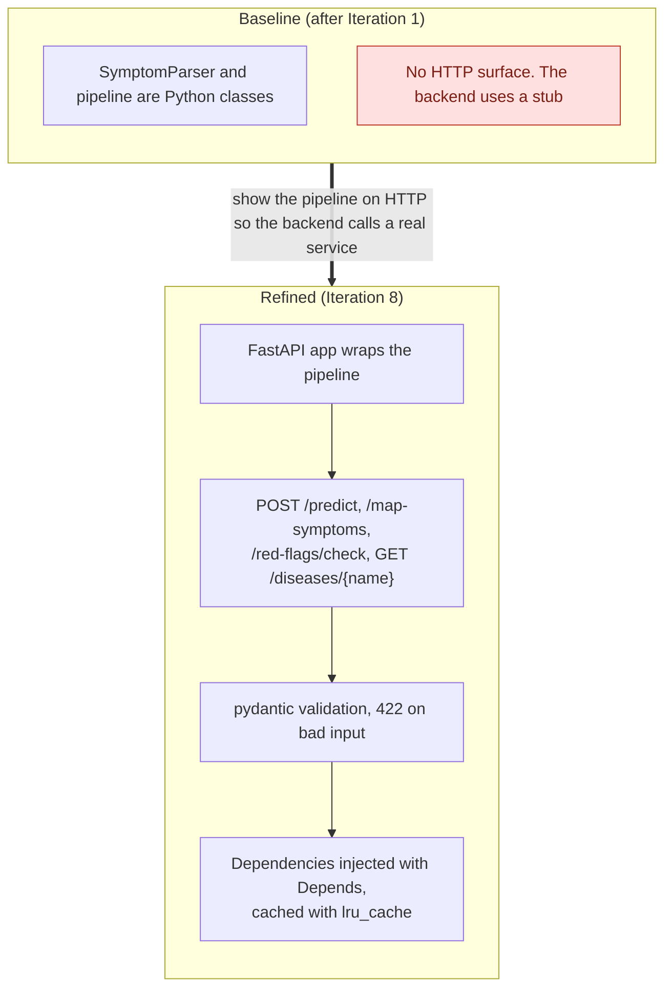

# MDD Iteration 8 — Prediction Service: Web Layer (Python)

Design and model-to-code record for Iteration 8 of the Model Driven Development cycle (Lab05,
Problem 1). The slice: put an HTTP layer in front of the Iteration 1 pipeline so the Java backend
can call a real service instead of a stub.

- **Anchored to:** FR-P1 and FR-P2 (predict diseases from symptoms), the SOA rule (the backend
  must not run ML code; it calls the Python service).
- **Lives in:** `disease-prediction-ai` (the Prediction Service web layer).
- **Status:** done. Steps 5 and 6 are filled in after implementation.

> Render the `.mmd` files with the VS Code *Markdown Preview Mermaid* extension, IntelliJ's
> Mermaid plugin, or by pasting into <https://mermaid.live>. GitHub renders the fenced `mermaid`
> blocks below automatically.

---

## Step 1 — Requirements envisioning

- Slice: show the pipeline on HTTP. The service predicts diseases. It maps free text to symptoms.
  It checks red flags. It gives disease information.
- Anchored to FR-P1 and FR-P2 (predict diseases from symptoms) and the SOA rule. The backend must
  not run ML code. The backend calls the Python service.

## Step 2 — Architecture / platform envisioning (SOA)

- The web layer stays in the Prediction Service (Python). It does not go into the backend.
- Use FastAPI. FastAPI gives input validation, dependency injection and an OpenAPI contract.
- Inject the pipeline, the red-flag engine, the knowledge base and the specialty mapper with
  `Depends`. Cache each one with `lru_cache`. The model loads one time for each process.

### Endpoints

| Operation | Function | Success | Error |
| --- | --- | --- | --- |
| `POST /predict` | Free text to ranked diseases, with descriptions, precautions, red flags and specialty | `200` | `422` if the text is empty |
| `POST /map-symptoms` | Free text to structured symptom entries | `200` | `422` |
| `POST /red-flags/check` | Active symptoms to red-flag rules and urgency | `200` | `422` |
| `GET /diseases/{name}` | Description and precautions for one disease | `200` | `404` if the disease is unknown |
| `GET /health`, `GET /ready` | Liveness and readiness for the container probes | `200` / `503` | — |

## Step 3 — Model the slice

### Structural model (`web_layer_class.mmd`)

```mermaid
classDiagram
    class FastAPIApp {
        +POST /predict
        +POST /predict/followup
        +POST /map-symptoms
        +POST /red-flags/check
        +GET /diseases/{name}
        +GET /health
        +GET /ready
    }
    class PredictRequest {
        +str text
    }
    class PredictResponse {
        +PredictionItem[] predictions
        +RedFlag[] redFlags
        +Urgency urgency
        +bool needs_follow_up
        +FollowUp follow_up
    }
    class PredictionPipeline {
        +predict(text) PredictionResult
        +classifier
    }
    class RedFlagEngine {
        +evaluate(active) RedFlag[]
    }
    class DiseaseKnowledgeBase {
        +describe(disease)
        +precautions(disease)
    }
    class SpecialtyMapper {
        +specialty_for(disease)
    }

    FastAPIApp --> PredictRequest : validates
    FastAPIApp --> PredictResponse : returns
    FastAPIApp --> PredictionPipeline : get_pipeline (Depends)
    FastAPIApp --> RedFlagEngine : get_red_flag_engine (Depends)
    FastAPIApp --> DiseaseKnowledgeBase : get_knowledge (Depends)
    FastAPIApp --> SpecialtyMapper : get_specialty_mapper (Depends)
```

### Baseline vs refined (`baseline_vs_refined.mmd`)



The baseline from Iteration 1 was a pipeline of Python classes. It had no network surface. The
backend could use only a stub. Iteration 8 adds a FastAPI app. The app wraps the pipeline and does
not change it. The app adds validation and container probes.

## Step 4 — Model-to-code transformation

| Model element | Code element | File |
| --- | --- | --- |
| FastAPI app and routes | `app`, `predict`, `map_symptoms`, `red_flags_check`, `disease_info`, `health`, `ready` | `prediction_service/api.py` |
| Request and response models | `PredictRequest`, `PredictResponse`, `MapSymptomsResponse`, `RedFlagCheckResponse`, `DiseaseInfoResponse` | `prediction_service/api.py` |
| Pipeline dependency | `get_pipeline()`, env `DISEASE_MODEL_PATH` | `prediction_service/api.py`, `pipeline.py` |
| Red-flag engine | `RedFlagEngine`, `RedFlagRule`, `Urgency` | `prediction_service/red_flags.py` |
| Disease knowledge | `DiseaseKnowledgeBase` | `prediction_service/knowledge.py` |
| Specialty mapping (FR-P4) | `SpecialtyMapper` | `prediction_service/specialty.py` |

## Step 5 — Validate / test

The test suite passes. It has 166 tests on Python 3.12.10. The API tests (`test_api.py`) have 23
tests. The red-flag tests (`test_red_flags.py`) have 7 tests. The knowledge tests
(`test_knowledge.py`) have 6 tests. The API tests call each endpoint with the FastAPI `TestClient`.

## Step 6 — Review & refine the model

1. The dependencies are cached, not global. `lru_cache` loads the model one time for each process.
   `Depends` keeps the endpoints easy to test.
2. There are two probes. `/health` is liveness. `/ready` reports if the model is loaded.
3. The red-flag check is deterministic. It runs next to the prediction. It is not a diagnosis.
4. The follow-up endpoint is added later (Iteration 9b). It reuses this app. For this reason,
   `PredictResponse` already carries `needs_follow_up` and `follow_up`.
