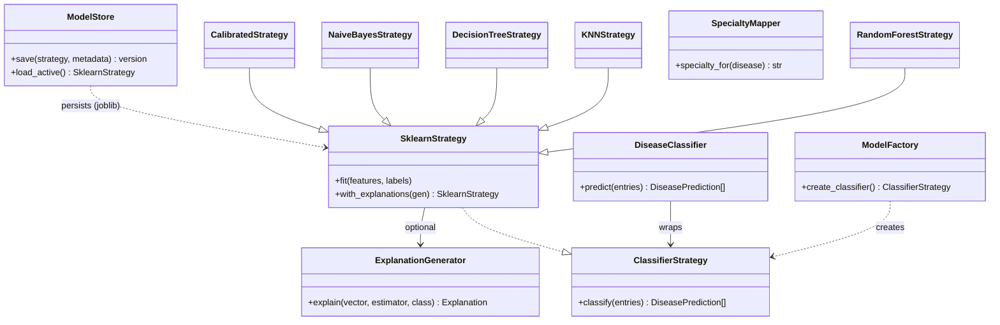
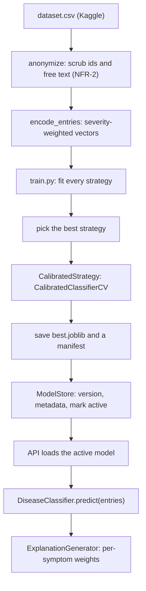
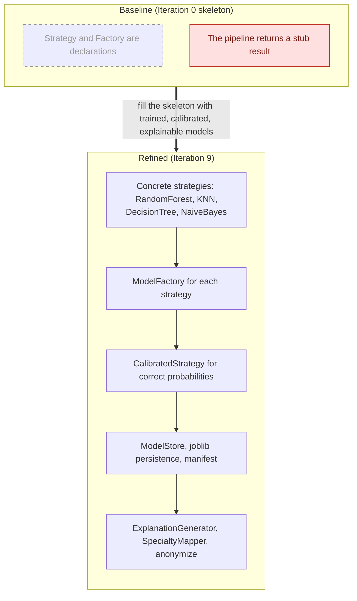

# MDD Iteration 9 — ML Pipeline: Trained Classifier (Python)

Design and model-to-code record for Iteration 9 of the Model Driven Development cycle (Lab05,
Problem 1). The slice: fill the Iteration 0 Strategy and Factory skeleton with trained, calibrated
classifier models so `/predict` returns real ranked diseases instead of a stub result.

- **Anchored to:** FR-P2 (ranked probabilities), FR-P4 (specialty routing), NFR-2 (anonymise the
  training data).
- **Lives in:** `disease-prediction-ai` (the Prediction Service ML pipeline).
- **Status:** done. Steps 5 and 6 are filled in after implementation.

> Render the `.mmd` files with the VS Code *Markdown Preview Mermaid* extension, IntelliJ's
> Mermaid plugin, or by pasting into <https://mermaid.live>. GitHub renders the fenced `mermaid`
> blocks below automatically.

---

## Step 1 — Requirements envisioning

- Slice: train classifiers on the Kaggle dataset. Calibrate the best model. Save it. Serve ranked
  diseases with explanations and a specialty.
- Anchored to FR-P2 (ranked probabilities), FR-P4 (specialty routing) and NFR-2 (anonymise the
  training data).

## Step 2 — Architecture / platform envisioning (SOA)

- All of this stays in the Prediction Service (Python).
- Keep the Iteration 0 patterns. Strategy holds the interchangeable classifier algorithms.
  Factory builds each strategy.
- Train the models offline in `train.py`. The API loads a saved model at request time. The heavy
  training does not run in the request path.

### Classifier strategies

| Strategy | Estimator |
| --- | --- |
| `RandomForestStrategy` | random forest |
| `KNNStrategy` | k-nearest neighbours |
| `DecisionTreeStrategy` | decision tree |
| `NaiveBayesStrategy` | naive Bayes |
| `CalibratedStrategy` | wraps the best strategy in `CalibratedClassifierCV` |

## Step 3 — Model the slice

### Structural model (`classifier_class.mmd`)

### Training flow (`training_flow.mmd`)

### Baseline vs refined (`baseline_vs_refined.mmd`)

Iteration 0 left Strategy and Factory as declarations with a stub. Iteration 9 makes them real. It
adds concrete strategies, a factory for each strategy, a calibration wrapper, a model registry with
provenance, explanations, and the FR-P4 specialty mapper. It anonymises the training data first.

## Step 4 — Model-to-code transformation

| Model element | Code element | File |
| --- | --- | --- |
| Strategy interface and base | `ClassifierStrategy`, `SklearnStrategy` | `prediction_service/classifier.py` |
| Concrete strategies | `RandomForestStrategy`, `KNNStrategy`, `DecisionTreeStrategy`, `NaiveBayesStrategy` | `prediction_service/classifier.py` |
| Calibration | `CalibratedStrategy` (`CalibratedClassifierCV`) | `prediction_service/classifier.py` |
| Factory | `ModelFactory` and the four concrete factories | `prediction_service/factory.py` |
| Classifier wrapper | `DiseaseClassifier` | `prediction_service/classifier.py` |
| Feature encoding | `encode_entries` | `prediction_service/features.py` |
| Explanations | `ExplanationGenerator`, `Explanation` | `prediction_service/explanation.py` |
| Specialty mapping (FR-P4) | `SpecialtyMapper` | `prediction_service/specialty.py` |
| Model registry and persistence | `ModelStore`, `save_strategy`, `load_strategy` | `prediction_service/persistence.py` |
| Provenance manifest | `write_model_manifest`, `verify_model_artifact` | `prediction_service/artifact.py` |
| Training script | `train.py` | `prediction_service/train.py` |
| Anonymisation (NFR-2) | `anonymize_entries`, `scrub_text`, `pseudonymize_id` | `prediction_service/anonymize.py` |

## Step 5 — Validate / test

The test suite passes. It has 166 tests. The classifier tests have 20 tests. The calibration tests
have 8 tests. The explanation tests have 8 tests. The specialty tests have 6 tests. The persistence
tests have 11 tests. The training tests have 6 tests. The anonymise tests have 12 tests.

## Step 6 — Review & refine the model

1. Calibration is a strategy, not a special case. `CalibratedStrategy` subclasses `SklearnStrategy`.
   The API loads it and calls it like any other strategy.
2. The project uses `joblib`, not `pickle`. scikit-learn models hold large NumPy arrays. `joblib`
   saves them well. The loader still reads the old `.pkl` files.
3. The manifest travels with the model. It records the artifact hash, the data hash, the strategy,
   the scores and the runtime.
4. The explanation code unwraps the calibration wrapper. It then reads the feature importances or
   the coefficients. Only the active symptoms can contribute.
5. The project anonymises the data before training (NFR-2). It hashes the `entry_id`. It scrubs the
   free text.
