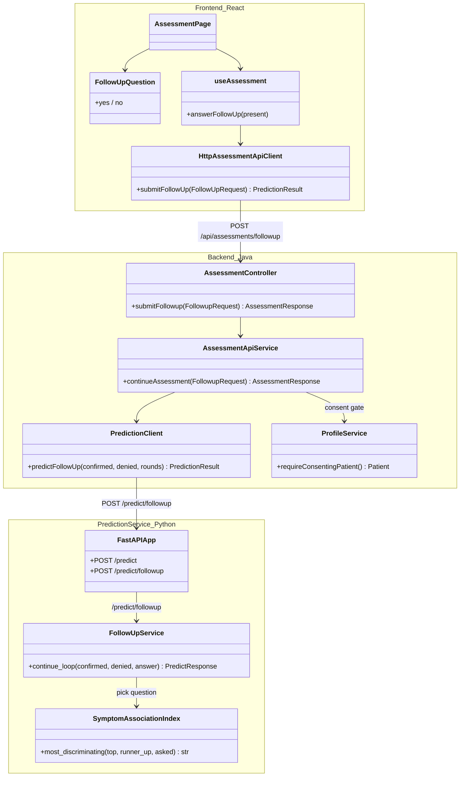
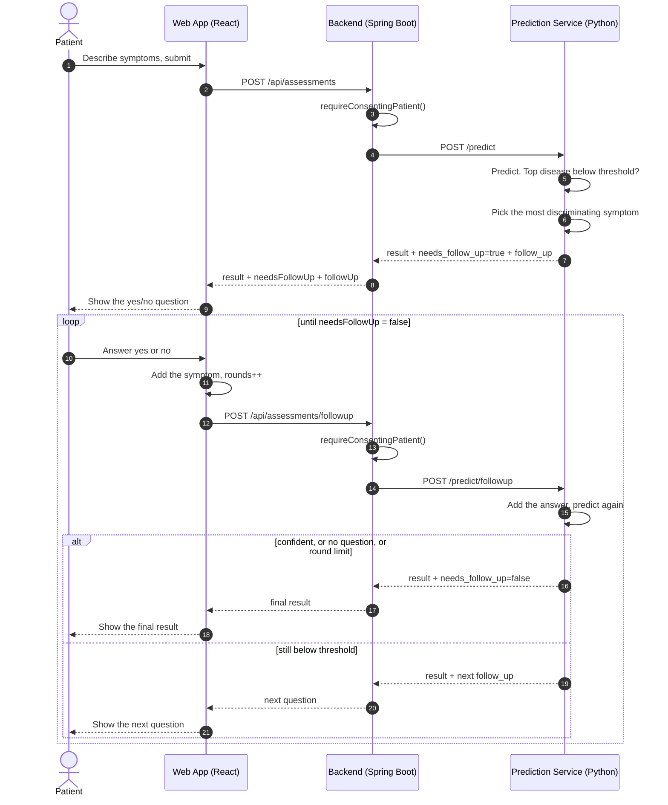
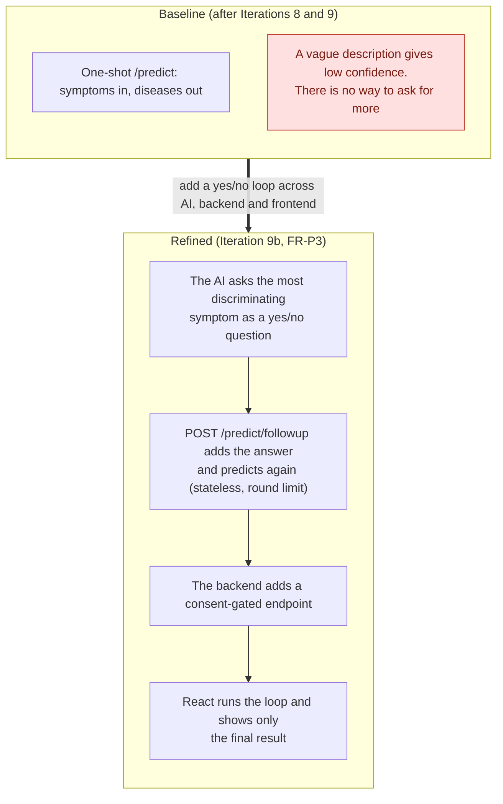

# MDD Iteration 9b — Adaptive Follow-up Questions (AI + backend + React, FR-P3)

Design and model-to-code record for Iteration 9b of the Model Driven Development cycle (Lab05,
Problem 1). The slice: add a follow-up loop across the three services. When a prediction is not
confident, the service asks the patient one yes/no question, adds the answer, and predicts again.
This iteration comes after Iteration 9 and does not use the Iteration 7 number.

- **Anchored to:** FR-P3 (follow-up questions to refine a prediction).
- **Lives in:** `disease-prediction-ai` (branch `feat/adaptive-followup-questions`),
  `disease-prediction-be` (branch `feat/adaptive-followup`), `disease-prediction-fe`
  (branch `feat/adaptive-followup`).
- **Status:** done. Steps 5 and 6 are filled in after implementation.
- **Out of scope:** free-text answers (the service accepts only yes or no). The server keeps no
  session state; the client carries the symptom sets between turns.

> Render the `.mmd` files with the VS Code *Markdown Preview Mermaid* extension, IntelliJ's
> Mermaid plugin, or by pasting into <https://mermaid.live>. GitHub renders the fenced `mermaid`
> blocks below automatically.

---

## Step 1 — Requirements envisioning

- Slice: for a prediction that is not confident, ask one yes/no question. The question is about the
  symptom that best separates the top disease from the next disease. Add the answer. Predict again.
  Stop when the prediction is confident.
- Anchored to FR-P3 (follow-up questions to refine a prediction).
- Out of scope: free-text answers. The service accepts only yes or no. The server keeps no session
  state. The client carries the symptom sets between turns.

## Step 2 — Architecture / platform envisioning (SOA)

The feature uses all three services. Each service keeps its role:

- **AI (Python):** selects the question. Decides when to stop. It keeps no state. The caller sends
  the confirmed and denied symptoms for each turn.
- **Backend (Java):** adds one endpoint with the consent check. It relays the loop to the AI
  service. It adds no ML logic.
- **Frontend (React):** runs the loop in the UI. It collects the symptom sets across the turns. It
  gives only the final confident result to the page.

### How the loop works

1. A normal prediction runs (`POST /predict`).
2. The top disease is below the confidence threshold (default 0.80). The AI selects the symptom
   that is frequent in the top disease and rare in the next disease. It returns this symptom as a
   yes/no question.
3. The patient answers. The service adds the symptom to the confirmed set or the denied set.
4. `POST /predict/followup` adds the answer and predicts again. It reuses the trained model. It
   does not run the NLP stage again.
5. The loop stops for one of three reasons: the confidence reaches the threshold; no useful
   question remains; the loop reaches the round limit. The round limit makes sure that the loop
   always stops.

## Step 3 — Model the slice

### Structural model (`followup_class.mmd`)

### Sequence (`followup_sequence.mmd`)

### Baseline vs refined (`baseline_vs_refined.mmd`)

## Step 4 — Model-to-code transformation (by repository)

**AI (`disease-prediction-ai`, branch `feat/adaptive-followup-questions`)**

- `associations.py` — `SymptomAssociationIndex` learns the symptom frequency for each disease. It
  selects the most discriminating symptom that the patient has not answered.
- `followup.py` — `FollowUpService` runs the loop. It uses the confidence threshold and the round
  limit.
- `api.py` — `/predict` returns `needs_follow_up` and `follow_up`. The new `POST /predict/followup`
  continues the loop from the carried symptoms and the latest answer.
- `pipeline.py` — exposes the trained classifier so the loop re-ranks without the NLP stage.
- Configuration: `DISEASE_FOLLOWUP_THRESHOLD`, `DISEASE_FOLLOWUP_MAX_ROUNDS`, `DISEASE_DATASET_PATH`.

**Backend (`disease-prediction-be`, branch `feat/adaptive-followup`)**

- `assessment-api.yaml` — adds `POST /api/assessments/followup`. Adds the `FollowupRequest`,
  `FollowupAnswer` and `FollowUp` schemas. Adds `activeSymptoms`, `needsFollowUp` and `followUp`
  to `PredictionResult`.
- `PredictionClient` / `HttpPredictionClient` — add `predictFollowUp(...)`. It posts to the AI
  `/predict/followup`.
- `AssessmentApiService.continueAssessment(...)` — puts the yes/no answer into the confirmed set or
  the denied set. It calls `requireConsentingPatient()` first, like `runAssessment`.
- `AssessmentController.submitFollowup(...)` — a thin delegate.

**Frontend (`disease-prediction-fe`, branch `feat/adaptive-followup`)**

- `domain/assessment.ts` — adds the `FollowUp`, `FollowUpAnswer` and `FollowUpRequest` types. Adds
  `activeSymptoms`, `needsFollowUp` and `followUp` to `PredictionResult`. These fields are optional.
- `HttpAssessmentApiClient` — adds `submitFollowUp(...)`. It posts to `/api/assessments/followup`.
- `useAssessment.answerFollowUp(present)` — collects the confirmed and denied symptoms and the
  round count across the turns.
- `FollowUpQuestion` and `AssessmentPage` — show the yes/no question and run the loop in the page.
  The page gives only the final confident result to the host.
- Same branch: the symptom checklist now covers the full canonical vocabulary (131 symptoms) in
  clinical groups. It replaces the earlier subset.

### Later refinement — top condition with precautions (branch `feat/top-disease-with-precautions`)

A follow-up change on top of this iteration narrows what the result view shows and surfaces the
disease precautions, which were already produced by the AI but dropped before reaching the patient.

- **AI (`disease-prediction-ai`):** no change. The `/predict` response already carries a
  `description` and `precautions` for each disease, loaded by `DiseaseKnowledgeBase` from
  `data/symptom_Description.csv` and `data/symptom_precaution.csv`.
- **Backend (`disease-prediction-be`):** `assessment-api.yaml` adds `description` and `precautions`
  to the `DiseasePrediction` schema; `HttpPredictionClient` now maps both fields from the AI
  response instead of discarding them.
- **Frontend (`disease-prediction-fe`):** `domain/assessment.ts` adds optional `description` and
  `precautions` to `DiseasePrediction`. `PredictionResultView` shows only the single most likely
  condition — its probability, description, contributing symptoms and recommended precautions —
  rather than the full ranked list. The backend still requests the top five.

## Step 5 — Validate / test

| Service | Scope | Result |
| --- | --- | --- |
| AI (Python 3.12.10) | association index (6), follow-up loop (9), endpoints in `test_api.py` (23) | full suite 166 tests pass |
| Backend (JDK 25) | the client maps the new fields and posts to `/predict/followup`; the service merges answers and counts rounds; the controller returns 200 / 400 | full suite 16 tests pass |
| Frontend | client method and error mapping, hook loop, `FollowUpQuestion` component, one integration test | 157 tests pass (113 unit + 44 integration) |

The AI tests confirm that the loop stops: the confidence rises past the threshold; the service does
not ask a denied symptom again; the round limit stops the loop.

## Step 6 — Review & refine the model

1. The loop keeps no state on the server. The client carries the confirmed symptoms, the denied
   symptoms and the round count. Both services stay stateless. Both services scale horizontally.
2. The service selects a discriminating question, not only a frequent symptom. Each answer gives
   more information. The loop needs fewer questions.
3. The loop always stops. There are three reasons: the confidence reaches the threshold; no useful
   question remains; the loop reaches the round limit.
4. The service checks consent for each turn. `continueAssessment` calls `requireConsentingPatient()`,
   like `runAssessment`. A follow-up answer cannot pass the Iteration 6 consent check.
5. The UI shows only the final result. `AssessmentPage` runs the loop in the page. It does not show
   the intermediate results.
6. The same branch fixes an authentication race. A protected call could run before the Hanko token
   was ready. This caused a wrong 401. The fetch now waits for the token.
7. The result view shows only the top condition, with precautions. The ranked list was replaced by
   the single most likely disease plus its description, contributing symptoms and precautions. The
   precautions already existed in the AI response; the backend had been dropping them, so the fix
   was to relay the field (backend) and render it (frontend), not to produce new data.
