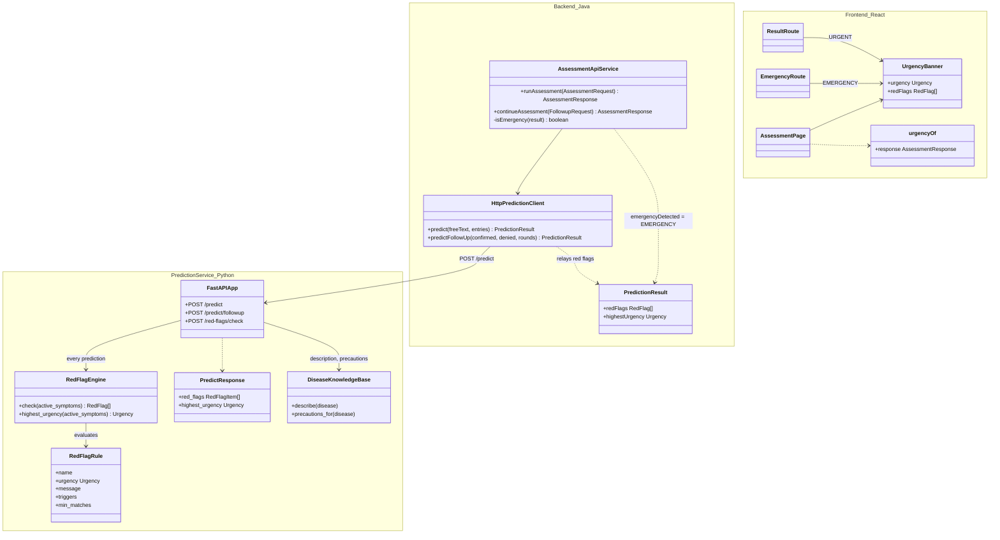
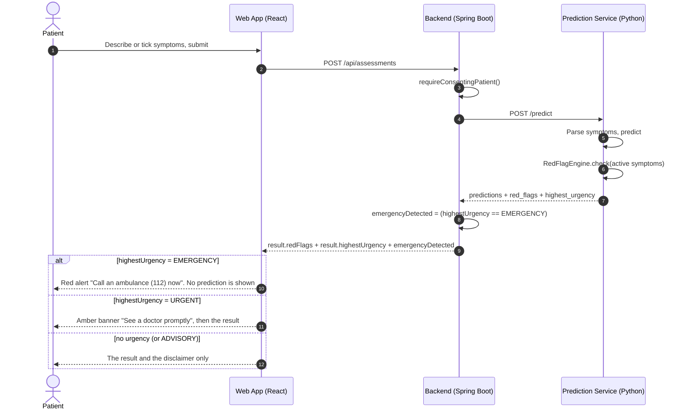
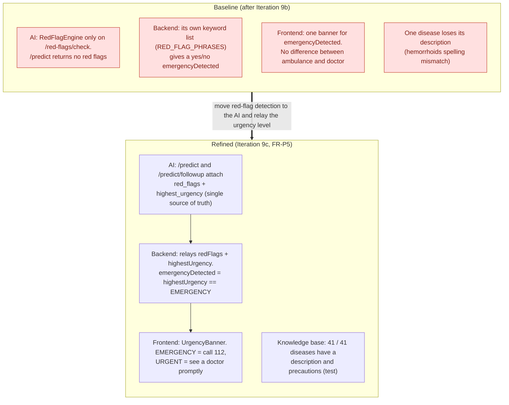

# MDD Iteration 9c — Red-flag Urgency: Ambulance vs Doctor (AI + backend + React, FR-P5)

Design and model-to-code record for Iteration 9c of the Model Driven Development cycle (Lab05,
Problem 1). This is the **final iteration** of the cycle. The slice: make the AI prediction service
the single source of truth for red flags, relay the urgency level through the backend, and show the
patient a clear instruction: **call an ambulance (112)** or **see a doctor promptly**. The same
iteration closes a data gap: every one of the 41 diseases now has a description and precautions.
Like Iteration 9b, it comes after Iteration 9 and does not use a planned roadmap number.

- **Anchored to:** FR-P5 / UC2 (emergency alert), FR-P3 (description and precautions).
- **Lives in:** `disease-prediction-ai`, `disease-prediction-be` and `disease-prediction-fe`, each
  on branch `feat/red-flag-urgency` (from `develop`, PR into `develop`).
- **Status:** done. Steps 5 and 6 are filled in after implementation.
- **Out of scope:** the unused backend chain `RedFlagHandler` / `ChestPainHandler` /
  `RedFlagRule.java` (left for a separate cleanup PR); urgency from free-text answers in the
  follow-up loop (the loop accepts only yes or no).

> Render the `.mmd` files with the VS Code *Markdown Preview Mermaid* extension, IntelliJ's
> Mermaid plugin, or by pasting into <https://mermaid.live>. GitHub renders the fenced `mermaid`
> blocks below automatically.

---

## Step 1 — Requirements envisioning

- Slice: detect dangerous symptom patterns once, in the AI service, and tell the patient what to
  do. The instruction depends on the urgency level:

  | Urgency | Patient instruction | Basis |
  | --- | --- | --- |
  | `EMERGENCY` | "Call emergency services (112) or go to the nearest emergency department now." | A short list of dangerous symptoms or symptom combinations. It does not depend on the predicted disease |
  | `URGENT` | "See a doctor promptly today; seek emergency care if it gets worse." | Single serious symptoms |
  | `ADVISORY` / none | The normal result and the disclaimer | Default |

- Decision rule: the urgency comes from the **symptoms**, never from the precaution text. The
  precaution text is noisy. For example, "consult nearest hospital" is a precaution for
  Osteoarthritis, which is not an emergency.
- Data gap: `symptom_Description.csv` spells one disease "Dimorphic hemorrhoids(piles)". The
  dataset and the precaution file spell it "Dimorphic hemmorhoids(piles)". The lookup did not match,
  so this disease had no description.

## Step 2 — Architecture / platform envisioning (SOA)

Before this iteration, three red-flag mechanisms existed and they were not connected:

| Layer | Before | Problem |
| --- | --- | --- |
| AI `red_flags.py` | `RedFlagEngine`, 6 rules, 3 urgency levels | Only on `/red-flags/check`. `/predict` returns no red flags |
| Backend `AssessmentApiService` | A keyword list (`RED_FLAG_PHRASES`) on the free text and the symptom text | Parallel logic, yes/no only, different from the AI rules |
| Frontend `EmergencyBanner` | One banner, keyed on `emergencyDetected` | Cannot tell "ambulance" from "doctor" |

After this iteration each service keeps its role:

- **AI (Python):** runs the red-flag rules on every prediction. It is the single source of truth.
- **Backend (Java):** relays the red flags and the highest urgency. It keeps `emergencyDetected`
  for older clients and derives it from `highestUrgency == EMERGENCY`. It has no keyword list now.
- **Frontend (React):** shows the right banner. For `EMERGENCY` it leads with the ambulance banner
  and does not show the prediction.

Each layer degrades gracefully when the layer below is older: the new fields are optional, and the
frontend falls back to `emergencyDetected`.

### Red-flag rules (AI)

| Rule | Urgency | Triggers |
| --- | --- | --- |
| `possible_cardiac_event` | EMERGENCY | any 2 of `chest_pain`, `breathlessness`, `sweating` |
| `possible_stroke` | EMERGENCY | `weakness_of_one_body_side`, `altered_sensorium` or `slurred_speech` |
| `loss_of_consciousness` (new) | EMERGENCY | `coma` |
| `coughing_blood_with_breathlessness` (new) | EMERGENCY | `blood_in_sputum` and `breathlessness` |
| `severe_dehydration` | URGENT | `vomiting` and `dehydration` |
| `high_fever` | URGENT | `high_fever` |
| `acute_breathing_difficulty` | URGENT | `breathlessness` |
| `gi_bleeding` | URGENT | `bloody_stool` |
| `stomach_bleeding` (new) | URGENT | `stomach_bleeding` |
| `acute_liver_failure` (new) | URGENT | `acute_liver_failure` |
| `fluid_overload` (new) | URGENT | `fluid_overload` |

Every EMERGENCY message tells the patient to call 112. Every URGENT message tells the patient to
see a doctor promptly.

## Step 3 — Model the slice

### Structural model (`urgency_class.mmd`)

### Sequence (`urgency_sequence.mmd`)

### Baseline vs refined (`baseline_vs_refined.mmd`)

## Step 4 — Model-to-code transformation (by repository)

**AI (`disease-prediction-ai`, branch `feat/red-flag-urgency`)**

- `red_flags.py` — adds `loss_of_consciousness` and `coughing_blood_with_breathlessness`
  (EMERGENCY), and `stomach_bleeding`, `acute_liver_failure` and `fluid_overload` (URGENT). The
  messages now say "call 112" or "see a doctor promptly".
- `api.py` — `PredictResponse` gets `red_flags` and `highest_urgency`. `/predict` and
  `/predict/followup` run `RedFlagEngine.check(...)` on the active symptoms. `RedFlagItem` is reused
  from `/red-flags/check`.
- `knowledge.py` — `_key()` maps the description spelling "dimorphic hemorrhoids(piles)" to the
  dataset spelling. The Kaggle CSVs are downloaded, not versioned in the repository, so the fix is in
  the lookup and not in the CSV file.

**Backend (`disease-prediction-be`, branch `feat/red-flag-urgency`, contract-first)**

- `assessment-api.yaml` — adds the `Urgency` enum (`EMERGENCY`, `URGENT`, `ADVISORY`) and the
  `RedFlag` schema (`name`, `urgency`, `message`, `matchedSymptoms`). Adds `redFlags` and
  `highestUrgency` (nullable) to `PredictionResult`. Keeps `emergencyDetected` on
  `AssessmentResponse`. The Java models are regenerated with `./mvnw generate-sources`; no
  generated code is edited by hand.
- `HttpPredictionClient` — maps `red_flags` and `highest_urgency` from the AI response into
  `PredictionResult`. An unknown urgency value maps to "no urgency".
- `AssessmentApiService` — removes `RED_FLAG_PHRASES`, `detectEmergency()` and `containsRedFlag()`.
  It always calls the prediction service and sets `emergencyDetected` from the relayed urgency, on
  the initial path and on the follow-up path.

**Frontend (`disease-prediction-fe`, branch `feat/red-flag-urgency`)**

- `domain/assessment.ts` — adds the `Urgency` type, the `RedFlag` interface, and optional
  `redFlags` / `highestUrgency` on `PredictionResult`. `urgencyOf(response)` returns the relayed
  urgency, or `EMERGENCY` from `emergencyDetected` for older backends.
- `UrgencyBanner` (new) — `EMERGENCY`: red alert "Call an ambulance (112) now" (`role="alert"`,
  `tel:112` link). `URGENT`: amber notice "See a doctor promptly" (`role="status"`). Otherwise
  nothing. Both list the red-flag messages as the reasons.
- `AssessmentPage`, `AssessmentRoute`, `EmergencyRoute`, `ResultRoute` — choose the banner from
  `urgencyOf(...)`. `EMERGENCY` goes to `/assessment/emergency` and shows no prediction (FR-P5, as
  in Iterations 3 and 4). `URGENT` shows the result with the banner above it.

## Step 5 — Validate / test

| Service | Scope | Result |
| --- | --- | --- |
| AI (Python 3.12) | new rules fire and do not fire; urgency order; `/predict` returns `EMERGENCY` for `{chest_pain, breathlessness}`, `URGENT` for `high_fever`, nothing for benign input; `/predict/followup` returns `EMERGENCY`; spelling alias; all 41 diseases have a description and precautions | 179 tests pass, 12 new. The 41-disease test runs when the Kaggle CSVs are in `data/` and is skipped otherwise. 12 tests in `test_publish_model_runtime.py` (image publishing script) also fail on `develop` on Windows; they are not related to this change |
| Backend (JDK 25) | the client maps `red_flags` / `highest_urgency` and missing fields; the service derives `emergencyDetected` from `EMERGENCY` only (not from `URGENT`, not from keywords) on both paths; the controller returns the urgency in JSON | 36 tests without a database pass (19 in the changed classes). The 42 Testcontainers tests need Docker, which was not available on the test machine; run `./mvnw clean test` with Docker before merging |
| Frontend | `UrgencyBanner` for each urgency; `urgencyOf` and its fallback; routed flow: emergency leads with the ambulance banner and hides the prediction, urgent shows "see a doctor" above the result, benign shows no banner; inline page: the alert comes before the form | 169 tests pass (123 unit + 46 integration); `tsc`, ESLint, Prettier and the build pass |

Acceptance criteria:

- `{chest_pain, breathlessness}` gives `highestUrgency = EMERGENCY` and the UI leads with "Call an
  ambulance (112) now".
- A single `high_fever` gives `URGENT` and the UI says "See a doctor promptly".
- Benign input shows no urgency banner, only the result and the disclaimer.
- The backend has no keyword list; `emergencyDetected` comes from the relayed urgency.
- All 41 diseases have a description and precautions; a test checks it.

## Step 6 — Review & refine the model

1. **One source of truth.** The red-flag rules exist only in the AI service. The backend keyword
   list is gone, so the backend and the AI can no longer disagree about an emergency.
2. **Symptoms, not precautions.** The urgency comes from the symptoms only. The precaution text is
   not used, because it marks non-urgent diseases (for example Osteoarthritis) with "consult
   nearest hospital".
3. **Two levels for the patient.** The patient now sees two different instructions: ambulance
   (112) for `EMERGENCY` and doctor for `URGENT`. Before, there was only one yes/no alert.
4. **Emergency still halts the prediction.** For `EMERGENCY` the prediction is relayed (so the red
   flags reach the client) but the frontend does not show it, as FR-P5 and the UC1 sequence
   require.
5. **Trade-off: emergency now needs the AI service.** Before, the backend keyword check could flag
   an emergency even when the AI service was down. Now, if the AI service cannot be reached, the
   request fails (503) and no urgency is computed. The frontend error message keeps the 112 advice.
   A circuit breaker with a fallback (roadmap Iteration 10, Resilience4j) is the place to restore an
   offline emergency check.
6. **Backward compatible.** `emergencyDetected` stays in the contract. The new fields are optional.
   The frontend falls back to `emergencyDetected` when `highestUrgency` is absent.
7. **Data fix in the lookup.** The Kaggle CSVs are not in the repository, so the spelling fix is an
   alias in `DiseaseKnowledgeBase._key()`. The coverage test protects the 41 / 41 result.

## Roadmap check (planned iterations 5–13)

Status of the roadmap items (`roadmap/roadmap.png`) at the end of the cycle, checked against
`develop` in each repository:

| Roadmap iteration | Status |
| --- | --- |
| 5 — User and consent store (Java BE) | Done (`iteration5/`) |
| 6 — Identity (BE + React) | Done with Hanko instead of Keycloak (`iteration6/`) |
| 7 — Health-data persistence (Java BE) | Not done (no assessment tables; migrations stop at V2) |
| 8 — Python prediction service web layer | Done (`iteration8/`) |
| 9 — Python ML pipeline (classifier) | Done (`iteration9/`); follow-up loop in `iteration9b/` |
| 10 — Real SOA boundary (BE to Python) | Partly done: `HttpPredictionClient` calls the AI service; no Resilience4j circuit breaker yet |
| 11 — Event-driven communication (Kafka) | Not done |
| 12 — Doctor and admin apps (React) | Not done |
| 13 — Observability | Not done |
| 9c — Red-flag urgency (this iteration, not on the roadmap) | Done |
