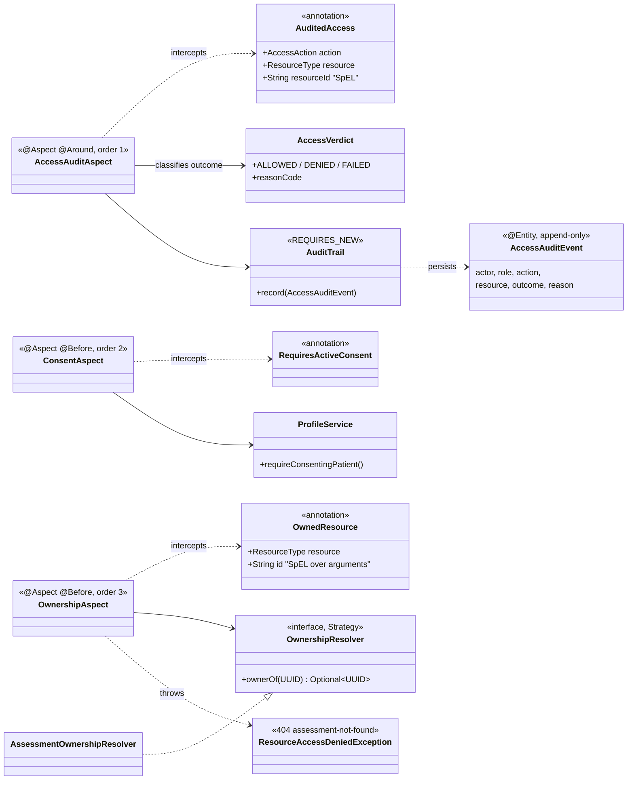
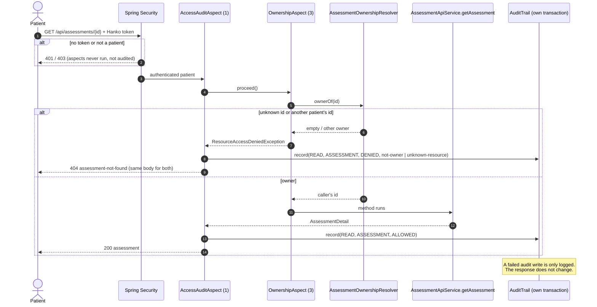

# Disease Prediction: Recap from Iteration 6 Onward

A recap of the MDD iterations from Iteration 6 to the latest work on `main`. Sources:
`mdd/MDD_ITERATIONS.md` and the `mdd/iteration*/README.md` files. Each iteration folder has the
full model (Mermaid diagrams), the model-to-code tables and the test results.

The iterations were not built in number order. The order of work was:
**6, then 8, 9, 9b, 9c, then 7, then 12a**. This recap lists them by number.

## Repositories

| Repository | Role |
| --- | --- |
| `disease-prediction` | Documentation and MDD models |
| `disease-prediction-ai` | Python prediction service (FastAPI, scikit-learn) |
| `disease-prediction-be` | Java backend (Spring Boot, PostgreSQL, Flyway) |
| `disease-prediction-fe` | React frontend (Vite, TypeScript) |
| `disease-prediction-gitops` | K3s deployment configuration |

## Overview

| Iteration | Slice | Repos | Status |
| --- | --- | --- | --- |
| 6 | Identity and login with Hanko, plus the AOP access guard (Part B) | BE, FE, GitOps | Done |
| 7 | Health-data persistence (stored assessments and reports) | BE | Done |
| 8 | Prediction service web layer | AI | Done |
| 9 | Trained classifier | AI | Done |
| 9b | Adaptive follow-up questions | AI, BE, FE | Done |
| 9c | Red-flag urgency: ambulance or doctor | AI, BE, FE | Done |
| 12a | Pocket Doc app shell and role workspaces | FE | Done |

---

## Iteration 6: Identity and login with Hanko

**Goal:** every API request belongs to a known, logged-in user ("secured before stored"). A
first-login onboarding step creates the patient profile and records consent.
Anchored to NFR-1 (GDPR Article 9), FR-G1 (consent) and UC1 step 1.

**Architecture decisions**
- **Identity provider:** Hanko v3.1.0 replaces the planned Keycloak. DevOps already runs it on K3s
  (dev and production). The Hanko user id (token `sub`) goes into the existing `identity_id`
  column, so the schema did not change.
- **Session transport:** `Authorization: Bearer <Hanko session JWT>`. No refresh tokens. The
  session lifespan goes from 15 minutes to 1 hour.
- **Token check:** Spring Security OAuth2 resource server (RS256, JWKS, issuer, audience), plus a
  cached call to Hanko `POST /sessions/validate`, so a logged-out or revoked session is refused.
  If Hanko cannot be reached, the request fails (fail closed).
- **Roles:** stored in the app database (the Iteration 5 discriminator). New users are patients.

**Backend (`disease-prediction-be`)**
- `SecurityConfig`: stateless filter chain, problem+json 401/403 responses.
- `HankoSessionCheckFilter` with a Caffeine cache keyed by session id.
- `RoleAuthoritiesConverter`: loads the user by `sub` and adds `ROLE_<role>`.
- Profile API from `profile-api.yaml`: `GET/POST /api/me`, `POST /api/me/consents`.
- Running an assessment requires a consenting patient with a verified email.
- Local Hanko, its database and Mailpit in `compose.yaml`.

**Frontend (`disease-prediction-fe`)**
- Hanko Elements 3.1.0 (`<hanko-auth>`, `<hanko-profile>`).
- `AuthProvider` over the Hanko session events. `AuthorizedFetch` adds the bearer token and sends
  the user to `/login` on a 401.
- Route guards `RequireAuth` and `RequireProfile`. New pages: `/login`, `/onboarding`, `/account`
  (profile, consent, logout).

**GitOps (`disease-prediction-gitops`)**
- Dev Hanko: `account.allow_signup: true`, `session.lifespan: 1h`.

**Part B:** the AOP Personal Data Access Guard. See [AOP: Personal Data Access Guard](#aop-personal-data-access-guard).

---

## Iteration 7: Health-data persistence

**Goal:** store every assessment a patient runs, with symptoms, follow-up answers and the latest
result, plus a report for a doctor. The patient can list and open their own assessments.
Anchored to NFR-1, UC1 steps 2–5, FR-P3 and FR-D1.

**What was built (`disease-prediction-be`)**
- Tables `assessments` and `reports` (Flyway `V4`). Hibernate runs with `ddl-auto=validate`.
- **Encryption:** input, follow-up state, result and clinical notes are AES-256-GCM ciphertext
  (`FieldEncryptor`), one JSON document per column. Only ids, timestamps, statuses and counters are
  plaintext.
- **Snapshots:** the stored result is exactly what the patient saw, so a reopened assessment looks
  the same.
- **Server-side follow-up state:** the loop updates the same assessment. The client sends only
  `assessmentId` and the answer. The server keeps the confirmed and denied symptoms and the round
  count.
- **No transaction across the AI call:** the backend calls the prediction service first, then saves
  in a short transaction. Concurrent answers are caught by an optimistic lock (409).
- **Reports:** status `DRAFT`, `SENT`, `OPENED`, `REVIEWED`. It stays `DRAFT` until the doctor portal
  exists (Iteration 12).
- **Deletion:** assessments and reports cascade from the patient. Audit rows stay.

**API changes (`assessment-api.yaml`)**

| Change | Detail |
| --- | --- |
| `GET /api/assessments` | New. Summaries, newest first: top disease, probability, highest urgency, report status |
| `GET /api/assessments/{id}` | New. Detail: input, confirmed and denied symptoms, latest result, report |
| `FollowupRequest.assessmentId` | New, optional. With it, the server uses the stored state. Without it, the old stateless path runs |
| New problems | 404 `assessment-not-found`, 409 `assessment-completed`, 409 `assessment-conflict`, 400 `invalid-followup` |

**Who can do what**

| Request | Rule |
| --- | --- |
| `POST /api/assessments` | Patient, verified email, active consent |
| `POST /api/assessments/followup` with id | As above, plus owner of the assessment |
| `GET /api/assessments` | Patient, verified email (no consent needed: GDPR right of access) |
| `GET /api/assessments/{id}` | Patient, verified email, owner |

**Tests:** 147 pass against a real PostgreSQL 18 (Testcontainers, migrations V1–V4). 100% coverage
on `security/access`.

**Review findings**
- Symptoms echoed by the AI service are merged into the state, not replaced. Replacing them dropped
  a symptom the patient had just confirmed.
- Ownership is checked after consent, so a patient without consent hears about consent first.
- The database cannot search by disease or symptom, because those columns are encrypted.

---

## Iteration 8: Prediction service web layer

**Goal:** put an HTTP layer in front of the Iteration 1 pipeline, so the Java backend calls a real
service instead of a stub. Anchored to FR-P1 and FR-P2 (predict diseases from symptoms) and the
SOA rule: the backend runs no ML code, it calls the Python service.

**Before and after**
- **Before (after Iteration 1):** the symptom parser and the pipeline were plain Python classes,
  with no network access. The backend could only use a stub.
- **After:** a FastAPI app wraps the pipeline without changing it. It adds input validation, an
  OpenAPI contract and container probes.

**Architecture decisions**
- The web layer stays in the Prediction Service (Python), not in the backend.
- **FastAPI**, because it gives input validation (pydantic), dependency injection and an OpenAPI
  contract out of the box.
- **Dependencies:** the pipeline, the red-flag engine, the knowledge base and the specialty mapper
  are injected with `Depends` and cached with `lru_cache`. The model loads once per process, not
  once per request.
- The model file path comes from the environment variable `DISEASE_MODEL_PATH`.

**Endpoints**

| Endpoint | Function | Success | Error |
| --- | --- | --- | --- |
| `POST /predict` | Free text to ranked diseases, with descriptions, precautions, red flags and specialty | 200 | 422 if the text is empty |
| `POST /map-symptoms` | Free text to structured symptom entries | 200 | 422 |
| `POST /red-flags/check` | Active symptoms to red-flag rules and urgency | 200 | 422 |
| `GET /diseases/{name}` | Description and precautions for one disease | 200 | 404 if the disease is unknown |
| `GET /health` | Liveness probe: the process is up | 200 | — |
| `GET /ready` | Readiness probe: the model is loaded | 200 | 503 |

`POST /predict/followup` was added to the same app later, in Iteration 9b.

**Model to code** (`disease-prediction-ai`)

| Model element | Code | File |
| --- | --- | --- |
| FastAPI app and routes | `app`, `predict`, `map_symptoms`, `red_flags_check`, `disease_info`, `health`, `ready` | `prediction_service/api.py` |
| Request and response models | `PredictRequest`, `PredictResponse`, `MapSymptomsResponse`, `RedFlagCheckResponse`, `DiseaseInfoResponse` | `prediction_service/api.py` |
| Pipeline dependency | `get_pipeline()`, `DISEASE_MODEL_PATH` | `prediction_service/api.py`, `pipeline.py` |
| Red-flag engine | `RedFlagEngine`, `RedFlagRule`, `Urgency` | `prediction_service/red_flags.py` |
| Disease knowledge | `DiseaseKnowledgeBase` | `prediction_service/knowledge.py` |
| Specialty mapping | `SpecialtyMapper` | `prediction_service/specialty.py` |

**Tests:** the full suite has 166 tests on Python 3.12.10, and all pass. Of these, 23 are API tests
(`test_api.py`, every endpoint called through the FastAPI `TestClient`), 7 are red-flag tests and 6
are knowledge tests.

---

## Iteration 9: ML pipeline (trained classifier)

**Goal:** fill the Iteration 0 Strategy and Factory skeleton with trained, calibrated models, so
`/predict` returns real ranked diseases. Anchored to FR-P2, FR-P4 and NFR-2.

- Strategies: random forest, k-nearest neighbours, decision tree, naive Bayes, and
  `CalibratedStrategy` (wraps the best one in `CalibratedClassifierCV`).
- Training runs offline in `train.py`. The API loads the saved model.
- Models are saved with `joblib`, with a manifest (artifact hash, data hash, strategy, scores).
- Explanations: the contributing symptoms come from feature importances or coefficients.
- Training data is anonymised first (hashed ids, scrubbed free text).

**Tests:** 166 tests pass.

---

## Iteration 9b: Adaptive follow-up questions

**Goal:** when a prediction is not confident, ask the patient one yes/no question and predict
again (FR-P3).

**How the loop works**
1. `POST /predict` runs.
2. If the top disease is below 0.80, the AI picks the symptom that is frequent in the top disease
   and rare in the next one, and asks about it.
3. `POST /predict/followup` adds the answer and predicts again, reusing the trained model.
4. The loop stops when the confidence is high enough, no useful question remains, or the round
   limit is reached.

**By service**
- **AI:** chooses the question and decides when to stop.
- **Backend:** new follow-up endpoint with the consent check. It relays the loop and has no ML
  logic.
- **Frontend:** runs the loop and shows only the final result.

**Later changes**
- The result view shows only the top condition, with its description, contributing symptoms and
  precautions. The precautions already came from the AI. The backend had been dropping them.
- Fixed a login race: a protected call could run before the Hanko token was ready (wrong 401).

**Tests:** AI 166, frontend 157 (113 unit, 44 integration).

---

## Iteration 9c: Red-flag urgency (ambulance or doctor)

**Goal:** the AI service is the single source of red flags. The patient gets a clear instruction:
**call an ambulance (112)** or **see a doctor promptly** (FR-P5, UC2).

**Before:** three red-flag mechanisms that did not agree. The AI had rules but `/predict` did not
return them. The backend had its own keyword list. The frontend had one yes/no banner.

**After**
- **AI:** runs 11 red-flag rules on every prediction. EMERGENCY examples: possible cardiac event,
  possible stroke, loss of consciousness. URGENT examples: high fever, severe dehydration,
  GI bleeding.
- **Backend:** relays the red flags and the highest urgency. The keyword list is gone.
  `emergencyDetected` stays for older clients.
- **Frontend:** `UrgencyBanner`. For EMERGENCY it shows the ambulance banner and hides the
  prediction. For URGENT it shows "see a doctor" above the result.
- All 41 diseases now have a description and precautions. A test checks it.

**Trade-off:** an emergency check now needs the AI service. If it is down, the request fails (503).
The frontend error message keeps the 112 advice. A circuit breaker (Iteration 10) is the place for
an offline fallback.

**Tests:** AI 179, frontend 169.

---

## Iteration 12a: Pocket Doc app shell and role workspaces

**Goal:** bring the Pocket Doc design (Figma Make prototype) into the web app, with a workspace for
each role. This is the first part of roadmap Iteration 12. Frontend only. It uses the Iteration 7
API as it is.

- **Shell:** sidebar, header with the signed-in user, mobile menu, sign-out in the sidebar.
- **Roles:** the sidebar follows the role from `GET /api/me`. `RequireRole` blocks the other
  workspaces. The user cannot switch roles (the prototype could).
- **Patient:** overview (start an assessment, latest assessment, consent status), the assessment
  form, **My reports** (search, status filter) and a report detail page. My reports still works
  after consent is withdrawn.
- **Doctor and admin:** dashboards with empty states. No sample data from the prototype is shown,
  so nothing can be mistaken for a real patient or report.
- **Bug fix:** the frontend did not send `assessmentId` with follow-up answers, so every answer was
  stored as a new assessment. Building My reports made this visible.
- **Accessibility:** labelled navigation, `aria-current`, emergency banner still an alert, no text
  smaller than 12px, dark mode kept.

**Tests:** 140 unit tests (17 new) and 61 integration tests (15 new). Type check, ESLint, Prettier
and the build pass.

---

## AOP: Personal Data Access Guard

The Lab 9 AOP component (security option). Designed in Iteration 6, Part B. Consent and audit were
built in Lab 9 (backend PR #84). Ownership was built in Iteration 7.

### Why AOP

Spring Security answers "is this a logged-in patient?". It does not answer:
- "Has this patient consented?"
- "Is this the patient's own record?"
- "Who accessed which personal data, and was it allowed?"

These checks cut across every service that touches personal or health data. With AOP, a service
method declares the rule with an annotation, and an aspect enforces and records it. The business
code stays free of security checks.

### Annotations and aspects

Package: `com.diseaseprediction.security.access`.

| Annotation | Aspect | Advice | Order | What it does |
| --- | --- | --- | --- | --- |
| `@AuditedAccess(action, resource, resourceId)` | `AccessAuditAspect` | `@Around` | 1 (outermost) | Records every call as `ALLOWED`, `DENIED` or `FAILED`, then returns or rethrows unchanged |
| `@RequiresActiveConsent` | `ConsentAspect` | `@Before` | 2 | Calls `ProfileService.requireConsentingPatient()`. Refuses without consent or a verified email |
| `@OwnedResource(resource, id)` | `OwnershipAspect` | `@Before` | 3 | Reads the resource id from the method arguments (SpEL), asks the `OwnershipResolver` for the owner, and allows only the owner |

The order is fixed in `AccessGuardOrder`: audit → consent → ownership → method. The audit aspect is
outermost, so it also records refusals from the inner aspects.

Supporting classes:
- `AccessVerdict`: maps an exception to `DENIED` (any 401/403) or `FAILED`, plus a reason code.
- `AuditTrail`: saves an `AccessAuditEvent` in its own transaction (`REQUIRES_NEW`), so a refusal is
  recorded even when the caller's transaction rolls back.
- `OwnershipResolver`: one implementation per resource type (Strategy pattern), for example
  `AssessmentOwnershipResolver`.
- `ResourceAccessDeniedException`: an unknown id and another patient's id give the same 404, so the
  response does not reveal whether a record exists. The audit keeps the difference (`not-owner` or
  `unknown-resource`).

### Diagrams

The structure as built after Iteration 7. It is a simplified version of
`mdd/iteration6/access_guard_class.mmd`; the denial monitor is left out because it is not built.

The order the aspects run in, for `GET /api/assessments/{id}`. That method has audit and ownership.
Methods with `@RequiresActiveConsent` pass through the consent check between the two.

The full request flow for `POST /api/assessments` (audit and consent) is in
`mdd/iteration6/access_guard_sequence.mmd`.

### Audit table

- `access_audit_events`, created by Flyway `V3__create_access_audit_events.sql`.
- Columns: time, actor user id and role, action, resource type and id, outcome, reason code.
- No tokens, names, dates of birth or symptoms are stored.
- Append-only: database triggers reject `UPDATE`, `DELETE` and `TRUNCATE`, so the application cannot
  rewrite its own history.
- If the audit write fails, the error is logged and the user still gets the normal response.

### Where it is used

| Method | Annotations |
| --- | --- |
| `ProfileService.getProfile` | `@AuditedAccess(READ, PATIENT_PROFILE)` |
| `ProfileService.createPatientProfile` | `@AuditedAccess(CREATE, PATIENT_PROFILE)` |
| `ProfileService.recordConsent` | `@AuditedAccess(UPDATE, CONSENT)` |
| `AssessmentApiService.runAssessment` | `@AuditedAccess(CREATE, ASSESSMENT)`, `@RequiresActiveConsent` |
| `AssessmentApiService.continueAssessment` | `@AuditedAccess(UPDATE, ASSESSMENT)`, `@RequiresActiveConsent`, ownership (Iteration 7) |
| `AssessmentApiService.getAssessment` | `@AuditedAccess(READ, ASSESSMENT)`, `@OwnedResource(ASSESSMENT, ...)` (Iteration 7) |

The annotations are on service methods, not controllers, because the backend keeps its rules in
the service layer.

### Example: `POST /api/assessments`

1. Spring Security checks the Hanko token. With no token, or for a non-patient, it returns 401/403
   before the aspects run, so this case is not audited.
2. `AccessAuditAspect` wraps the call.
3. `ConsentAspect` checks consent. Without consent it throws 403 `consent-required`, and the audit
   records `DENIED consent-required`.
4. With consent, the method runs. A failure (bad input, AI service down) is recorded as `FAILED`.
   Success is recorded as `ALLOWED`.

### Tests

- `AccessGuardAspectsTest`: aspects woven around a test bean. Order, every outcome, and audit
  failures that change neither a result nor a refusal.
- `AccessVerdictTest`: every outcome and reason code.
- `AccessAuditIntegrationTest`: real security chain and PostgreSQL. A whole patient session, consent
  and role refusals, no personal data in rows, a refusal kept after a rollback, the append-only
  triggers.
- `OwnershipAspectTest` (Iteration 7): owner allowed; foreign, unknown, missing and malformed ids
  refused.
- Result: 106 tests in Lab 9, 147 after Iteration 7. 100% instruction and branch coverage on
  `security/access`.

### Limits and open points

- Requests refused by Spring Security in the filter chain never reach the aspects, so they are not
  audited.
- `DeniedAccessMonitor` (block an actor after many refusals) is a stretch goal and is not built.
- No request id in the audit rows yet, because the backend has no request-id mechanism.
- Account deletion (FR-G2): it is not decided whether audit rows are kept or deleted.
- Who may read the audit trail (an admin endpoint, or database access only) is not decided.

---

## Use of AI

This section follows the Lab05 AI-use policy. It collects what the docs record about AI use from
Iteration 6 onward.

### Tools

| Tool | Model | Where |
| --- | --- | --- |
| Kiro IDE agent | Server-selected ("Auto") | MDD iterations: modelling, documentation, traceability tables (`mdd/MDD_ITERATIONS.md`) |
| Kiro IDE agent mode | Claude Opus 5.5 | AOP component implementation, Lab 9 (`mdd/iteration6/README.md`, "Use of AI tools") |
| Kiro IDE agent | Claude Opus 5.5 | This recap |

### How AI was used in the MDD iterations

- The AI acted as a modelling and documentation partner.
- The team made the decisions: MDD over TDD, which slices to build, the SOA split, Hanko instead
  of Keycloak.
- The AI read the existing code and derived the model fragments that the code implements. It built
  the model-to-code tables, ran the test suites for the Step 5 evidence, and drew the Mermaid
  diagrams.
- The team reviewed the diagrams and tables.

### Use of Ai in frontend design

The **Pocket Doc** design was generated with Figma Make, Figma's AI tool that builds a clickable
prototype from a text prompt. The team then took the prototype as a starting point and changed it
where it did not fit a real medical app. https://www.figma.com/make/kXYOZqypl8dEi1r6Y7NKAt/Crossword-Puzzle-Generator?t=qpErIQHIwaEn38ow-1

**How the output was used:** the prototype was a design reference, not production code. The team
rebuilt the screens in the existing React app (`disease-prediction-fe`, PR #63), on top of the real
API and the existing tests.

[Team: add the prompt(s) given to Figma Make, the date, and who did the design.]

